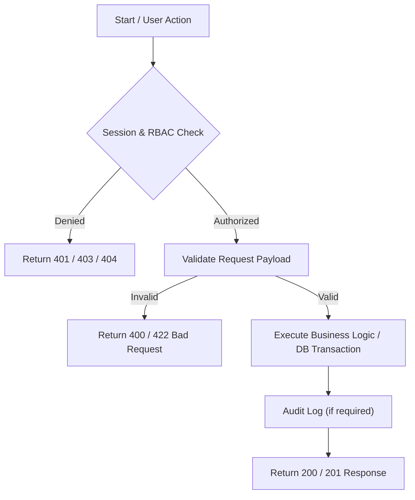
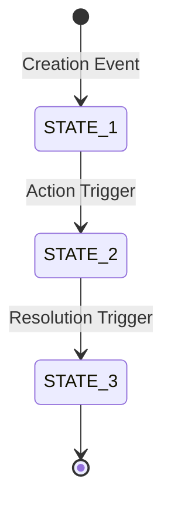

# Feature Specification Template

> **Usage Guide:** Every detailed feature specification under `docs/features/` (`authentication/`, `student/`, `faculty/`, `shared/`, `ai/`) must follow this standardized template. Do not omit sections; mark sections as *N/A (Not Applicable)* with a short justification if a specific concern does not apply.
>
> **Authority & Classification Rule:**
> - Clearly distinguish **Approved requirements** (grounded in `COLLEGE_OS_SOT.md` or `FEATURE_INVENTORY.md`), **Resolved design decisions** (e.g. SOT §11.5, §12, §14, §15.3, §16, §17), **Proposed implementation details** (concrete schema types, API paths, indexes), **Open decisions** (blocking or deferred questions), and **Existing UI implementation gaps** (discrepancies between current frontend code and approved requirements).
> - Do not present assumptions or unapproved frontend UI artifacts as approved product requirements.
> - Reference `shared/backend-conventions.md` for shared API formats, error responses, authentication verification, and validation standards rather than repeating them verbatim.

---

# [FEATURE-ID] — [Feature Title]

- **Feature ID:** `[DOMAIN]-[NUM]` (e.g., `STU-04`, `SHARED-01`, `FAC-08`)
- **Feature Title:** [Feature Name as documented in `FEATURE_INVENTORY.md`]
- **Domain:** [Authentication | Student | Faculty | Shared | AI]
- **Milestone:** [Core MVP | Phase 2]
- **Status:** [Draft for Review | Approved | Blocked]
- **Owning Module:** [One of the 12 Core MVP Modules, 1 Institutional Entity, or 4 Phase 2 Modules]
- **Primary SOT References:** `COLLEGE_OS_SOT.md` §[X], `FEATURE_INVENTORY.md` §[Y], Project Plan §[Z]

---

## 1. Executive Summary & Purpose

### 1.1 Purpose
[A concise 2–3 sentence explanation of why this feature exists and what value it delivers to the campus community.]

### 1.2 In-Scope
[Bulleted list of capabilities explicitly approved and required for this milestone.]
- [Requirement 1]
- [Requirement 2]

### 1.3 Out-of-Scope (Non-Goals)
[Explicitly list capabilities that are NOT part of this feature or milestone. Reference SOT §21 Non-Goals where relevant.]
- [Out-of-scope item 1]
- [Out-of-scope item 2]

---

## 2. Actors, Permissions & Ownership

### 2.1 Actors & Roles
| Role | Access Level | Description / Responsibilities |
| :--- | :--- | :--- |
| `student` | [None \| Read-Only \| Read-Write \| Own-Only] | [Role responsibility within this feature] |
| `faculty` | [None \| Read-Only \| Read-Write \| Assigned-Only] | [Role responsibility within this feature] |
| `hod` | [None \| Read-Only \| Read-Write \| Dept-Only] | [Role responsibility within this feature] |
| `principal` / `vp` | [None \| Read-Only \| Read-Write \| Campus-Wide] | [Role responsibility within this feature] |
| `admin` | [None \| Read-Only \| Full \| System-Only] | [Role responsibility within this feature] |

### 2.2 Ownership & Scoping Boundaries
- **Ownership Rule:** [Who owns the record (e.g., creator student, assigned faculty, institution)]
- **Access Boundary:** [How access is restricted server-side (e.g., class-section match via `teachingAssignments`, student's active enrollment, department match)]
- **Field-Level Immutability:** [Which fields are system/institution-controlled vs user-controlled]

---

## 3. Related UI Routes & Current Behavior

### 3.1 Primary Frontend Routes
| Route | Access Guard | Current Status in Repo | Key Component Files |
| :--- | :--- | :--- | :--- |
| `/[route-path]` | [`student` \| `faculty` \| Public] | [Implemented (Mock) \| Partial \| Not Implemented] | `frontend/app/...` |

### 3.2 Current UI Behavior & Gaps
- **Current Behavior:** [Describe what the existing frontend code actually renders, loads, and submits today.]
- **Existing Implementation Gaps:**
  - [Gap 1: e.g., Uses mock localStorage data instead of backend API]
  - [Gap 2: e.g., Permits client-side modification of read-only academic fields]
  - [Gap 3: e.g., Lacks server-side error handling for network failures]

---

## 4. User Workflows & Flowchart

### 4.1 Primary User Flows
1. **[Flow Name 1]:** [Step-by-step description of the user journey]
2. **[Flow Name 2]:** [Step-by-step description of an alternate or exception flow]

### 4.2 Workflow Flowchart


---

## 5. Business Rules, Validations & State Transitions

### 5.1 Business Rules
- **Rule 1:** [Core business invariant]
- **Rule 2:** [Threshold, limit, or formula]

### 5.2 Server-Side Validations
| Field / Parameter | Rules & Constraints | Error Code | HTTP Status |
| :--- | :--- | :--- | :--- |
| `[field]` | [Required, type, range, regex, enum] | `[ERR_CODE]` | [400 \| 422] |

### 5.3 State Lifecycle & Transitions (where applicable)


### 5.4 Edge Cases & Failure Handling
- **Concurrent Updates:** [How race conditions or conflicting writes are prevented]
- **Network / Storage Outage:** [Graceful degradation and client-facing error feedback]
- **Partial Failure:** [Rollback / transactional boundaries]

---

## 6. Proposed Data Models & Constraints

> [!NOTE]
> Database schemas follow Mongoose ODM on MongoDB Atlas (SOT §16). All collections must maintain multi-tenant / institutional consistency (`institutionId`) where applicable.

### 6.1 Collection Name: `[collectionName]`
```typescript
interface I[EntityName] {
  _id: ObjectId;
  institutionId: ObjectId;          // References collegeProfile._id
  // Institution-controlled fields
  [field]: [type];                   // Constraint details
  // User-controlled fields
  [field]: [type];
  createdAt: Date;
  updatedAt: Date;
}
```

### 6.2 Indexes & Constraints
| Index Fields | Type | Purpose / Enforcement |
| :--- | :--- | :--- |
| `{ [field]: 1 }` | Unique / Compound / Text | [Prevent duplicates, accelerate lookup] |

### 6.3 Entity Relationships
- References to other collections (e.g. `users._id`, `studentProfiles._id`, `facultyProfiles._id`, `classes.classId`).

---

## 7. API Contracts

> All endpoints adhere to `shared/backend-conventions.md`. Requests and responses use the standard JSON envelope.

### 7.1 `[HTTP_METHOD]` `/api/v1/[resource-path]`
- **Description:** [What the endpoint does]
- **Authentication:** [Public \| Bearer Session Cookie (HttpOnly)]
- **Authorization:** [Roles allowed, scope check required]
- **Request Headers:**
  ```http
  Cookie: college_os_session=<jwt>
  Content-Type: application/json
  ```
- **Request Body:**
  ```json
  {
    "exampleField": "value"
  }
  ```
- **Success Response (200 OK / 201 Created):**
  ```json
  {
    "success": true,
    "data": {
      "exampleField": "value"
    }
  }
  ```
- **Error Responses:**
  - `400 BAD_REQUEST`: `{ "success": false, "error": { "code": "VALIDATION_FAILED", "message": "..." } }`
  - `401 UNAUTHORIZED`: `{ "success": false, "error": { "code": "UNAUTHENTICATED", "message": "..." } }`
  - `403 FORBIDDEN`: `{ "success": false, "error": { "code": "FORBIDDEN", "message": "..." } }`
  - `404 NOT_FOUND`: `{ "success": false, "error": { "code": "RESOURCE_NOT_FOUND", "message": "..." } }`
- **Side Effects & Audit:** [DB updates, audit log records created, notifications dispatched]

---

## 8. Cross-Cutting Concerns

- **Auditing (SOT §6.8, §16, Inventory §6):** [Does this feature require audit trail recording? What fields/actions are captured?]
- **File Handling (SHARED-08 / SOT §11.5):** [Does this feature upload or serve files? Private storage key and MIME validation requirements.]
- **Notifications (SHARED-03 / Inventory §6):** [Does this feature trigger in-app notifications to users?]
- **Campus AI & Grounding Boundary (SOT §15):** [What data from this feature can Campus AI access? Which private fields are permanently excluded?]

---

## 9. Architectural Do's and Don'ts

| Do | Don't |
| :--- | :--- |
| **Do** enforce every role and scope check on the backend server. | **Don't** trust client-supplied roles, IDs, or session flags. |
| **Do** validate input types, lengths, and enums before processing. | **Don't** perform unvalidated partial document updates. |
| **Do** separate institution-controlled fields from user profile fields. | **Don't** let users mutate official academic credentials. |
| **Do** exclude passwords, hashes, and OTPs from all responses and logs. | **Don't** leak sensitive credentials in logs or API payloads. |

---

## 10. Acceptance Criteria & Test Scenarios

### 10.1 Acceptance Criteria
- [ ] AC-1: [Specific, measurable functional requirement]
- [ ] AC-2: [Specific boundary/validation requirement]
- [ ] AC-3: [Specific security/authorization requirement]

### 10.2 Positive Test Scenarios
1. **Happy Path:** [Given, When, Then description]
2. **Authorized Workflow:** [Given, When, Then description]

### 10.3 Negative & Authorization Test Scenarios
1. **Unauthenticated Access:** Request without session cookie returns `401 Unauthorized`.
2. **Cross-Role Tampering:** Student attempting faculty endpoint returns `403 Forbidden`.
3. **Out-of-Scope Access:** Faculty accessing unassigned class returns `403 Forbidden` or `404 Not Found`.
4. **Invalid Payload:** Request violating validation rules returns `400 Bad Request` or `422 Unprocessable Entity`.

---

## 11. Dependencies & Cross-Feature Interactions

- **Upstream Dependencies:** [Features required before this can function, e.g. `AUTH-01`, `AUTH-07`, `SHARED-01`, `SHARED-02`]
- **Downstream Dependents:** [Features that rely on this feature, e.g. `STU-01`, `FAC-01`, `AI-01`]

---

## 12. Decision Log & Gaps

### 12.1 Resolved Design Decisions
- **Decision 1:** [Resolved decision with pointer to SOT section, e.g. SOT §16.0]
- **Decision 2:** [Resolved decision with pointer to SOT section]

### 12.2 Genuinely Open Decisions
- **Open Item 1:** [Unresolved item, who owns the decision, and impact]

### 12.3 Existing UI Gaps to Address
- **UI Gap 1:** [Frontend route or component discrepancy that needs alignment with this spec]

---

## 13. Traceability Matrix

| SOT Section | Project Plan Section | Feature Inventory ID | Verification Method |
| :--- | :--- | :--- | :--- |
| SOT §[X] | Plan §[Y] | `[FEATURE-ID]` | [Automated Unit/Integration Test / Manual Audit] |

