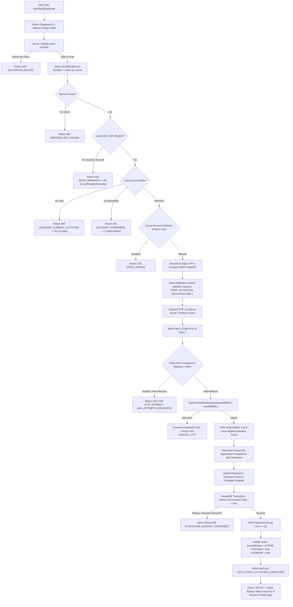

# AUTH-04 — Faculty & Staff Account Activation (OTP)

- **Feature ID:** `AUTH-04`
- **Feature Title:** Faculty & Staff Account Activation (OTP)
- **Domain:** Authentication & Identity
- **Milestone:** Core MVP
- **Status:** Approved Specification (Ready for Implementation)
- **Owning Module:** Module 1: Authentication, Institutional Identity & RBAC
- **Primary SOT References:** `COLLEGE_OS_SOT.md` §6.0, §6.1, §6.3, §6.4, §6.5, §6.6, §6.7, §6.8, §7, §8, §16.0, §16.1, §16.3, §17, §18, §22.2, §22.3, §22.4, §22.8; `FEATURE_INVENTORY.md` (`AUTH-04`, `AUTH-05`, `SHARED-01`, `SHARED-02`); Project Plan §4, §6, §16, §17

---

## 1. Executive Summary & Purpose

### 1.1 Purpose
Faculty & Staff Account Activation is the authoritative multi-factor onboarding gateway for all non-student institutional personnel in College OS. In strict accordance with the foundational SOT principle—**"Users do not choose their institutional role. The institution provisions and authorizes the user's role"** (SOT §6.0, §22.8)—no staff member can self-register an account, invent an institutional identity, or choose their operational role.

Before any staff member can access the platform, their institutional record must pre-exist within the database through institutional provisioning (`AUTH-01`). An eligible staff member proves identity ownership by executing a secure multi-factor verification handshake:
$$\text{Employee ID / Faculty ID} + \text{Official Institutional Email / Verified Contact} + \text{Time-Bound OTP}$$

Upon successful cryptographic OTP verification, the staff member confirms their verified, read-only institutional appointment details (`fullName`, `facultyId`, `department`, `designation`, `assignedRole`), and configures their private password. The account then transitions atomically from `INVITED` to `ACTIVE`.

### 1.2 In-Scope (Approved Core MVP Scope)
This single feature specification governs first-time activation for **all non-student roles** recognized by the College OS architecture:
- **Teaching Faculty (`faculty`):** Assistant Professors, Associate Professors, and Professors.
- **Head of Department (`hod`):** Academic departmental executives provisioned with departmental authority (SOT §6.4).
- **Executive Administration (`principal`, `vp`):** Principal, Vice Principal, and Deans provisioned with campus-wide administrative authority (SOT §6.5).
- **System Administration (`admin`):** IT administrators provisioned with tenant configuration and account lifecycle controls (SOT §7, §18).

Core functional scope comprises:
- **Multi-Factor Institutional Identity Matching:** Validating that the submitted Employee ID (`facultyProfiles.facultyId`) and official college email (or approved verified contact) strictly match an existing pre-provisioned record in `users` and `facultyProfiles`.
- **Role Derivation from Database Authority:** Resolving the user's role strictly from the authoritative database record. No client-supplied role selections are accepted.
- **Cryptographic OTP Handshake:** Generating, dispatching, and verifying a time-bound, single-use One-Time Password via the staff member's official contact channel.
- **Read-Only Institutional Confirmation:** Displaying pre-provisioned appointment data (Name, Department, Designation, Employee ID, Authoritative Role) without permitting client modification of institutional fields.
- **Staff Password Creation:** Setting a private, user-owned password meeting institutional complexity requirements, hashed server-side using `bcrypt` (salt rounds $\ge 12$, exceeding SOT §6.7 requirement of $\ge 10$).
- **Atomic Activation & Lifecycle Transition:** Atomically consuming the activation challenge, updating `users.accountStatus` to `ACTIVE`, setting `isActivated = true`, and timestamping `activatedAt = new Date()`.
- **Audit Logging:** Writing an immutable record of the activation event to `auditLogs`.
- **Handoff to Staff Login (`AUTH-05`):** Directing the newly activated staff member to the unified Staff Login portal to authenticate and establish a protected session.

### 1.3 Out-of-Scope (Explicit Non-Goals)
- **No Open Public Self-Registration (SOT §6.0, §21.1, §22.2):** Arbitrary visitors cannot create staff accounts or request credentials. Unprovisioned identities are rejected.
- **No Role Self-Selection or Elevation (SOT §6.5, §22.8):** A user cannot select "HOD", "Principal", or "Admin" on the frontend. A faculty member cannot activate an executive record, nor can an activation attempt elevate a role.
- **No Student Account Activation:** Student onboarding is governed exclusively by `AUTH-02` at `/auth/student/activate`. Student enrollment numbers submitted to this staff flow are strictly rejected.
- **No Separate Profile Collections (SOT §16.0, `SHARED-01`):** All staff roles share the unified `facultyProfiles` collection. There are no `hodProfiles`, `principalProfiles`, `vpProfiles`, or `adminProfiles` collections.
- **No Direct Session Issuance on Activation Completion:** Activation marks the account `ACTIVE` and directs the user to the unified Staff Login flow (`AUTH-05`). It does not silently issue a full session cookie unless explicitly authenticated via login.
- **No Permanent Passwords Maintained by College (SOT §6.7):** Administrators have zero access to plaintext passwords; passwords are owned and set exclusively by the staff member.

---

## 2. Actors, Permissions & Ownership

### 2.1 Actors & Roles
| Actor | Role / State | Permitted Action | Access Restrictions & Behavior |
| :--- | :--- | :--- | :--- |
| **Unactivated Faculty** | `faculty` (`INVITED`) | Staff Activation | Submits Employee ID + Email, verifies OTP, confirms details, sets password &rarr; transitions to `ACTIVE`. |
| **Unactivated HOD** | `hod` (`INVITED`) | Staff Activation | Same flow; role anchored to pre-provisioned departmental appointment. Cannot modify department. |
| **Unactivated Principal / VP** | `principal` / `vp` (`INVITED`) | Executive Staff Activation | Same flow; role anchored to pre-provisioned executive appointment. High-security audit logged. |
| **Unactivated Admin** | `admin` (`INVITED`) | Admin Staff Activation | Same flow; role anchored to pre-provisioned IT admin appointment. Mandatory security audit logged. |
| **Already Activated Staff** | Any staff (`ACTIVE`) | Blocked | Ineligible for activation. Server rejects attempt with error directing user to Staff Login (`AUTH-05`). |
| **Suspended Staff** | Any staff (`SUSPENDED`) | Blocked | Under administrative hold. Activation requests are immediately rejected (`403 FORBIDDEN`). |
| **Relieved / Offboarded Staff** | Any staff (`RELIEVED`) | Blocked | Inactive institutional record; cannot initiate or complete activation. |
| **Student** | `student` (`INVITED`/`ACTIVE`) | Blocked on Staff Route | Enrollment numbers and student records are rejected with guidance to use `/auth/student/activate`. |
| **Unprovisioned Visitor** | Unknown / Public | Blocked | Rejected with generic error indicating no matching institutional record exists. |

### 2.2 Security Ownership & Immutability Rules
- **Role Anchoring (SOT §6.0, §7, §22.8):** The user's role is stored in `users.role` during institutional provisioning (`AUTH-01`). The activation endpoint ignores any role parameters submitted in request payloads and derives the role exclusively from the database record matching the Employee ID and verified contact.
- **Multi-Factor Rule (SOT §6.3, §22.4):** Employee ID alone is **strictly insufficient** to activate an account or claim a staff identity. Employee IDs may appear on campus directories, class schedules, or departmental notice boards; mandatory OTP delivery to the verified institutional email/contact prevents impersonation and account hijacking.
- **Immutability of Institutional Fields (SOT §8, §16.3, `SHARED-01`):** During activation step 2/3, the staff member is shown a read-only confirmation card of their appointment (`fullName`, `facultyId`, `department`, `designation`, `officialEmail`). These fields are strictly immutable; any payload attempting to modify them is rejected with `400 BAD_REQUEST` (`IMMUTABLE_FIELD_MODIFICATION`).
- **Profile Integrity Rule:** Every non-student account in `users` must map 1:1 to a linked record in `facultyProfiles` via `userId`. If a user record exists without a linked `facultyProfiles` document, activation aborts with `500 INTERNAL_SERVER_ERROR` and raises an urgent administrative alert.

---

## 3. Related UI Routes & Current Behavior

### 3.1 Primary Frontend Routes
| Route | Access Guard | Current Repo Implementation | Key Component File |
| :--- | :--- | :--- | :--- |
| `/auth/faculty/activate` | Public (Unauthenticated) | Implemented (Multi-step wizard UI) | `frontend/app/auth/faculty/activate/page.jsx`<br>`frontend/components/auth/FacultyActivationPage.jsx` |
| `/auth/faculty` | Public (Redirects to dashboard if authenticated) | Implemented (Faculty Login route) | `frontend/app/auth/faculty/page.jsx`<br>`frontend/components/auth/StaffLoginPage.jsx` |
| `/auth/staff/login` | Public (Unified Staff Login) | Implemented | `frontend/app/auth/staff/login/page.jsx`<br>`frontend/components/auth/StaffLoginPage.jsx` |

### 3.2 Current UI Behavior & Implementation Gaps
Inspection of `frontend/components/auth/FacultyActivationPage.jsx` reveals the following structure and gaps:
1. **Multi-Step Wizard Design:** The component cleanly defines a 3-step sequence (`FACULTY_STEPS`):
   - Step 1: *Verify Identity* (Employee ID + Official Institutional Email).
   - Step 2: *Verify OTP* (6-digit discrete input grid with 45-second resend countdown).
   - Step 3: *Create Password* (Password input with 4 visual criteria checks: $\ge 8$ chars, uppercase/lowercase, number, special char).
   - Step 4: *Success View* (Displays activation confirmation snapshot and "Proceed to Faculty Login" button routing to `/auth/faculty`).
2. **Existing Implementation Gaps to Address:**
   - **Hardcoded In-Memory Faculty Records:** `FacultyActivationPage.jsx` (lines 30–59) validates inputs against a hardcoded array of 4 demo faculty members (`PRE_PROVISIONED_FACULTY`: `EMP-1042`, `EMP-2088`, `EMP-3045`, `EMP-4012`) with a hardcoded OTP (`842196`).
   - **Client-Side SessionStorage State:** Progress is persisted in `sessionStorage.getItem("college_os_faculty_activation_flow")` without cryptographic challenge binding or backend API calls.
   - **Scope Narrowing in Labels:** The UI is currently titled *"Faculty Account Activation"*. While teaching faculty form the largest user cohort, SOT §6.4–§6.6 and Feature Inventory `AUTH-04` mandate that this route activates all non-student roles (`faculty`, `hod`, `principal`, `vp`, `admin`). Subtitles and helper notes must reflect *"Faculty & Staff Account Activation"*.
   - **Missing Backend Integration:** Must be wired to the authoritative backend REST endpoints (`/api/v1/auth/faculty/activate/*`) specified in Section 7.

---

## 4. End-to-End Activation Workflow & Flowcharts

### 4.1 Step-by-Step Activation Lifecycle
1. **Access Screen:** The staff member navigates to `/auth/faculty/activate`.
2. **Submit Identity:** Staff member enters their official Employee ID (e.g. `EMP-1042`) and official college email or approved verified institutional contact.
3. **Institutional Matching & Eligibility Verification:**
   - Backend sanitizes input (trims strings, converts Employee ID to uppercase, normalizes email to lowercase).
   - Queries `facultyProfiles.findOne({ facultyId })` and loads linked `users` record via `userId`.
   - Validates that `users.role` is a recognized staff role (`faculty`, `hod`, `principal`, `vp`, `admin`). If a student ID is submitted, the request is rejected with a redirect hint to `/auth/student/activate`.
   - Validates lifecycle state: `users.accountStatus === "INVITED"` and `users.isActivated === false`. If already `ACTIVE`, return `409 CONFLICT` (`ACCOUNT_ALREADY_ACTIVATED`). If `SUSPENDED`, return `403 FORBIDDEN` (`ACCOUNT_SUSPENDED`).
4. **Authoritative Role & Scope Derivation:** Backend retrieves the authoritative role, department, and designation directly from the pre-provisioned database records.
5. **OTP Generation & Dispatch:**
   - Server generates a cryptographically random 6-digit numeric OTP.
   - Computes keyed HMAC: `HMAC-SHA256(rawOtp, SERVER_SECRET)`.
   - Creates an activation challenge record in MongoDB with `purpose: "STAFF_ACCOUNT_ACTIVATION"`, `expiresAt = Date.now() + 10 minutes`, `attemptsCount: 0`, and `isConsumed: false`.
   - Dispatches the raw OTP via the staff member's official college email (or SMS/verified contact). Plaintext OTP is discarded immediately from memory and never persisted or logged.
6. **OTP Submission:** Staff member enters the 6-digit OTP on the verification screen.
7. **OTP Cryptographic Verification:**
   - Backend verifies rate limits and expiration (`expiresAt > Date.now()`).
   - Increments `attemptsCount`. If attempts exceed threshold (proposed default: 5), challenge is invalidated.
   - Recomputes HMAC and executes constant-time comparison `crypto.timingSafeEqual`.
   - Upon match, marks challenge `isOtpVerified = true` and issues a short-lived, signed **Activation Ticket** (JWT or server-cached token) embedding `challengeId`, `userId`, and `purpose: "STAFF_ACTIVATION_COMPLETE"` with 15-minute validity.
8. **Institutional Confirmation:** Staff member reviews their verified appointment snapshot (Full Name, Employee ID, Department, Designation, Institutional Role). All fields are presented in read-only mode.
9. **Password Configuration:** Staff member enters their new institutional password complying with password security criteria.
10. **Atomic Activation Completion:**
    - Staff member submits password along with the Activation Ticket to the completion endpoint.
    - Inside an atomic MongoDB transaction:
      - Validates Activation Ticket signature, purpose, and unexpired state.
      - Finds challenge document with `{ _id: challengeId, isOtpVerified: true, isConsumed: false }`.
      - Atomically sets `isConsumed: true`. If already consumed (race condition or replay attempt), transaction aborts with `409 CONFLICT` (`CHALLENGE_ALREADY_CONSUMED`).
      - Hashes password using `bcrypt` (salt rounds $\ge 12$).
      - Updates `users` record: `passwordHash = hash`, `accountStatus = "ACTIVE"`, `isActivated = true`, `activatedAt = new Date()`.
      - Logs immutable audit record `AUTH_STAFF_ACTIVATION_COMPLETED` with actor ID, role, department, and timestamp.
11. **Navigation to Staff Login:** Server returns `200 OK`. The client UI displays the success screen and prompts the staff member to proceed to Staff Login (`AUTH-05` at `/auth/faculty` or `/auth/staff/login`) to establish their first authenticated session.

### 4.2 Comprehensive Staff Activation Flowchart



---

## 5. Security Architecture & OTP Protection

### 5.1 Keyed HMAC Protection for Low-Entropy OTP
A standard 6-digit numeric OTP has an entropy space of only $10^6$ ($1,000,000$) possible combinations. Storing a simple unsalted or salted SHA-256 hash in the database exposes users to trivial offline dictionary precomputation if the database is compromised.

Consistent with the approved security architecture established in `AUTH-02`:
- **Proposed Cryptographic Storage:** The server computes a keyed Hash-based Message Authentication Code:
  $$\text{otpHash} = \text{HMAC-SHA256}(\text{rawOtp}, K_{\text{otp}})$$
  where $K_{\text{otp}}$ is a cryptographically strong server secret managed securely in environment configuration or a Key Management Service (KMS), strictly segregated from database access.
- **Verification:** Verification uses constant-time comparison `crypto.timingSafeEqual` between the stored HMAC and the HMAC recomputed from user input.
- **Plaintext Discard:** The raw OTP is dispatched to the delivery transport service and immediately dereferenced from memory. It is never logged, printed to console, or stored in any database column.

### 5.2 Challenge Binding & Single-Use Enforcement
- **Purpose Binding:** The challenge record explicitly sets `purpose: "STAFF_ACCOUNT_ACTIVATION"`. An OTP generated for password reset (`AUTH-06`) cannot be accepted by the activation endpoint.
- **Account Binding:** The challenge embeds the specific `userId` and `institutionId`.
- **Atomic Single-Use Consumption:** The final completion step executes an atomic query condition:
  ```javascript
  const challenge = await ActivationChallenge.findOneAndUpdate(
    { _id: challengeId, userId: user._id, isOtpVerified: true, isConsumed: false },
    { $set: { isConsumed: true, consumedAt: new Date() } },
    { session }
  );
  if (!challenge) {
    throw new ApiError(409, "CHALLENGE_ALREADY_CONSUMED", "Activation challenge has already been used or expired.");
  }
  ```
  This atomic conditional update prevents replay attacks, token cloning, and concurrent submission race conditions.

### 5.3 Throttling & Proposed Numeric Defaults
The following controls protect the activation endpoint against brute-force and SMS/email flooding attacks:
- **Locked SOT Requirements:** OTP must be time-bound, single-use, purpose-bound, and protected by attempt limits and resend throttling.
- **Proposed Numeric Defaults (Requiring Institutional Confirmation):**
  - **OTP Length:** 6 numeric digits (`[0-9]{6}`).
  - **OTP Expiration Window:** 10 minutes (`600` seconds).
  - **Resend Cooldown:** 60 seconds mandatory wait between OTP requests (current UI has 45 seconds; 60 seconds recommended).
  - **Maximum Failed Verification Attempts:** 5 attempts before the challenge is permanently invalidated.
  - **Activation Ticket Validity:** 15 minutes (`900` seconds) from OTP verification to password submission.
  - **Password Bcrypt Cost Factor:** 12 rounds (surpassing SOT §6.7 requirement of $\ge 10$).

---

## 6. Role-Specific Onboarding & Scope Boundaries

### 6.1 Role Handling During Activation
All staff roles follow the same unified activation flow, but their authoritative roles and operational boundaries originate from institutional provisioning:

| Role | Provisioning Authority (SOT) | Scope Boundary upon Activation | Onboarding Governance |
| :--- | :--- | :--- | :--- |
| **Faculty (`faculty`)** | Administration Course Allocation (SOT §6.1, §6.3) | Assigned classes, sections, and subjects (`teachingAssignments`) | Standard staff activation using provisioned Employee ID and email. |
| **Head of Department (`hod`)** | Executive Department Appointment (SOT §6.4) | Department-wide scope (`departmentCode`) | Provisioned with departmental executive authority. Cannot alter assigned department. |
| **Principal / VP (`principal`, `vp`)** | University Governance (SOT §6.5) | Campus-wide institutional scope | Institutional executive provisioning. High-security audit log recorded on activation. |
| **System Admin (`admin`)** | IT Administration Authority (SOT §7, §18) | System configuration & tenant lifecycle | IT admin provisioning. Mandatory dual-admin notification or security logging on activation. |

### 6.2 Administrative Onboarding Safeguards (SOT §6.4, §6.5)
- **Zero Frontend Elevation:** Under no circumstances can a user alter their role during activation. If a faculty member enters their own Employee ID, their account is activated strictly as `role: "faculty"`. If an HOD enters their Employee ID, they are activated as `role: "hod"`.
- **Cross-Role Activation Isolation:** An Employee ID provisioned for one individual cannot be activated with another individual's email. Both Employee ID and official institutional email must match the same database record.
- **No Competing Dashboards in Feature:** Activation does not define or alter dashboard routing. After activation, routing is handled exclusively by the unified Staff Login flow (`AUTH-05`) inspecting `users.role`.

---

## 7. Profile & Identity Model Alignment (`SHARED-01`)

### 7.1 Single Staff Profile Collection (`facultyProfiles`)
In strict adherence to SOT §16.0 and `SHARED-01`, College OS maintains **one unified profile collection** for all non-student roles:
- `users` represents the core authentication account.
- `facultyProfiles` represents the institutional appointment for `faculty`, `hod`, `principal`, `vp`, and `admin`.
- No `hodProfiles`, `principalProfiles`, or `adminProfiles` collections are permitted.

```typescript
// Existing MongoDB Atlas Collection: facultyProfiles (SOT §16.3)
interface IFacultyProfile {
  _id: Types.ObjectId;
  userId: Types.ObjectId;              // Unique 1:1 reference -> users._id
  // --- INSTITUTION-CONTROLLED FIELDS (Immutable during activation) ---
  facultyId: string;                   // Official Employee ID (e.g. "EMP-1042", unique index)
  fullName: string;                    // Official Full Name (e.g. "Dr. Arjun Mehta")
  officialEmail: string;               // Institutional Email (e.g. "arjun.mehta@college.edu")
  phone?: string;                      // Verified Institutional Contact
  department: string;                  // e.g. "Computer Science & Engineering"
  designation: string;                 // "Associate Professor", "Professor", "Head of Department", "Principal", "Admin"
  assignedClassIds?: string[];         // Optional: Teaching assignments (empty for non-teaching staff)
  assignedSubjectIds?: string[];       // Optional: Teaching assignments (empty for non-teaching staff)
  academicStatus: 'ACTIVE' | 'ON_LEAVE' | 'RELIEVED';
  // --- STAFF-CONTROLLED PROFILE FIELDS (Mutable post-activation) ---
  cabinLocation?: string;              // Office location
  bio?: string;                        // Research interests & biography
  avatarUrl?: string;                  // Profile picture URL
  createdAt: Date;
  updatedAt: Date;
}
```

### 7.2 Handling Inconsistent or Mismatched Records
- **Unmatched Record:** If the Employee ID and email do not match any pre-provisioned pair in `facultyProfiles`, the API returns `404 NOT_FOUND` (`INSTITUTIONAL_RECORD_NOT_FOUND`).
- **Orphaned User Record:** If a `users` record exists with a staff role but no corresponding `facultyProfiles` record exists, the server aborts with `500 INTERNAL_SERVER_ERROR` (`PROFILE_LINKAGE_CORRUPTED`) and writes an error log to trigger IT intervention.
- **Duplicate Employee ID Collision:** If a pre-provisioned Employee ID appears more than once due to administrative import error, unique index enforcement in MongoDB rejects the query with `500 INTERNAL_SERVER_ERROR` (`DUPLICATE_INSTITUTIONAL_IDENTITY`).

---

## 8. Proposed API Contracts (Documentation Proposals)

> [!NOTE]
> The following API specifications are **proposed architectural REST contracts** designed for backend implementation. They do not represent existing active endpoints in the repository.

### 8.1 `POST /api/v1/auth/faculty/activate/initiate` (Proposed)
Initiates staff activation by validating pre-provisioned identity and dispatching an OTP.

- **Authentication:** Public (Unauthenticated)
- **Request Headers:**
  ```http
  Content-Type: application/json
  ```
- **Request Body:**
  ```json
  {
    "employeeId": "EMP-1042",
    "officialEmail": "arjun.mehta@college.edu"
  }
  ```
- **Validation:**
  - `employeeId`: Required, string, trimmed, uppercase, 3–30 characters.
  - `officialEmail`: Required, valid email format, lowercase.
- **Success Response (`200 OK`):**
  ```json
  {
    "success": true,
    "data": {
      "maskedContact": "a***a@college.edu",
      "cooldownSeconds": 60,
      "expiresInSeconds": 600,
      "message": "Verification code dispatched to your official institutional contact."
    }
  }
  ```
- **Common Error Responses:**
  - `400 BAD_REQUEST`: `{ "code": "VALIDATION_FAILED", "message": "Valid Employee ID and official email are required." }`
  - `400 BAD_REQUEST`: `{ "code": "ROLE_MISMATCH", "message": "Student records cannot be activated via the staff portal. Please visit /auth/student/activate." }`
  - `403 FORBIDDEN`: `{ "code": "ACCOUNT_SUSPENDED", "message": "This account is placed on administrative hold. Please contact institutional governance." }`
  - `404 NOT_FOUND`: `{ "code": "INSTITUTIONAL_RECORD_NOT_FOUND", "message": "No pre-provisioned staff appointment matches this Employee ID and official email." }`
  - `409 CONFLICT`: `{ "code": "ACCOUNT_ALREADY_ACTIVATED", "message": "This account has already been activated. Please proceed to Staff Login.", "redirectTo": "/auth/faculty" }`
  - `429 TOO_MANY_REQUESTS`: `{ "code": "RATE_LIMITED", "message": "Too many requests. Please wait before requesting another verification code." }`

---

### 8.2 `POST /api/v1/auth/faculty/activate/verify-otp` (Proposed)
Verifies the submitted OTP and issues a short-lived, signed Activation Ticket for password configuration.

- **Authentication:** Public (Unauthenticated)
- **Request Body:**
  ```json
  {
    "employeeId": "EMP-1042",
    "otp": "842196"
  }
  ```
- **Validation:**
  - `employeeId`: Required string.
  - `otp`: Required string matching `/^\d{6}$/`.
- **Success Response (`200 OK`):**
  ```json
  {
    "success": true,
    "data": {
      "activationTicket": "eyJhbGciOiJIUzI1NiIsIn...",
      "appointment": {
        "fullName": "Dr. Arjun Mehta",
        "employeeId": "EMP-1042",
        "department": "Computer Science & Engineering",
        "designation": "Associate Professor",
        "role": "faculty",
        "officialEmail": "arjun.mehta@college.edu"
      }
    }
  }
  ```
- **Common Error Responses:**
  - `400 BAD_REQUEST`: `{ "code": "INVALID_OTP_FORMAT", "message": "OTP must be a 6-digit number." }`
  - `401 UNAUTHORIZED`: `{ "code": "INVALID_OTP", "message": "Invalid verification code. Attempts remaining: 3." }`
  - `410 GONE`: `{ "code": "OTP_EXPIRED", "message": "Verification code has expired. Please request a new code." }`
  - `429 TOO_MANY_REQUESTS`: `{ "code": "MAX_ATTEMPTS_EXCEEDED", "message": "Maximum verification attempts exceeded. Challenge invalidated." }`

---

### 8.3 `POST /api/v1/auth/faculty/activate/complete` (Proposed)
Atomically sets the user's password, invalidates the activation challenge, and transitions the account state to `ACTIVE`.

- **Authentication:** Bearer token (Activation Ticket)
- **Request Headers:**
  ```http
  Authorization: Bearer <activationTicket>
  Content-Type: application/json
  ```
- **Request Body:**
  ```json
  {
    "password": "SecurePassword@2026",
    "confirmPassword": "SecurePassword@2026"
  }
  ```
- **Validation:**
  - `password`: Required, min 8 characters, at least 1 uppercase, 1 lowercase, 1 digit, 1 special character.
  - `confirmPassword`: Must match `password` identically.
- **Success Response (`200 OK`):**
  ```json
  {
    "success": true,
    "data": {
      "activated": true,
      "employeeId": "EMP-1042",
      "fullName": "Dr. Arjun Mehta",
      "role": "faculty",
      "redirectTo": "/auth/faculty",
      "message": "Staff account successfully activated. Please proceed to Staff Login."
    }
  }
  ```
- **Common Error Responses:**
  - `400 BAD_REQUEST`: `{ "code": "WEAK_PASSWORD", "message": "Password does not meet institutional complexity criteria." }`
  - `400 BAD_REQUEST`: `{ "code": "PASSWORDS_DO_NOT_MATCH", "message": "Passwords do not match." }`
  - `401 UNAUTHORIZED`: `{ "code": "INVALID_ACTIVATION_TICKET", "message": "Activation ticket is invalid or expired." }`
  - `409 CONFLICT`: `{ "code": "CHALLENGE_ALREADY_CONSUMED", "message": "Activation challenge has already been consumed." }`

---

## 9. Cross-Cutting Concerns

### 9.1 Auditing & Compliance (SOT §6.8, §16, §18)
All activation events write immutable audit records to MongoDB `auditLogs`:
```typescript
{
  actorUserId: user._id,
  actorRole: user.role,                  // "faculty" | "hod" | "principal" | "vp" | "admin"
  action: "AUTH_STAFF_ACTIVATION_COMPLETED",
  targetResourceId: user._id,
  targetModel: "users",
  details: {
    facultyId: profile.facultyId,
    department: profile.department,
    designation: profile.designation,
    officialEmail: user.email,
    ipAddress: req.ip,
    userAgent: req.headers["user-agent"]
  },
  timestamp: new Date()
}
```
For privileged executive roles (`principal`, `vp`, `admin`), activation additionally triggers a high-severity operational log event for administrative compliance review.

### 9.2 Rate Limiting & Denial-of-Service Defense
- **IP-Level Throttling:** Maximum 10 activation initiation requests per IP per hour.
- **Account-Level Throttling:** Maximum 3 OTP generation requests per Employee ID per 15 minutes.
- **Resend Cooldown:** 60-second enforced cooldown between OTP generation calls.

---

## 10. Architectural Do's and Don'ts

| Do | Don't |
| :--- | :--- |
| **Do** derive the user's role strictly from the pre-provisioned database record. | **Don't** accept a `role` field from client request payloads or permit role self-selection. |
| **Do** store OTP hashes as keyed HMACs with a server-side secret segregated from the database. | **Don't** store or log plaintext OTPs, and don't use simple unsalted SHA-256 for 6-digit codes. |
| **Do** use the single `facultyProfiles` collection for all staff roles (Faculty, HOD, Principal, VP, Admin). | **Don't** create competing collections such as `hodProfiles`, `principalProfiles`, or `adminProfiles`. |
| **Do** consume activation challenges atomically using conditional update queries (`isConsumed: false` $\to$ `true`). | **Don't** rely on stateless tokens without database consumption checks, which permit token replay attacks. |
| **Do** reject student records submitted to the staff activation portal with appropriate guidance. | **Don't** allow a student account to be activated under a staff profile or grant faculty permissions. |
| **Do** redirect newly activated staff to the unified Staff Login portal (`AUTH-05`). | **Don't** issue an unauthenticated session cookie directly from the activation endpoint without login. |

---

## 11. Acceptance Criteria & Test Scenarios

### 11.1 Acceptance Criteria
- [ ] **AC-1:** Eligible unactivated faculty (`role: "faculty"`, `accountStatus: "INVITED"`) successfully activate using Employee ID and official email.
- [ ] **AC-2:** Eligible unactivated HOD (`role: "hod"`), Principal/VP (`role: "principal" | "vp"`), and Admin (`role: "admin"`) successfully activate using their pre-provisioned records without role elevation or alteration.
- [ ] **AC-3:** Role is derived authoritatively from the database; client-supplied role values are strictly ignored.
- [ ] **AC-4:** Multi-factor matching requires both Employee ID and official email/contact to match the same record; mismatched pairs return `404 NOT_FOUND`.
- [ ] **AC-5:** Student records submitted to `/auth/faculty/activate` are rejected with `400 BAD_REQUEST` (`ROLE_MISMATCH`).
- [ ] **AC-6:** OTP is time-bound (10 minutes proposed default), single-use, account-bound, and protected against brute-force (max 5 attempts).
- [ ] **AC-7:** Password meets complexity requirements and is hashed using `bcrypt` (salt rounds $\ge 12$).
- [ ] **AC-8:** Challenge consumption is atomic; replay attempts return `409 CONFLICT` (`CHALLENGE_ALREADY_CONSUMED`).
- [ ] **AC-9:** Already activated accounts cannot re-activate and return `409 CONFLICT` directing to login.
- [ ] **AC-10:** Suspended staff accounts are blocked from activation with `403 FORBIDDEN` (`ACCOUNT_SUSPENDED`).
- [ ] **AC-11:** Successful activation records an immutable `AUTH_STAFF_ACTIVATION_COMPLETED` audit log entry.

### 11.2 Positive Test Scenarios
1. **Standard Faculty Activation:** Faculty member enters `EMP-1042` and `arjun.mehta@college.edu` &rarr; receives OTP &rarr; enters OTP &rarr; reviews read-only details &rarr; sets password &rarr; receives 200 OK; account transitions to `ACTIVE`.
2. **HOD Activation:** Pre-provisioned HOD enters their Employee ID &rarr; completes OTP handshake &rarr; sets password &rarr; account transitions to `ACTIVE` with `role: "hod"`.
3. **Executive (Principal / VP) Activation:** Pre-provisioned Principal enters executive Employee ID &rarr; completes OTP handshake &rarr; sets password &rarr; account transitions to `ACTIVE` with `role: "principal"`; high-severity audit log is created.
4. **Resend OTP within Allowed Limits:** Faculty member waits 60 seconds and clicks "Resend Code" &rarr; new OTP is dispatched; previous OTP is superseded.

### 11.3 Negative & Security Test Scenarios
1. **Unprovisioned Employee ID:** Submitting non-existent ID `EMP-9999` &rarr; returns `404 NOT_FOUND` (`INSTITUTIONAL_RECORD_NOT_FOUND`).
2. **Employee ID / Email Mismatch:** Submitting `EMP-1042` with email belonging to another faculty member &rarr; returns `404 NOT_FOUND`.
3. **Student Record on Staff Portal:** Submitting a valid student enrollment number (e.g. `CS-2022-049`) &rarr; returns `400 BAD_REQUEST` (`ROLE_MISMATCH`).
4. **Role Tampering Attempt:** Request payload includes `"role": "admin"` during faculty activation &rarr; server ignores payload role and activates strictly as `faculty`.
5. **Replay of Activation Ticket:** Attacker captures and re-submits an already-consumed activation ticket &rarr; returns `409 CONFLICT` (`CHALLENGE_ALREADY_CONSUMED`).
6. **Expired OTP Submission:** Entering OTP after 10-minute expiry window &rarr; returns `410 GONE` (`OTP_EXPIRED`).
7. **Brute-Force OTP Guessing:** Entering 5 incorrect OTP codes &rarr; 6th attempt returns `429 TOO_MANY_REQUESTS` (`MAX_ATTEMPTS_EXCEEDED`); challenge is invalidated.
8. **Already Activated Account:** Submitting activation for an account already in `ACTIVE` state &rarr; returns `409 CONFLICT` (`ACCOUNT_ALREADY_ACTIVATED`) with link to Staff Login.
9. **Suspended Account Attempt:** Submitting activation for an account in `SUSPENDED` state &rarr; returns `403 FORBIDDEN` (`ACCOUNT_SUSPENDED`).
10. **Weak Password Submission:** Submitting password lacking special characters or numbers &rarr; returns `400 BAD_REQUEST` (`WEAK_PASSWORD`).

---

## 12. Dependencies & Decision Log

### 12.1 Upstream Dependencies
- **`AUTH-01 — Institutional User Provisioning`:** Creates pre-provisioned records in `users` and `facultyProfiles` with `accountStatus: "INVITED"`.
- **`SHARED-01 — User Identity & Profile Foundation`:** Governs the unified `facultyProfiles` model and immutability of institutional fields.
- **`SHARED-02 — Roles & Permissions (RBAC)`:** Defines role boundaries (`faculty`, `hod`, `principal`, `vp`, `admin`).
- **`backend-conventions.md`:** Standard API error envelopes, HTTP codes, and MongoDB transaction patterns.

### 12.2 Downstream Dependents
- **`AUTH-05 — Staff Login & Role Routing`:** Unified login portal where newly activated staff members authenticate.
- **`AUTH-07 — Session, Logout & Route Protection`:** Manages JWT session issuance and cookie lifecycle.
- **All Staff & Administrative Features (`FAC-*`, `HOD-*`, `PRIN-*`, `ADM-*`):** Enabled once staff members are activated.

### 12.3 Decision Log: Resolved vs. Open vs. UI Gaps
- **Resolved Requirements (SOT §6.0, §6.3–§6.5, §16.0, §16.3):**
  - No open self-registration; all accounts pre-provisioned via `AUTH-01`.
  - Single staff profile collection `facultyProfiles` for all non-student roles.
  - Multi-factor handshake (Employee ID + Email + OTP) mandatory.
  - User owns and creates password; administrators have zero access to plaintext passwords.
  - Single-use challenge consumption enforced atomically in database.
- **Documented Ambiguities & Open Decisions:**
  - *Staff Offboarding Lifecycle Representation:* SOT §6.8 references "faculty offboarded" alongside student graduation, but SOT §16.3 specifies `academicStatus: "RELIEVED"`. How staff offboarding is reconciled between `users.accountStatus` and `facultyProfiles.academicStatus` remains an open system design question.
  - *Proposed Numeric Defaults:* OTP length (6 digits), expiration (10 min), cooldown (60s), and attempt limit (5 attempts) are proposed defaults requiring institutional confirmation.
  - *Dual-Authorization for Executive Onboarding:* SOT §6.4–§6.5 requires "secure administrative onboarding" for HOD, Principal, VP, and Admin. A formal four-eyes / dual-authorization approval workflow for executive accounts is recommended but remains an open governance decision.
- **Existing UI Gaps in Repository:**
  - `frontend/components/auth/FacultyActivationPage.jsx` currently uses mock in-memory data (`PRE_PROVISIONED_FACULTY`) and client-only `sessionStorage`. Must be wired to `/api/v1/auth/faculty/activate/*`.
  - The UI currently displays 45-second resend cooldown; recommended standard is 60 seconds.
  - The page title should be adjusted from "Faculty Account Activation" to "Faculty & Staff Account Activation" to acknowledge HOD, Principal, VP, and Admin users.

---

## 13. Traceability Matrix

| SOT Section | Project Plan Section | Feature Inventory ID | Verification Method |
| :--- | :--- | :--- | :--- |
| SOT §6.0 (Core Provisioning Principle) | Plan §6.1 (Identity Model) | `AUTH-04` | Security Test: Rejection of Public Registration & Role Tampering |
| SOT §6.3 (Faculty Activation Flow) | Plan §6.2 (Staff Onboarding) | `AUTH-04` | Integration Test: Multi-Factor Handshake (Employee ID + OTP) |
| SOT §6.4 (HOD Provisioning) | Plan §6.2 (Executive Provisioning) | `AUTH-04` | Integration Test: Departmental Role Anchoring during Activation |
| SOT §6.5 (Principal / VP Provisioning) | Plan §6.2 (Executive Provisioning) | `AUTH-04` | Security Test: Executive Role Preservation without Elevation |
| SOT §6.7 (Password Ownership) | Plan §6.3 (Security) | `AUTH-04` | Security Test: Bcrypt Hashing ($\ge 12$ rounds) & Zero Plaintext |
| SOT §6.8 (Account Lifecycle) | Plan §6.2 (Lifecycle) | `AUTH-04` | State Machine Test: `INVITED` &rarr; `ACTIVE` Atomic Transition |
| SOT §16.0 / §16.3 (`facultyProfiles`) | Plan §16.4 (Staff Profiles) | `AUTH-04` / `SHARED-01` | Database Test: Unified Profile Linkage for All Staff Roles |

