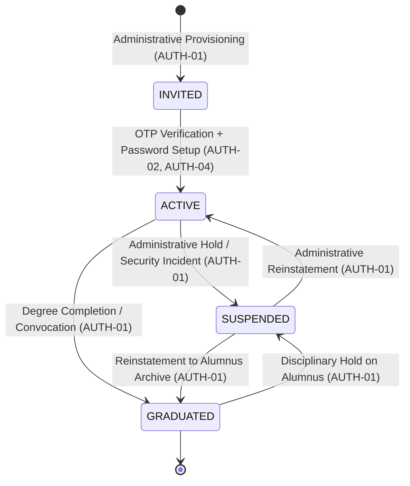
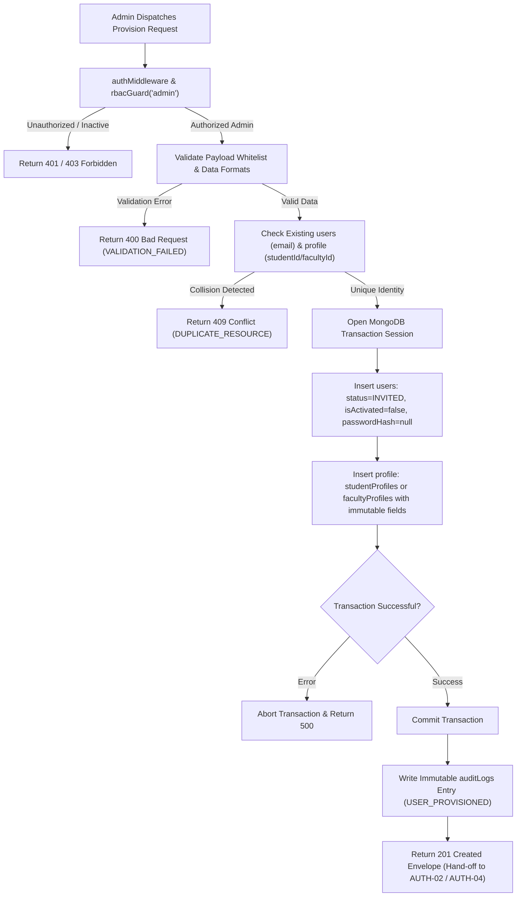

# AUTH-01 — Institutional User Provisioning & Account Lifecycle

- **Feature ID:** `AUTH-01`
- **Feature Title:** Institutional User Provisioning & Account Lifecycle
- **Domain:** Authentication & Identity
- **Milestone:** Core MVP (Genesis Requirement)
- **Status:** Approved Specification (Ready for Implementation)
- **Owning Module:** Module 1: Authentication, Institutional Identity & RBAC
- **Primary SOT References:** `COLLEGE_OS_SOT.md` §5, §6.1, §6.4, §6.5, §6.8, §7, §16.0, §16.1, §16.2, §16.3, §17, §18, §21.1, §22.1, §22.2, §22.7, §22.10; `FEATURE_INVENTORY.md` (AUTH-01, §1, §6, §7.1, §7.2); Project Plan §4, §6, §16, §18

---

## 1. Executive Summary & Purpose

### 1.1 Purpose
Institutional User Provisioning & Account Lifecycle is the genesis entry point for all identities in College OS. The foundational rule of the platform is that **the institution creates every student and staff record before anyone can log in** (SOT §6.1, §22.1). Unrestricted public self-registration is strictly rejected across all user levels (SOT §21.1, §22.2).

This specification governs the initial pre-provisioning of institutional identities (`users` plus their linked `studentProfiles` or `facultyProfiles`), assigns authoritative roles, establishes initial account states, and enforces the formal four-state account lifecycle machine (`INVITED`, `ACTIVE`, `SUSPENDED`, `GRADUATED`).

### 1.2 Boundary Clarifications & Phase Separation
To ensure clear architectural boundaries, the four distinct phases of the user journey are separated:
1. **Institutional Provisioning (`AUTH-01` — This Specification):** College administration pre-provisions an official identity record. The account is created with `accountStatus = "INVITED"`, `isActivated = false`, and `passwordHash = null`.
2. **Account Activation (`AUTH-02`, `AUTH-04`):** The student or staff member proves identity via Enrollment Number / Employee ID and verified contact, completes multi-factor OTP verification, reviews read-only institutional data, and creates their password. This transitions `accountStatus` from `INVITED` to `ACTIVE`.
3. **Authentication & Session Issuance (`AUTH-03`, `AUTH-05`, `AUTH-07`):** The active user submits credentials, the server validates identity, and issues a secure `college_os_session` HttpOnly JWT cookie.
4. **Lifecycle Management (`AUTH-01` — This Specification):** Ongoing administrative state transitions: placing an account on disciplinary or administrative hold (`SUSPENDED`), or archiving graduating students (`GRADUATED`).

```
┌────────────────────────────────────────────────────────────────────────────────────────┐
│                                USER IDENTITY TIMELINE                                  │
├───────────────────────┬────────────────────────┬───────────────────────┬───────────────┤
│    1. PROVISIONING    │     2. ACTIVATION      │   3. AUTHENTICATION   │ 4. LIFECYCLE  │
│       (AUTH-01)       │   (AUTH-02 / AUTH-04)  │  (AUTH-03 / AUTH-05)  │   (AUTH-01)   │
├───────────────────────┼────────────────────────┼───────────────────────┼───────────────┤
│ College Admin creates │ User verifies via OTP; │ User signs in with    │ Admin manages │
│ pre-provisioned user  │ confirms official info;│ email/ID + password;  │ suspension or │
│ & profile record.     │ sets own password.     │ receives JWT session. │ graduation.   │
│                       │                        │                       │               │
│ status = INVITED      │ status: INVITED→ACTIVE │ Session issued        │ ACTIVE→       │
│ isActivated = false   │ isActivated = true     │ role enforced         │ SUSPENDED /   │
│ passwordHash = null   │ passwordHash stored    │                       │ GRADUATED     │
└───────────────────────┴────────────────────────┴───────────────────────┴───────────────┘
```

### 1.3 In-Scope (Approved Core MVP Scope)
- **Pre-Provisioning of All Institutional Accounts:** Creation of `users` records paired atomically with `studentProfiles` (for students) or `facultyProfiles` (for all staff roles).
- **Authoritative Role Assignment:** Initial role assignment (`student`, `faculty`, `hod`, `principal`, `vp`, `admin`) set by institutional authority and stored in MongoDB Atlas.
- **Enforcement of SOT §6.8 Lifecycle States:**
  - `INVITED`: Account pre-provisioned; cannot authenticate until OTP activation is completed.
  - `ACTIVE`: Full role-permitted access within assigned scope.
  - `SUSPENDED`: Administrative hold; login blocked and all active sessions revoked immediately.
  - `GRADUATED`: Read-only archive access to historical records; write permissions strictly revoked.
- **Duplicate Prevention:** Atomic database validation preventing duplicate emails, enrollment numbers, or employee IDs.
- **Audit Trail Mandate:** Immediate, immutable audit logging for all provisioning, status change, and role assignment events.

### 1.4 Out-of-Scope (Explicit Non-Goals)
- **No Open Public Self-Registration (SOT §21.1, §22.2):** Anyone cannot register a self-created institutional identity or choose a role.
- **No Dedicated Leadership / Admin Dashboards (SOT §16.0, Inventory AUTH-01):** There is no approved `/admin` GUI dashboard screen in Core MVP; provisioning capabilities are provided via authorized backend administrative endpoints and ingestion tooling.
- **No Self-Service Role Switching or Elevation:** Users can never change their assigned role or status.
- **No Password Creation at Provisioning Time:** College administrators never assign, see, or store temporary passwords (SOT §22.5); passwords are set exclusively by users during activation.

---

## 2. Actors, Roles & Authorization

### 2.1 Actors & Responsibilities
| Actor | Role | Permissions in AUTH-01 | Constraints & Requirements |
| :--- | :--- | :--- | :--- |
| **Registrar / IT Admin** | `admin` | Full provisioning of students and faculty; lifecycle state updates | Must be authenticated with an active `admin` role session. All actions generate immutable audit logs. |
| **Department Head** | `hod` | Denied | Cannot provision accounts or alter account lifecycle states directly. |
| **Executive Leadership**| `principal` / `vp` | Denied (Direct) / Audited Review | Reads lifecycle audit logs; cannot directly bypass IT provisioning protocols. |
| **Faculty / Staff** | `faculty` | Denied | Zero provisioning rights. Attempting provisioning returns `403 FORBIDDEN`. |
| **Student** | `student` | Denied | Zero provisioning rights. Attempting provisioning returns `403 FORBIDDEN`. |

### 2.2 Unresolved Authority Questions & Recommended Defaults
The Feature Inventory (`AUTH-01`) identifies two specific open questions regarding provisioning authority:

1. **Provisioning Method (Bulk Import vs. Single Record Creation):**
   - *Status:* Unresolved in SOT.
   - *Proposed Recommendation (Least Privilege):* Both should be supported by backend API architecture:
     - Single-record endpoint (`POST /api/v1/admin/provision/student`, `POST /api/v1/admin/provision/staff`) for ad-hoc admissions and mid-term transfers.
     - Bulk-import endpoint (`POST /api/v1/admin/provision/bulk`) accepting structured JSON/CSV arrays for start-of-year matriculation batches.
2. **Authority Hierarchy for Privileged Role Provisioning:**
   - *Status:* Unresolved in SOT (Inventory §7.2 Item 6).
   - *Proposed Recommendation (Least Privilege):*
     - Student and teaching faculty accounts may be provisioned by authorized academic registrar staff holding the `admin` role.
     - HOD, Principal, Vice Principal, and new System Administrator accounts require higher-tier institutional governance approval (e.g. initial super-admin root key or multi-signature administrative authorization). Under no circumstances can a provisioned admin account create unmonitored peer administrators without an audit trail.

---

## 3. Account and Profile Linkage Model

`AUTH-01` strictly implements the unified identity model defined in SOT §16.0–§16.3 and `SHARED-01`:

```
                                  PROVISIONING TRANSACTION
                                             │
                       ┌─────────────────────┴─────────────────────┐
                       ▼                                           ▼
             ROLE === "student"                           ROLE !== "student"
                       │                                           │
         ┌─────────────┴─────────────┐               ┌─────────────┴─────────────┐
         ▼                           ▼               ▼                           ▼
  Insert into users          Insert into users  Insert into users          Insert into users
  (accountStatus=INVITED)    (studentProfiles)  (accountStatus=INVITED)    (facultyProfiles)
  role = "student"           studentId unique   role in [faculty, hod,     facultyId unique
                             userId unique               principal, vp,    userId unique
                                                         admin]
```

### 3.1 Strict Invariants
1. **One Account Per Person:** Every person has exactly one `users` record uniquely identified by official institutional email (`email`).
2. **One Account, One Profile:**
   - `role === "student"` &rarr; paired with a document in `studentProfiles`.
   - `role in ["faculty", "hod", "principal", "vp", "admin"]` &rarr; paired with a document in `facultyProfiles`.
3. **No Duplicate Profile Models:** Staff roles never create secondary collections (`hodProfiles`, `adminProfiles`). All staff data resides in `facultyProfiles`, using `designation` and `role` to distinguish leadership duties.
4. **Atomic Transaction Boundary:** When provisioning a user, the `users` document and the corresponding profile document must be inserted within an atomic MongoDB transaction session (`withTransaction`). If either fails (e.g. unique constraint collision), the entire operation rolls back. No orphaned `users` or profiles can exist.

---

## 4. Account Lifecycle State Machine (SOT §6.8)

Every account adheres to the four formal states governed by `accountStatus`:



### 4.1 State Definitions & Access Rules

| State | Authentication Allowed? | Session Issuance? | Read Capabilities | Write Capabilities | Operational Behavior |
| :--- | :--- | :--- | :--- | :--- | :--- |
| **`INVITED`** | **NO** | Blocked | None | None | Pre-provisioned record created by college. User cannot log in. Awaiting OTP activation flow (`AUTH-02`, `AUTH-04`). Returns `403 FORBIDDEN` (`ACCOUNT_NOT_ACTIVATED`). |
| **`ACTIVE`** | **YES** | Permitted | Full role-permitted scope | Full role-permitted scope | Normal operating state. Full access to dashboard, academics, AI, and profile updates within assigned scope. |
| **`SUSPENDED`** | **NO** | Revoked | None | None | Administrative hold (disciplinary or security). Logins blocked immediately. Any active session is revoked; protected requests return `403 FORBIDDEN` (`ACCOUNT_SUSPENDED`). |
| **`GRADUATED`** | **YES** | Permitted | Read-only archive access | **STRICTLY BLOCKED** | Student graduated or faculty offboarded. May log in to view and download historical records (transcripts, portfolios). All mutations return `403 FORBIDDEN` (`ACCOUNT_GRADUATED_READ_ONLY`). |

### 4.2 State Transition Matrix & Authority
| Current State | Target State | Triggering Mechanism | Authorized Actor | Audit Required? |
| :--- | :--- | :--- | :--- | :--- |
| *None* | `INVITED` | Pre-provisioning import | `admin` | **YES** (`USER_PROVISIONED`) |
| `INVITED` | `ACTIVE` | Successful OTP activation + password setup | Student / Staff Owner (`AUTH-02`, `AUTH-04`) | **YES** (`ACCOUNT_ACTIVATED`) |
| `ACTIVE` | `SUSPENDED` | Disciplinary action, security hold, or payment block | `admin` | **YES** (`ACCOUNT_SUSPENDED`) |
| `SUSPENDED` | `ACTIVE` | Reinstatement upon resolution | `admin` | **YES** (`ACCOUNT_REINSTATED`) |
| `ACTIVE` | `GRADUATED` | Formal convocation / degree completion batch | `admin` (Registrar) | **YES** (`ACCOUNT_GRADUATED`) |
| `GRADUATED` | `SUSPENDED` | Post-graduation disciplinary hold | `admin` | **YES** (`ACCOUNT_SUSPENDED`) |
| *Any* | `INVITED` | **DISALLOWED** | N/A | Rejected |

---

## 5. Provisioning Workflow & Flowcharts

### 5.1 Pre-Provisioning Workflow Flowchart



### 5.2 Hand-off to Activation Workflows
Once `AUTH-01` commits the pre-provisioned records, the account rests in the `INVITED` state. The hand-off to the activation features occurs as follows:
- **Student Activation Hand-off (`AUTH-02`):** When the student initiates activation at `/auth/student/activate`, the system matches their entered Enrollment Number (`studentId`) and official email/phone against the pre-provisioned `studentProfiles` and `users` records created here.
- **Faculty Activation Hand-off (`AUTH-04`):** When faculty initiate activation at `/auth/faculty/activate`, the system matches their entered Employee ID (`facultyId`) and official email against the pre-provisioned `facultyProfiles` and `users` records.

---

## 6. Proposed Data Requirements

All schemas adhere strictly to `COLLEGE_OS_SOT.md` §16.0–§16.3 and `shared/backend-conventions.md`.

### 6.1 Minimum Provisioning Input Data

#### Student Provisioning Record
```typescript
interface IProvisionStudentInput {
  institutionId: string;       // References collegeProfile._id
  email: string;               // Unique official institutional email (e.g. "aarav.sharma@csmu.edu.in")
  studentId: string;           // Unique Enrollment Number / PRN (e.g. "CS-2022-049")
  fullName: string;            // Legal official full name
  phone?: string;              // Official contact number for activation OTP delivery
  department: string;          // Department code (e.g. "CSE")
  semester: number;            // Current semester (1 to 8)
  section: string;             // Section identifier (e.g. "A")
  rollNumber?: string;         // Class roll number (e.g. "CSE-302")
  academicStatus?: 'REGULAR' | 'PROBATION'; // Defaults to "REGULAR"
}
```

#### Staff Provisioning Record
```typescript
interface IProvisionStaffInput {
  institutionId: string;       // References collegeProfile._id
  email: string;               // Unique official institutional email (e.g. "priya.nair@csmu.edu.in")
  facultyId: string;           // Unique Employee ID (e.g. "EMP-CSE-104")
  fullName: string;            // Legal official full name
  phone?: string;              // Official contact number for activation OTP delivery
  department: string;          // Department code (e.g. "CSE")
  designation: string;         // Official title (e.g. "Assistant Professor", "HOD", "Principal")
  role: 'faculty' | 'hod' | 'principal' | 'vp' | 'admin'; // Authoritative role
  assignedClassIds?: string[]; // Optional initial class assignments (e.g. ["CSE-7A"])
  assignedSubjectIds?: string[];// Optional initial subject assignments (e.g. ["CS-701"])
  academicStatus?: 'ACTIVE' | 'ON_LEAVE'; // Defaults to "ACTIVE"
}
```

### 6.2 Pre-Provisioned Record State in Database
Upon execution of `AUTH-01`:
- In `users`:
  - `accountStatus = "INVITED"`
  - `isActivated = false`
  - `passwordHash = undefined` (or excluded from document)
  - `activatedAt = undefined`
  - `lastLoginAt = undefined`
- In `studentProfiles` / `facultyProfiles`:
  - All institutional fields are populated from the verified provision input.
  - User-controlled fields (`bio`, `skills`, `avatarUrl`, `githubUrl`) are initialized to empty defaults (`""` or `[]`).

---

## 7. Proposed API Contracts (Documentation Proposals)

> [!NOTE]
> The Feature Inventory notes for `AUTH-01`: *"Routes: none yet (no screen in approved scope)"*. The following contracts are **proposed architectural REST contracts** for backend implementation and administration tooling. They do not represent existing or previously built endpoints.

### 7.1 `POST /api/v1/admin/provision/student` (Proposed)
Pre-provisions a single student institutional account and profile.

- **Authentication:** Mandatory (HttpOnly JWT cookie)
- **Authorization:** `admin` role only
- **Request Headers:**
  ```http
  Cookie: college_os_session=<admin_jwt>
  Content-Type: application/json
  ```
- **Request Body:**
  ```json
  {
    "email": "aarav.sharma@csmu.edu.in",
    "studentId": "CS-2022-049",
    "fullName": "Aarav Sharma",
    "phone": "+919876543210",
    "department": "CSE",
    "semester": 7,
    "section": "A",
    "rollNumber": "CSE-302"
  }
  ```
- **Success Response (`201 Created`):**
  ```json
  {
    "success": true,
    "data": {
      "userId": "65f2a1b9c0a1b2c3d4e5f6a1",
      "profileId": "65f2a1b9c0a1b2c3d4e5f6a2",
      "studentId": "CS-2022-049",
      "email": "aarav.sharma@csmu.edu.in",
      "accountStatus": "INVITED",
      "isActivated": false,
      "message": "Student pre-provisioned successfully. Ready for student OTP activation."
    }
  }
  ```
- **Error Responses:**
  - `400 BAD_REQUEST`: `{ "success": false, "error": { "code": "VALIDATION_FAILED", "message": "Invalid email domain or missing studentId." } }`
  - `401 UNAUTHORIZED`: `{ "success": false, "error": { "code": "UNAUTHENTICATED", "message": "Admin session invalid or expired." } }`
  - `403 FORBIDDEN`: `{ "success": false, "error": { "code": "FORBIDDEN", "message": "Only authorized administrators can provision accounts." } }`
  - `409 CONFLICT`: `{ "success": false, "error": { "code": "DUPLICATE_RESOURCE", "message": "An account with this email or Enrollment Number already exists." } }`

---

### 7.2 `POST /api/v1/admin/provision/staff` (Proposed)
Pre-provisions a single staff institutional account and `facultyProfiles` record.

- **Authentication:** Mandatory
- **Authorization:** `admin` role only
- **Request Body:**
  ```json
  {
    "email": "dr.priya.nair@csmu.edu.in",
    "facultyId": "EMP-CSE-104",
    "fullName": "Dr. Priya Nair",
    "phone": "+919876543211",
    "department": "CSE",
    "designation": "Associate Professor",
    "role": "faculty",
    "assignedClassIds": ["CSE-7A", "CSE-5B"],
    "assignedSubjectIds": ["CS-701", "CS-503"]
  }
  ```
- **Success Response (`201 Created`):**
  ```json
  {
    "success": true,
    "data": {
      "userId": "65f2b2c9d0a1b2c3d4e5f7b1",
      "profileId": "65f2b2c9d0a1b2c3d4e5f7b2",
      "facultyId": "EMP-CSE-104",
      "role": "faculty",
      "accountStatus": "INVITED",
      "isActivated": false,
      "message": "Staff member pre-provisioned successfully. Ready for staff OTP activation."
    }
  }
  ```

---

### 7.3 `POST /api/v1/admin/provision/bulk` (Proposed)
Batch pre-provisioning endpoint for matriculation and staff onboarding batches.

- **Authentication:** Mandatory
- **Authorization:** `admin` role only
- **Request Body:**
  ```json
  {
    "batchType": "student",
    "records": [
      {
        "email": "student1@csmu.edu.in",
        "studentId": "CS-2022-001",
        "fullName": "Student One",
        "department": "CSE",
        "semester": 1,
        "section": "A"
      },
      {
        "email": "student2@csmu.edu.in",
        "studentId": "CS-2022-002",
        "fullName": "Student Two",
        "department": "CSE",
        "semester": 1,
        "section": "A"
      }
    ]
  }
  ```
- **Success Response (`200 OK` or `207 Multi-Status`):**
  ```json
  {
    "success": true,
    "data": {
      "totalProcessed": 2,
      "successCount": 2,
      "failureCount": 0,
      "failures": []
    }
  }
  ```

---

### 7.4 `PATCH /api/v1/admin/users/:id/lifecycle` (Proposed)
Administrative endpoint to transition account states (`SUSPENDED`, `ACTIVE`, `GRADUATED`).

- **Authentication:** Mandatory
- **Authorization:** `admin` role only
- **Request Body:**
  ```json
  {
    "targetStatus": "SUSPENDED",
    "reason": "Administrative suspension pending disciplinary review #CSMU-DISC-2026-09"
  }
  ```
- **Success Response (`200 OK`):**
  ```json
  {
    "success": true,
    "data": {
      "userId": "65f2a1b9c0a1b2c3d4e5f6a1",
      "previousStatus": "ACTIVE",
      "newStatus": "SUSPENDED",
      "message": "Account suspended successfully. Active sessions revoked."
    }
  }
  ```
- **Side Effects:**
  - Immediately marks account as `SUSPENDED` in database.
  - Automatically revokes any active JWT sessions for this `userId` (via token revocation table or token version increment).
  - Writes immutable record to `auditLogs`.

---

## 8. Security & Auditing

### 8.1 Threat Mitigations
1. **Unauthorized Account Creation:** Guaranteed impossible by rejecting all public self-registration requests. Endpoints are protected by `authMiddleware` + `rbacGuard("admin")`.
2. **Privilege Escalation:** Roles are set exclusively via backend administrative provisioning. Payloads attempting self-elevation during activation or profile editing are rejected.
3. **Identity Collision & Race Conditions:** Enforced via MongoDB unique indexes (`users.email`, `studentProfiles.studentId`, `facultyProfiles.facultyId`) and atomic transactions.
4. **Reactivation Tampering:** Transitioning an account from `SUSPENDED` back to `ACTIVE` requires formal administrative authorization; the user cannot reactivate their own account.
5. **No Password Leakage:** Administrators never supply, see, or transmit passwords; pre-provisioned records have `passwordHash = null`. Password creation occurs exclusively on the user's browser during activation (`AUTH-02`, `AUTH-04`).
6. **Session Revocation on Suspension:** When an account is placed in `SUSPENDED` state, any pre-existing JWT session cookie presented to the API is rejected immediately by the `lifecycleGuard` database lookup (SOT §17, `shared/backend-conventions.md`).

### 8.2 Audit Log Requirements (SOT §6.8, §16, Inventory §6)
Every provisioning and lifecycle action writes an immutable record to `auditLogs`:
```typescript
interface IProvisionAuditEntry {
  actorUserId: Types.ObjectId;   // The Admin who provisioned or altered the record
  actorRole: 'admin';
  action: 'USER_PROVISIONED' | 'ACCOUNT_SUSPENDED' | 'ACCOUNT_REINSTATED' | 'ACCOUNT_GRADUATED';
  targetUserId: Types.ObjectId;  // The user account affected
  targetRole: string;            // 'student', 'faculty', etc.
  details: {
    studentId?: string;
    facultyId?: string;
    email: string;
    reason?: string;
    previousStatus?: string;
    newStatus?: string;
  };
  timestamp: Date;
}
```

---

## 9. Acceptance Criteria & Test Scenarios

### 9.1 Acceptance Criteria
- [ ] **AC-1:** Only authenticated users with the database-verified role `admin` can provision accounts.
- [ ] **AC-2:** Provisioned accounts are created with `accountStatus = "INVITED"`, `isActivated = false`, and without password hashes.
- [ ] **AC-3:** Pre-provisioning a student creates the `users` account and `studentProfiles` record atomically; failures rollback completely.
- [ ] **AC-4:** Pre-provisioning a staff member creates the `users` account and `facultyProfiles` record atomically; failures rollback completely.
- [ ] **AC-5:** Attempting to provision an account with an existing `email`, `studentId`, or `facultyId` is rejected with `409 CONFLICT` (`DUPLICATE_RESOURCE`).
- [ ] **AC-6:** Transitioning an account to `SUSPENDED` immediately blocks logins and revokes active sessions.
- [ ] **AC-7:** Transitioning an account to `GRADUATED` sets read-only archive status and blocks all write/mutation requests with `403 FORBIDDEN` (`ACCOUNT_GRADUATED_READ_ONLY`).
- [ ] **AC-8:** Every provisioning and lifecycle event records an immutable audit log entry.

### 9.2 Positive Test Scenarios
1. **Single Student Provisioning:** Admin submits valid student details &rarr; returns 201 Created with status `INVITED`; records present in `users` and `studentProfiles`.
2. **Single Faculty Provisioning:** Admin submits valid faculty details &rarr; returns 201 Created with status `INVITED`; records present in `users` and `facultyProfiles`.
3. **Account Suspension:** Admin suspends active user with reason &rarr; returns 200 OK; subsequent requests with user's session return `403 FORBIDDEN` (`ACCOUNT_SUSPENDED`).
4. **Alumnus Graduation:** Admin transitions student to `GRADUATED` &rarr; returns 200 OK; student can log in and read transcript, but profile mutations return `403 FORBIDDEN`.

### 9.3 Negative & Security Test Scenarios
1. **Unauthorized Provisioning Attempt:** Ordinary student or faculty sends POST to `/api/v1/admin/provision/student` &rarr; returns `403 FORBIDDEN`.
2. **Unauthenticated Provisioning Attempt:** Request sent without session cookie &rarr; returns `401 UNAUTHORIZED`.
3. **Duplicate Email Collision:** Admin attempts to provision student with an email already present in `users` &rarr; returns `409 CONFLICT` (`DUPLICATE_RESOURCE`); transaction rolls back.
4. **Duplicate Enrollment Number Collision:** Admin attempts to provision student with existing `studentId` &rarr; returns `409 CONFLICT` (`DUPLICATE_RESOURCE`).
5. **Direct Login of Pre-Provisioned Account:** User with status `INVITED` attempts login prior to OTP activation &rarr; returns `403 FORBIDDEN` (`ACCOUNT_NOT_ACTIVATED`).
6. **Write Attempt by Graduated Account:** User with status `GRADUATED` attempts `PATCH /api/v1/users/students/profile` &rarr; returns `403 FORBIDDEN` (`ACCOUNT_GRADUATED_READ_ONLY`).
7. **Privilege Escalation in Body:** Admin attempts to provision an unapproved role string (e.g. `role: "super_root"`) &rarr; returns `400 BAD_REQUEST` (`VALIDATION_FAILED`).

---

## 10. Dependencies & Open Decisions

### 10.1 Upstream Dependencies
- **`SHARED-01 — User Identity & Profile Foundation`:** Defines data models (`users`, `studentProfiles`, `facultyProfiles`) and field ownership boundaries.
- **`SHARED-02 — Roles & Permissions (RBAC)`:** Enforces administrative access to provisioning endpoints and evaluates lifecycle gates.

### 10.2 Downstream Dependents
- **`AUTH-02 — Student Account Activation (OTP)`:** Matches pre-provisioned student records and activates accounts.
- **`AUTH-04 — Faculty & Staff Account Activation (OTP)`:** Matches pre-provisioned staff records and activates accounts.
- **`AUTH-03 / AUTH-05 — Student / Staff Login`:** Verifies active status and credentials created after provisioning.
- **`AUTH-07 — Session, Logout & Route Protection`:** Enforces lifecycle token validity.

### 10.3 Classification of Decisions

#### Resolved SOT Decisions
- **College-Controlled Identity (SOT §6.1, §22.1):** Pre-provisioning by institution is mandatory.
- **No Open Registration (SOT §21.1, §22.2):** Public self-registration is strictly rejected.
- **Account Lifecycle States (SOT §6.8, §22.10):** Locked to `INVITED`, `ACTIVE`, `SUSPENDED`, `GRADUATED`.
- **Unified Staff Model (SOT §16.0):** All staff roles link to `facultyProfiles`.

#### Genuinely Open Decisions
1. **Bulk Ingestion Format & Schema Mapping:** Whether batch uploads use CSV, XLSX, or JSON, and how institutional registrar errors in bulk files are reported (e.g. line-by-line validation summary).
2. **Executive Role Provisioning Workflow:** Exact administrative approval protocol for provisioning HOD, Principal, VP, and new Admin accounts (e.g. dual-authorization registrar key).

#### Proposed Implementation Details
- Proposed REST endpoints: `POST /api/v1/admin/provision/student`, `POST /api/v1/admin/provision/staff`, `POST /api/v1/admin/provision/bulk`, `PATCH /api/v1/admin/users/:id/lifecycle`.
- MongoDB transaction session (`withTransaction`) for atomic user/profile creation.

#### Existing Implementation Gaps
- Currently, no administrative provisioning screens or backend endpoints exist in the repository (stub server).
- Frontend login page (`/auth/student`) currently features a legacy "Create an Account" link; per SOT §22.2 and Inventory `AUTH-03`, this must be removed or redirected to the activation workflow.

---

## 11. Traceability Matrix

| SOT Section | Project Plan Section | Feature Inventory ID | Verification Method |
| :--- | :--- | :--- | :--- |
| SOT §6.1 (Pre-Provisioned Accounts) | Plan §6.1 (Onboarding) | `AUTH-01` | Integration Test: Pre-provisioning without Password |
| SOT §6.8 (Account Lifecycle Machine) | Plan §6.2 (Lifecycle) | `AUTH-01` | Integration Test: State Transitions & Session Revocation |
| SOT §16.0–§16.3 (Identity Schemas) | Plan §16.1–§16.4 (Data) | `AUTH-01` / `SHARED-01` | Database Test: Atomic Transaction & Unique Constraints |
| SOT §18 (RBAC Matrix) | Plan §18.1 (Permissions)| `AUTH-01` / `SHARED-02` | Security Test: Admin Only Provisioning Guard |
| SOT §22.1–§22.2 (Locked Identity Rules) | Plan §21.1 (Non-Goals) | `AUTH-01` | Security Test: Rejection of Open Self-Registration |
