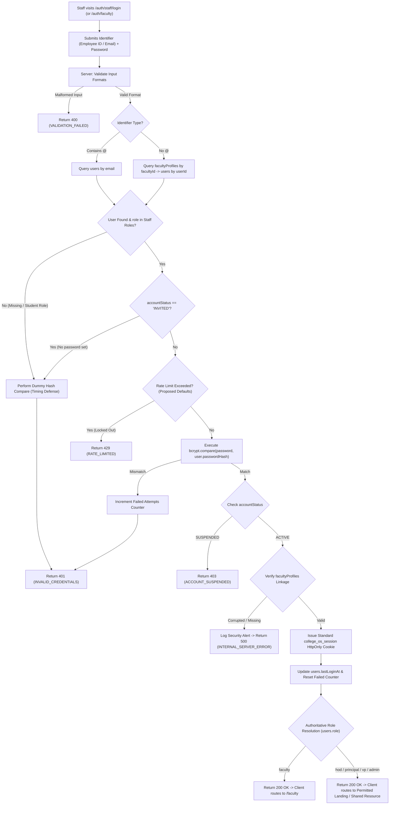

# AUTH-05 — Staff Login & Role Routing

- **Feature ID:** `AUTH-05`
- **Feature Title:** Staff Login & Role Routing
- **Domain:** Authentication & Identity
- **Milestone:** Core MVP
- **Status:** Approved Specification (Ready for Implementation)
- **Owning Module:** Module 1: Authentication, Institutional Identity & RBAC
- **Primary SOT References:** `COLLEGE_OS_SOT.md` §6.0, §6.3, §6.4, §6.5, §6.6, §6.7, §6.8, §7, §8, §16.0, §16.1, §16.3, §17, §18, §22.8; `FEATURE_INVENTORY.md` (`AUTH-05`, `AUTH-04`, `AUTH-07`, `SHARED-01`, `SHARED-02`, `FAC-01`); Project Plan §4, §6, §16, §17

---

## 1. Executive Summary & Purpose

### 1.1 Purpose
Staff Login & Role Routing is the single unified authentication entry point for all non-student institutional personnel in College OS. In strict accordance with the foundational SOT principle—**"Users do not choose their institutional role. The institution provisions and authorizes the user's role"** (SOT §6.0, §22.8)—staff members cannot choose, alter, or self-elevate their role during authentication.

Non-student users authenticate by submitting their approved institutional identifier (Official College Email or Employee ID) paired with their private password established during staff activation (`AUTH-04`). Upon cryptographic credential verification and account lifecycle validation, the backend resolves the user's authoritative role directly from the database and establishes a secure, server-controlled HttpOnly session cookie (`college_os_session`) conforming to SOT §17 and `AUTH-07`. The backend then determines the permitted post-login destination in strict compliance with approved workspace boundaries.

### 1.2 In-Scope (Approved Core MVP Scope)
This specification governs authentication for **all five non-student institutional roles**:
1. **Teaching Faculty (`faculty`):** Authenticates and routes to the approved Faculty Workspace (`/faculty`).
2. **Head of Department (`hod`):** Authenticates with departmental executive authority.
3. **Principal (`principal`):** Authenticates with campus-wide executive governance authority.
4. **Vice Principal / Dean (`vp`):** Authenticates with campus-wide administrative authority.
5. **System Administrator (`admin`):** Authenticates with IT tenant administration authority.

Core functional scope comprises:
- **Unified Staff Authentication Gateway:** Providing a single login mechanism across all non-student roles without role-selection dropdowns (SOT §6.6).
- **Dual Staff Identifier Lookup:** Supporting authentication via either Employee ID (`facultyProfiles.facultyId`) or official institutional email (`users.email`).
- **Server-Side Role Resolution (SOT §22.8):** Resolving the operational role strictly from MongoDB Atlas `users.role`. Client-submitted role parameters are strictly disregarded.
- **Unified Profile Model Linkage (`SHARED-01`):** Linking authenticated accounts exclusively to the single `facultyProfiles` collection.
- **Server-Enforced Lifecycle Gating (SOT §6.8):**
  - `ACTIVE`: Full login access to role-permitted features.
  - `INVITED`: Authentication denied with generic credentials response to prevent account existence disclosure; UI directs first-time staff to `/auth/faculty/activate`.
  - `SUSPENDED`: Authentication denied with `403 FORBIDDEN` (`ACCOUNT_SUSPENDED`) only after password verification, revoking all existing sessions.
  - `RELIEVED` / Offboarded: Inactive staff accounts cannot access active operational features.
- **Server-Issued Secure Session Hand-Off (SOT §17, `AUTH-07`):** Setting the single standard `college_os_session` HttpOnly cookie containing signed claims (`userId`, `role`, `institutionId`).
- **Post-Login Routing within Approved Scope:** Routing teaching faculty to the approved Faculty Workspace (`/faculty`), while maintaining strict scope boundaries for privileged roles (HOD, Principal, VP, Admin) where dedicated dashboards are explicitly not approved.
- **Anti-Enumeration & Brute-Force Defense:** Returning uniform error responses and enforcing attempt rate limiting.

### 1.3 Out-of-Scope (Explicit Non-Goals & Scope Boundaries)
- **No Separate Login Portals for Privileged Roles (SOT §6.6):** There is no separate "HOD Login", "Principal Login", or "Admin Login" screen. All non-student personnel use the unified staff portal.
- **No Dedicated Privileged Dashboards:** The approved Project Plan and Feature Inventory explicitly establish that dedicated dashboards for HOD (`/hod/dashboard`), Principal/VP (`/principal/dashboard`), and Admin (`/admin/dashboard`) are **out of scope for Core MVP**. Privileged roles must not be granted invented routes or redirected into the faculty dashboard if they do not hold teaching assignments.
- **No Role Self-Selection or Elevation:** Client payloads containing `role` (such as the legacy frontend mock passing `role: "faculty"`) are strictly ignored by the server.
- **No Student Authentication:** Students authenticate exclusively via the student portal (`AUTH-03` at `/auth/student`). Student enrollment numbers submitted here are rejected.
- **No Client-Set Session Cookies:** Browser JavaScript is strictly barred from setting or reading session cookies.

---

## 2. Actors, Permissions & Ownership

### 2.1 Actors & Roles
| Actor | Role (`users.role`) | Permitted Action | Login Behavior & Destination |
| :--- | :--- | :--- | :--- |
| **Teaching Faculty** | `faculty` (`ACTIVE`) | Staff Login | Authenticates; receives session cookie; redirected to Faculty Workspace (`/faculty`). |
| **Head of Department** | `hod` (`ACTIVE`) | Staff Login | Authenticates; receives session cookie; routed to permitted shared resources or pending landing destination. |
| **Principal / VP** | `principal` / `vp` (`ACTIVE`) | Staff Login | Authenticates; receives session cookie; high-audit logged; routed to permitted shared resources or pending landing destination. |
| **System Administrator** | `admin` (`ACTIVE`) | Staff Login | Authenticates; receives session cookie; IT audit logged; routed to permitted administrative resources. |
| **Unactivated Staff** | Any staff (`INVITED`) | Blocked | Unactivated accounts lack password; rejected with generic `401 UNAUTHORIZED` (`INVALID_CREDENTIALS`). |
| **Suspended Staff** | Any staff (`SUSPENDED`) | Blocked | Valid credentials return `403 FORBIDDEN` (`ACCOUNT_SUSPENDED`); prior sessions invalidated. |
| **Offboarded Staff** | Any staff (`RELIEVED`) | Blocked | Inactive employment record; login denied with generic credentials error or account inactive notice. |
| **Student** | `student` (`ACTIVE`/`INVITED`) | Blocked on Staff Route | Student credentials fail with generic `401 UNAUTHORIZED` (`INVALID_CREDENTIALS`). |
| **Unprovisioned Visitor** | Unknown / Public | Blocked | Rejected with generic `401 UNAUTHORIZED` (`INVALID_CREDENTIALS`) after dummy-hash delay. |

### 2.2 Identity Resolution & Ownership Rules
- **Sole Source of Authority (SOT §22.8):** Identity, role, and department derive strictly from MongoDB collections (`users` and `facultyProfiles`). The server queries records exclusively by the submitted identifier (Employee ID or official email).
- **Single Profile Model Constraint (SOT §16.0, `SHARED-01`):** All staff roles map 1:1 to `facultyProfiles`. The backend verifies that `facultyProfiles.userId` matches `users._id`. If missing or corrupted, the server aborts with generic `500 INTERNAL_SERVER_ERROR` and logs a high-severity security alert.
- **Dynamic Scope Association (`SHARED-02`):**
  - Teaching faculty permissions are dynamically bounded by `teachingAssignments` (`assignedClassIds`, `assignedSubjectIds`).
  - HOD permissions are bounded by `department` code.
  - Principal and VP permissions are bounded campus-wide.
  - Admin permissions are bounded by institutional system configuration.

---

## 3. Related UI Routes & Current Behavior

### 3.1 Primary Frontend Routes
| Route | Access Guard | Current Repo Implementation | Key Component File |
| :--- | :--- | :--- | :--- |
| `/auth/faculty` | Public (Unauthenticated) | Implemented (renders `StaffLoginPage`) | `frontend/app/auth/faculty/page.jsx`<br>`frontend/components/auth/StaffLoginPage.jsx` |
| `/auth/staff/login` | Public (Unauthenticated) | Implemented (renders `StaffLoginPage`) | `frontend/app/auth/staff/login/page.jsx`<br>`frontend/components/auth/StaffLoginPage.jsx` |
| `/faculty` | Protected (`role: "faculty"`) | Implemented (Faculty Workspace) | `frontend/app/faculty/page.js` |
| `/auth/faculty/activate` | Public | Implemented (Staff Activation) | `frontend/app/auth/faculty/activate/page.jsx` |
| `/auth/forgot-password?role=faculty`| Public | Implemented (Password Recovery) | `frontend/app/auth/forgot-password/page.jsx` |

### 3.2 Route Analysis & Canonical Route Recommendation
Inspection of the repository reveals that two distinct Next.js App Router routes render the exact same component:
1. `frontend/app/auth/faculty/page.jsx` &rarr; `<StaffLoginPage />`
2. `frontend/app/auth/staff/login/page.jsx` &rarr; `<StaffLoginPage />`

- **Finding:** Both routes are active in the codebase. However, having two public URLs for the same form creates duplicate entry points and documentation divergence.
- **Proposed Architectural Recommendation:** Establish `/auth/staff/login` as the canonical unified route for all non-student roles (reflecting that HODs, Principals, and Admins are staff members, not merely faculty), while preserving `/auth/faculty` as a 301/308 compatibility redirect.
- *(Note: This route consolidation is a proposed architectural recommendation pending formal product approval; both routes remain functional in the repository).*

### 3.3 Current UI Behavior & Implementation Gaps
Inspection of `frontend/components/auth/StaffLoginPage.jsx` identifies the following gaps:
1. **Hardcoded Role Submission in Mock:**
   - In `StaffLoginPage.jsx` (line 59), the form executes:
     `await login({ identifier, password, role: "faculty" });`
   - *Deviation:* Submitting a client-specified `role: "faculty"` violates SOT §22.8. The backend must strictly ignore client-supplied role fields and derive the role from `users.role`.
2. **Blind Faculty Redirect:**
   - In `StaffLoginPage.jsx` (line 61), successful authentication unconditionally executes `router.push("/faculty")`.
   - *Deviation:* Redirecting an HOD, Principal, or Admin to `/faculty` assumes all staff are teaching faculty. If an administrator has no teaching assignments, landing on a teaching schedule produces empty states or scope confusion.
3. **Demo Quick-Fill Helper:**
   - Line 35 provides `fillDemoFaculty()` populating `EMP-1042` / `CollegeOS@Staff2026`. This must be restricted to non-production environments.
4. **Legacy Cookie Generation:**
   - `AuthProvider.jsx` sets client-readable `college_os_session=true` in `document.cookie`. This must be replaced with server-issued HttpOnly session cookies.

---

## 4. Post-Login Role Routing & Scope Boundaries

### 4.1 Strict Scope Boundary Principles
A critical architectural constraint governs post-login routing in College OS Core MVP:
> [!IMPORTANT]
> **Dedicated HOD, Principal/VP, and Admin dashboards are explicitly NOT part of the approved Core MVP scope.**
> The absence of a dedicated dashboard does not eliminate role authorization. Authorization is enforced at the API layer on all shared and role-specific endpoints (SOT §16.0, §18).

### 4.2 Post-Login Destination Matrix
| Authoritative Role | Does Approved Dedicated Workspace Exist? | Permitted Post-Login Destination | Handling & Scope Rules |
| :--- | :--- | :--- | :--- |
| **`faculty`** | **Yes** (`/faculty`) | `/faculty` (`frontend/app/faculty/page.js`) | Lands on Faculty Workspace. Sidebar and features scope strictly to `teachingAssignments`. |
| **`hod`** | **No** (Out of Core MVP scope) | **Unresolved Product Decision** / Permitted Shared Resource (e.g. `/faculty` if teaching, or `/faculty/notices`) | If the HOD also holds teaching assignments, `/faculty` is accessible with departmental audit scope. If purely administrative, landing destination remains an open decision. Under no circumstances may an unapproved `/hod/dashboard` route be invented. |
| **`principal` / `vp`** | **No** (Out of Core MVP scope) | **Unresolved Product Decision** / Campus Circulars Overview | Executive users have campus-wide audit permissions at the API layer. Landing destination remains an open product decision. Under no circumstances may an unapproved `/principal/dashboard` route be invented. |
| **`admin`** | **No** (Out of Core MVP scope) | **Unresolved Product Decision** / Institutional Settings Overview | Admin permissions govern user provisioning and lifecycle APIs. Landing destination remains an open product decision. Under no circumstances may an unapproved `/admin/dashboard` route be invented. |

### 4.3 Separation of Authentication from Usable Workspace
Successful authentication confirms that an identity is valid and establishes a secure session. It does **not** imply that a custom UI dashboard exists. Privileged users without dedicated dashboards receive an authoritative session and can interact with permitted APIs and shared features (Notices, Events, Campus AI, User Management) within their RBAC scope (`SHARED-02`).

---

## 5. End-to-End Workflow & Flowchart

### 5.1 Staff Login Workflow
1. **Submission:** Staff member visits `/auth/staff/login` (or `/auth/faculty`) and enters an identifier (Employee ID or official college email) and password.
2. **Input Sanitization & Format Validation:** The server trims inputs, normalizes email to lowercase, converts Employee ID to uppercase, and rejects empty fields. Malformed payloads return `400 BAD_REQUEST` (`VALIDATION_FAILED`).
3. **Institutional Record Lookup:**
   - If identifier contains `@`, query `users.findOne({ email: identifier.toLowerCase() })`.
   - Otherwise, query `facultyProfiles.findOne({ facultyId: identifier.toUpperCase() })` and load linked `users` record via `userId`.
4. **Anti-Enumeration Timing Defense:**
   - If no record is found, or if `user.role === "student"`, execute a constant-time dummy bcrypt hash comparison and return generic `401 UNAUTHORIZED` (`INVALID_CREDENTIALS`).
   - If `user.accountStatus === "INVITED"` (no password hash configured yet), execute the dummy hash comparison and return generic `401 UNAUTHORIZED` (`INVALID_CREDENTIALS`). The public endpoint does not disclose account existence or activation state.
5. **Rate Limiting Check (Proposed Defaults):**
   - Check failure count for client IP and target account. If threshold exceeded (proposed default: 5 failed attempts in 15 minutes), return `429 TOO_MANY_REQUESTS` (`RATE_LIMITED`).
6. **Cryptographic Password Verification:**
   - Execute `bcrypt.compare(password, user.passwordHash)`.
   - If mismatch: increment failed attempts counter, log security event `AUTH_STAFF_LOGIN_FAILED_CREDENTIALS`, and return generic `401 UNAUTHORIZED` (`INVALID_CREDENTIALS`).
7. **Post-Authentication Lifecycle Evaluation (SOT §6.8):**
   - If `user.accountStatus === "SUSPENDED"`: Return `403 FORBIDDEN` (`ACCOUNT_SUSPENDED`). No session is issued. Internal audit records `AUTH_STAFF_LOGIN_BLOCKED_SUSPENDED`.
   - If `user.accountStatus === "ACTIVE"`: Proceed to session issuance.
8. **Profile Linkage & Session Issuance (SOT §17, `AUTH-07`):**
   - Verify linked `facultyProfiles` record exists. If missing, return `500 INTERNAL_SERVER_ERROR` (`INTERNAL_SERVER_ERROR`) without leaking internal schema corruption, and record an urgent audit alert.
   - Reset failed login attempt counter and update `users.lastLoginAt = new Date()`.
   - Issue single standard `college_os_session` HttpOnly cookie containing signed claims `{ sub: user._id, role: user.role, institutionId: user.institutionId }`.
9. **Role-Based Destination Resolution:**
   - For `role === "faculty"`: Response indicates `"redirectTo": "/faculty"`.
   - For privileged roles (`hod`, `principal`, `vp`, `admin`): Response provides the user data envelope and designated landing route or safe fallback, adhering to Section 4 scope boundaries.

### 5.2 Comprehensive Staff Login & Role Routing Flowchart



---

## 6. Business Rules, Validations & State Transitions

### 6.1 Business Rules & Security Invariants
1. **Authoritative Backend Credentials:** Authentication validity is determined strictly by the server matching `password` against `passwordHash` stored in `users`.
2. **Anti-Enumeration Invariant:** The public login endpoint returns identical generic error messages (`401 UNAUTHORIZED` with code `INVALID_CREDENTIALS`) for non-existent identifiers, incorrect passwords, student identities, and unactivated accounts. The public endpoint never reveals whether an Employee ID exists or its activation state.
3. **Post-Authentication Suspension Disclosure:** Account suspension (`accountStatus === "SUSPENDED"`) is disclosed only after valid password verification, preventing unauthenticated scanning of staff disciplinary records while ensuring suspended personnel receive no active session.
4. **Immutability of Role Authority:** Request body parameters attempting to specify `role`, `department`, or `permissions` are strictly stripped and discarded.
5. **Session Isolation:** The issued session is bound to the institutional tenancy (`institutionId`), user identity (`userId`), and authoritative role (`role`).

### 6.2 Server-Side Validations
| Field / Parameter | Validation Rules & Constraints | Error Code | HTTP Status |
| :--- | :--- | :--- | :--- |
| `identifier` | Required, string, trimmed, min 3 chars, max 100 chars | `INVALID_IDENTIFIER` | 400 |
| `password` | Required, string, non-empty, max 128 chars | `PASSWORD_REQUIRED` | 400 |
| `rememberMe` | Optional, boolean (defaults to false) | `INVALID_PAYLOAD` | 400 |

### 6.3 Attempt Limits & Lockout Policy (Proposed Defaults)
To protect staff credentials against brute-force and credential stuffing:
- **Max Consecutive Failed Attempts:** 5 failed attempts per account or IP within 15 minutes.
- **Lockout Duration:** 15 minutes temporary hold on exceeding limit.
- **Response upon Lockout:** Returns `429 TOO_MANY_REQUESTS` with error code `RATE_LIMITED` and a `Retry-After: 900` header.
- *(Note: Exact lockout duration and attempt limits are proposed defaults requiring institutional confirmation).*

---

## 7. Session Architecture & Cookie Specification (SOT §17, `AUTH-07`)

Upon successful authentication, the server sets a single standard session cookie adhering to SOT §17:
- **Cookie Name:** `college_os_session`
- **HttpOnly:** `true` (strictly inaccessible to document JavaScript, preventing XSS token theft)
- **Secure:** `true` in production (transmitted only over TLS/HTTPS)
- **SameSite:** `"Lax"` or `"Strict"` (CSRF defense)
- **Path:** `"/"`
- **Max-Age / Expiry:**
  - Standard session: 24 hours (`86400` seconds).
  - "Remember Me" checked: 7 days (`604800` seconds) — *proposed default*.
- **Token Claims Payload:**
  ```json
  {
    "sub": "65f2a1b9c0a1b2c3d4e5f6a5",
    "role": "faculty",
    "institutionId": "65f29a00b1c2d3e4f5a6b7c8",
    "iat": 1711500000,
    "exp": 1711586400
  }
  ```
- **Server-Side Re-Resolution (`AUTH-07`):** Downstream API requests verify the JWT signature and re-resolve the user's current `accountStatus`, `role`, and dynamic scope from MongoDB. If an account is suspended or relieved after login, subsequent requests are rejected immediately.

---

## 8. Proposed API Contracts (Documentation Proposals)

> [!NOTE]
> The following API specifications are **proposed architectural REST contracts** designed for backend implementation. They do not represent existing active endpoints in the repository.

### 8.1 `POST /api/v1/auth/staff/login` (Proposed)
Authenticates an eligible staff member and establishes a server-issued session cookie.

- **Authentication:** Public (Unauthenticated)
- **Request Headers:**
  ```http
  Content-Type: application/json
  ```
- **Request Body:**
  ```json
  {
    "identifier": "EMP-1042",
    "password": "SecurePassword@2026",
    "rememberMe": true
  }
  ```
- **Success Response (`200 OK` - Teaching Faculty):**
  ```http
  HTTP/1.1 200 OK
  Set-Cookie: college_os_session=eyJhbGciOiJIUzI1NiIsIn...; Path=/; HttpOnly; Secure; SameSite=Lax; Max-Age=604800
  Content-Type: application/json

  {
    "success": true,
    "data": {
      "user": {
        "id": "65f2a1b9c0a1b2c3d4e5f6a5",
        "email": "arjun.mehta@college.edu",
        "role": "faculty",
        "accountStatus": "ACTIVE"
      },
      "profile": {
        "id": "65f2a1b9c0a1b2c3d4e5f6b1",
        "facultyId": "EMP-1042",
        "fullName": "Dr. Arjun Mehta",
        "department": "Computer Science & Engineering",
        "designation": "Associate Professor",
        "assignedClassIds": ["CSE-7A", "CSE-5B"]
      },
      "redirectTo": "/faculty"
    }
  }
  ```
- **Success Response (`200 OK` - Head of Department / Executive):**
  ```json
  {
    "success": true,
    "data": {
      "user": {
        "id": "65f2a1b9c0a1b2c3d4e5f6a9",
        "email": "hod.cse@college.edu",
        "role": "hod",
        "accountStatus": "ACTIVE"
      },
      "profile": {
        "id": "65f2a1b9c0a1b2c3d4e5f6b9",
        "facultyId": "EMP-3045",
        "fullName": "Prof. Rajesh Sharma",
        "department": "Computer Science & Engineering",
        "designation": "Head of Department"
      },
      "redirectTo": "/faculty"
    }
  }
  ```
- **Common Error Responses:**
  - `400 BAD_REQUEST`: `{ "code": "VALIDATION_FAILED", "message": "Identifier and password are required." }`
  - `401 UNAUTHORIZED`: `{ "code": "INVALID_CREDENTIALS", "message": "Invalid Employee ID/Email or password." }`
    *(Uniform error returned for non-existent accounts, password mismatches, student identities, and unactivated accounts, preventing account enumeration).*
  - `403 FORBIDDEN`: `{ "code": "ACCOUNT_SUSPENDED", "message": "Your account is placed on administrative hold. Please contact campus governance." }`
    *(Returned only after successful credential verification against an account in SUSPENDED state).*
  - `429 TOO_MANY_REQUESTS`: `{ "code": "RATE_LIMITED", "message": "Too many failed login attempts. Please try again later." }`
  - `500 INTERNAL_SERVER_ERROR`: `{ "code": "INTERNAL_SERVER_ERROR", "message": "An unexpected error occurred during authentication. Please contact system support." }`

---

## 9. Cross-Cutting Concerns

### 9.1 Auditing & Compliance (SOT §6.8, §16, §18)
All staff authentication events update `users.lastLoginAt` and write immutable records to MongoDB `auditLogs`:
```typescript
{
  actorUserId: user._id,
  actorRole: user.role,                  // "faculty" | "hod" | "principal" | "vp" | "admin"
  action: "AUTH_STAFF_LOGIN_SUCCESS",
  targetResourceId: user._id,
  targetModel: "users",
  details: {
    facultyId: profile.facultyId,
    department: profile.department,
    ipAddress: req.ip,
    userAgent: req.headers["user-agent"]
  },
  timestamp: new Date()
}
```
Security-flagged events (e.g. 5 consecutive failed attempts, login against suspended staff accounts, or privileged executive logins) are logged with high severity.

### 9.2 Root Path Redirection Rule
The application root `/` checks for the presence of an authenticated session cookie:
- If valid student session: Redirect to `/student`.
- If valid staff session (`role === "faculty"`): Redirect to `/faculty`.
- If valid privileged staff session (`hod`, `principal`, `vp`, `admin`): Redirect to designated post-login destination.
- If unauthenticated: Redirect to `/auth/student`.

---

## 10. Architectural Do's and Don'ts

| Do | Don't |
| :--- | :--- |
| **Do** derive staff roles authoritatively from `users.role` in MongoDB. | **Don't** accept a client-submitted `role` field from request payloads. |
| **Do** use the single `facultyProfiles` collection for all non-student roles. | **Don't** create competing collections (`hodProfiles`, `adminProfiles`). |
| **Do** return generic `401 UNAUTHORIZED` (`INVALID_CREDENTIALS`) on failure to prevent user enumeration. | **Don't** disclose whether an Employee ID exists or if an account is unactivated when credentials fail. |
| **Do** route teaching faculty to the approved Faculty Workspace (`/faculty`). | **Don't** invent unapproved dashboards (`/hod/dashboard`, `/admin/dashboard`) or redirect non-teaching staff into faculty tools. |
| **Do** issue a single server-controlled HttpOnly cookie (`college_os_session`). | **Don't** set client-readable cookies (`college_os_session=true`) via JavaScript. |

---

## 11. Acceptance Criteria & Test Scenarios

### 11.1 Acceptance Criteria
- [ ] **AC-1:** Teaching faculty can log in using Employee ID or official email and password &rarr; receives session cookie and routes to `/faculty`.
- [ ] **AC-2:** Head of Department can log in using Employee ID or official email &rarr; receives session cookie with authoritative `role: "hod"`.
- [ ] **AC-3:** Principal, VP, and Admin can log in using Employee ID or official email &rarr; receives session cookie with authoritative executive/admin role.
- [ ] **AC-4:** Passwords are cryptographically verified using `bcrypt`; incorrect credentials fail with generic `401 UNAUTHORIZED` (`INVALID_CREDENTIALS`).
- [ ] **AC-5:** Unactivated staff accounts (`INVITED`) cannot log in and receive generic `401 UNAUTHORIZED` to prevent existence disclosure; UI guides first-time users to activate.
- [ ] **AC-6:** Suspended staff accounts (`SUSPENDED`) cannot log in; upon valid credential entry, they receive `403 FORBIDDEN` (`ACCOUNT_SUSPENDED`).
- [ ] **AC-7:** Student accounts attempting staff login receive generic `401 UNAUTHORIZED` (`INVALID_CREDENTIALS`).
- [ ] **AC-8:** Client-supplied `role` fields in login payloads are strictly ignored by the server.
- [ ] **AC-9:** Successful login sets a server-issued `college_os_session` HttpOnly cookie and updates `users.lastLoginAt`.
- [ ] **AC-10:** Consecutive failed attempts trigger rate limiting and temporary IP/account lockout based on proposed defaults.

### 11.2 Positive Test Scenarios
1. **Faculty Login by Employee ID:** Active faculty enters `EMP-1042` and valid password &rarr; receives 200 OK and `college_os_session` cookie; routed to `/faculty`.
2. **Faculty Login by Official Email:** Active faculty enters `arjun.mehta@college.edu` and valid password &rarr; receives 200 OK and session cookie.
3. **HOD Login:** Active HOD enters `EMP-3045` and valid password &rarr; receives 200 OK and session cookie carrying `role: "hod"`.
4. **Principal / Executive Login:** Active Principal enters executive credentials &rarr; receives 200 OK and session cookie carrying `role: "principal"`; high-severity audit log is recorded.
5. **Admin Login:** Active IT Admin enters administrative credentials &rarr; receives 200 OK and session cookie carrying `role: "admin"`.

### 11.3 Negative & Security Test Scenarios
1. **Incorrect Password:** Active staff member submits valid Employee ID but incorrect password &rarr; receives `401 UNAUTHORIZED` (`INVALID_CREDENTIALS`).
2. **Unprovisioned Identity:** User submits non-existent Employee ID `EMP-9999` &rarr; receives identical `401 UNAUTHORIZED` (`INVALID_CREDENTIALS`) after dummy hash delay.
3. **Student Identifier on Staff Form:** Submitting student enrollment number `CS-2022-049` &rarr; receives generic `401 UNAUTHORIZED` (`INVALID_CREDENTIALS`).
4. **Unactivated Staff Account:** Submitting credentials for an unactivated account (`INVITED`) &rarr; receives generic `401 UNAUTHORIZED` (`INVALID_CREDENTIALS`).
5. **Suspended Staff Attempt with Bad Password:** Suspended staff enters incorrect password &rarr; receives generic `401 UNAUTHORIZED` (`INVALID_CREDENTIALS`).
6. **Suspended Staff Attempt with Valid Password:** Suspended staff enters valid password &rarr; receives `403 FORBIDDEN` (`ACCOUNT_SUSPENDED`).
7. **Role Tampering Attempt:** Client submits payload `{"identifier": "EMP-1042", "password": "...", "role": "admin"}` for a faculty account &rarr; server ignores payload role, authenticates user strictly as `faculty`, and records security audit log.
8. **Client-Side Cookie Spoofing:** User creates browser cookie `college_os_session=true` and attempts to access `/faculty` &rarr; protected route rejects request with `401 UNAUTHORIZED`.
9. **Brute-Force Rate Limiting:** Attacker submits 5 incorrect passwords within 2 minutes &rarr; 6th attempt returns `429 TOO_MANY_REQUESTS` (`RATE_LIMITED`).
10. **Corrupted Profile Linkage:** User record exists with staff role but linked `facultyProfiles` document is missing &rarr; server logs security error and returns generic `500 INTERNAL_SERVER_ERROR`.

---

## 12. Dependencies & Decision Log

### 12.1 Upstream Dependencies
- **`AUTH-01 — Institutional User Provisioning`:** Creates pre-provisioned user and profile records with `accountStatus: "INVITED"`.
- **`AUTH-04 — Faculty & Staff Account Activation`:** Hashes user password and transitions account to `ACTIVE`.
- **`SHARED-01 — User Identity & Profile Foundation`:** Governs unified `facultyProfiles` schema and identity constraints.
- **`SHARED-02 — Roles & Permissions (RBAC)`:** Enforces authoritative roles on downstream protected endpoints.

### 12.2 Downstream Dependents
- **`AUTH-07 — Session, Logout & Route Protection`:** Manages JWT validation, cookie lifetime, and logout.
- **`FAC-01 — Faculty Workspace & Teaching Schedule`:** Landing workspace for teaching faculty.
- **All Staff Operational Modules (`FAC-*`, `HOD-*`, `PRIN-*`, `ADM-*`):** Protected by the session established here.

### 12.3 Decision Log: Resolved vs. Open vs. UI Gaps
- **Resolved Requirements (SOT §6.0, §6.6, §7, §16.0, §17, §22.8):**
  - Unified login portal across all non-student roles; no role-selection dropdowns.
  - Role derived authoritatively from database (`users.role`), never client input.
  - Single staff profile collection `facultyProfiles` for all non-student roles.
  - Standard session cookie `college_os_session` issued server-side with HttpOnly and Secure flags.
  - Anti-enumeration protocol returning generic `INVALID_CREDENTIALS` on failed authentication.
- **Genuine Open Decisions:**
  - *Post-Login Landing Destination for Non-Teaching Roles:* Dedicated dashboards for HOD, Principal, VP, and Admin are out of scope for Core MVP. Whether privileged non-teaching personnel land on a shared circulars/overview page or a dedicated portal remains an open product decision.
  - *Canonical Route Consolidation:* `/auth/faculty` vs `/auth/staff/login` both render `StaffLoginPage.jsx`. Designating `/auth/staff/login` as canonical and `/auth/faculty` as a compatibility redirect is a proposed architectural recommendation.
  - *Brute-Force Lockout Parameters:* 5 failed attempts with 15-minute lockout are proposed defaults requiring institutional confirmation.
  - *Staff Offboarding Representation:* Reconciliation of `users.accountStatus` and `facultyProfiles.academicStatus: "RELIEVED"` remains an unresolved SOT detail.
- **Existing UI Gaps in Repository:**
  - `StaffLoginPage.jsx` submits `role: "faculty"` in `login()` call. The frontend should stop passing `role`, and the backend must disregard it.
  - `StaffLoginPage.jsx` unconditionally redirects to `/faculty`. Should handle destination dynamically based on backend `redirectTo`.
  - Development quick-fill helper (`fillDemoFaculty()`) must be disabled in production.

---

## 13. Traceability Matrix

| SOT Section | Project Plan Section | Feature Inventory ID | Verification Method |
| :--- | :--- | :--- | :--- |
| SOT §6.0 (Core Provisioning Principle) | Plan §6.1 (Identity Model) | `AUTH-05` | Security Test: Rejection of Client-Supplied Role Claims |
| SOT §6.6 (Login Architecture) | Plan §6.3 (Login Flow) | `AUTH-05` | Integration Test: Dual Staff Identifier Login (EMP ID vs Email) |
| SOT §6.7 (Password Ownership) | Plan §6.3 (Security) | `AUTH-05` | Security Test: Bcrypt Hash Verification & Timing Attack Defense |
| SOT §6.8 (Account Lifecycle Machine) | Plan §6.2 (Lifecycle) | `AUTH-05` | State Machine Test: Gating on Active vs Suspended vs Invited |
| SOT §16.0 / §16.3 (`facultyProfiles`) | Plan §16.4 (Staff Profiles) | `AUTH-05` / `SHARED-01` | Database Test: Unified Profile Linkage for All Staff Roles |
| SOT §17 (Session Architecture) | Plan §17.1 (Auth Model) | `AUTH-05` / `AUTH-07` | Security Test: HttpOnly JWT Cookie Issuance & Claims Structure |
| SOT §22.8 (Authoritative Role Backend) | Plan §18.1 (RBAC) | `AUTH-05` / `SHARED-02` | End-to-End Test: Authoritative Role Derivation & Routing |

