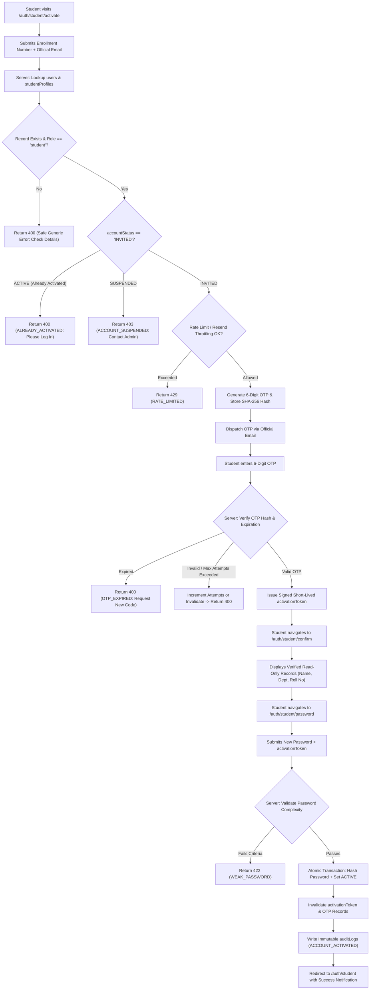

# AUTH-02 — Student Account Activation (OTP)

- **Feature ID:** `AUTH-02`
- **Feature Title:** Student Account Activation (OTP)
- **Domain:** Authentication & Identity
- **Milestone:** Core MVP
- **Status:** Approved Specification (Ready for Implementation)
- **Owning Module:** Module 1: Authentication, Institutional Identity & RBAC
- **Primary SOT References:** `COLLEGE_OS_SOT.md` §6.1, §6.2, §6.6, §6.7, §6.8, §7, §16.0, §16.1, §16.2, §17, §22.2, §22.3, §22.4, §22.5; `FEATURE_INVENTORY.md` (AUTH-02, §1, §6, §7.1, §7.2); Project Plan §4, §6, §16, §17

---

## 1. Executive Summary & Purpose

### 1.1 Purpose
Student Account Activation is the secure, multi-factor onboarding bridge connecting an institutionally pre-provisioned student identity to an active, student-owned user account. In strict accordance with the College OS core invariant—**No Open Registration** (SOT §21.1, §22.2)—students cannot self-register an arbitrary account or choose their institutional attributes. Instead, an eligible student must prove ownership of their pre-provisioned record using a mandatory multi-factor handshake:
$$\text{Enrollment Number / PRN} + \text{Official College Email / Verified Contact} + \text{Time-bound OTP}$$

Upon successful cryptographic OTP verification, the student reviews their verified, read-only institutional data (`fullName`, `department`, `semester`, `section`, `studentId`), optionally initializes showcase portfolio fields (`bio`, `skills`), and sets their private password. The account then transitions atomically from `INVITED` to `ACTIVE`.

### 1.2 In-Scope (Approved Core MVP Scope)
- **Multi-Factor Identity Matching:** Verifying that the submitted Enrollment Number (`studentId`) and official college email match an existing pre-provisioned record in `users` and `studentProfiles`.
- **Time-Bound, Single-Use OTP Verification:** Generating, hashing, dispatching, and verifying a cryptographically secure One-Time Password bound exclusively to student activation.
- **Read-Only Institutional Confirmation:** Displaying verified institutional credentials to the student without permitting client-side mutation of academic records.
- **User Password Creation:** Secure client-side password creation complying with institutional complexity rules, hashed server-side using `bcrypt` (salt rounds &ge; 12).
- **Atomic State Transition:** Updating `users.accountStatus` to `ACTIVE`, setting `isActivated = true`, and stamping `activatedAt = Date.now()`.
- **Invalidation of Activation Secrets:** Immediate single-use consumption and invalidation of the OTP upon completion.
- **Audit Trail Recording:** Writing an immutable audit log entry for the account activation event.

### 1.3 Out-of-Scope (Explicit Non-Goals)
- **No Open Public Self-Registration (SOT §21.1, §22.2):** A student cannot create an account without an existing pre-provisioned institutional record from `AUTH-01`.
- **No Faculty / Staff Activation:** Faculty and non-student staff onboarding is handled separately under `AUTH-04` using Employee IDs (`facultyId`).
- **No Self-Service Academic Field Modification (SOT §8, §16.2):** Students cannot edit their legal name, roll number, department, semester, or section during activation; corrections must go through the registrar via `SHARED-01`.
- **No Plaintext Password Handling by College:** Administrators never generate, see, or transmit passwords; the password is set exclusively by the student.

---

## 2. Actors, Permissions & Ownership

### 2.1 Actors & Roles
| Actor | Role | Access Level | Description / Responsibilities |
| :--- | :--- | :--- | :--- |
| **Unactivated Student** | Public / `INVITED` | Activation Initiation & Completion | Holds a pre-provisioned record. Can initiate activation, submit OTP, confirm read-only details, and create password. |
| **Active Student** | `student` | Ineligible for Activation | Already activated. Cannot reuse this flow; must sign in via Student Login (`AUTH-03`). |
| **Suspended User** | Any (`SUSPENDED`) | Blocked | Under administrative hold. Cannot activate or bypass suspension. |
| **Faculty / Staff** | Non-student | Blocked | Must use Faculty & Staff Activation (`AUTH-04`). |
| **Administrator** | `admin` | Audit & Support | Pre-provisions student records (`AUTH-01`); audits activation logs; cannot bypass user password ownership. |

### 2.2 Security Ownership & Immutability Rules
- **Account Binding:** The activation request binds strictly to the unique `studentProfiles.studentId` and `users.email`.
- **Multi-Factor Rule (SOT §6.2, §22.4):** Enrollment Number alone is **strictly insufficient** for account activation. Because enrollment numbers may be widely known to peers on notice boards or project lists, the multi-factor handshake is mandatory to prevent identity hijacking.
- **Field Immutability (SOT §8, §16.2):** All institutional fields confirmed during step 2 (`fullName`, `studentId`, `department`, `semester`, `section`, `officialEmail`) are populated directly from the database and are immutable.

---

## 3. Related UI Routes & Current Behavior

### 3.1 Primary Frontend Routes
The approved activation flow spans three sequential frontend routes documented in `FEATURE_INVENTORY.md`:

| Route | Step | Screen Title | Key Component File |
| :--- | :--- | :--- | :--- |
| `/auth/student/activate` | Step 1 | Identity Verification & OTP | `frontend/components/auth/StudentActivationPage.jsx` |
| `/auth/student/confirm` | Step 2 | Confirm Institutional Details | `frontend/components/auth/StudentConfirmPage.jsx` |
| `/auth/student/password` | Step 3 | Set Account Password | `frontend/components/auth/StudentPasswordPage.jsx` |

### 3.2 Current UI Behavior & Implementation Gaps
Inspection of the current frontend repository reveals several critical implementation gaps:
1. **Missing OTP Input in Step 1:** In `frontend/components/auth/StudentActivationPage.jsx`, the UI form accepts `enrollmentNo` and `email`, but immediately navigates to `/auth/student/confirm` without displaying an OTP input or challenging the user for an OTP. The OTP handshake exists in marketing copy but is omitted from the UI components.
2. **Client-Side Mock in `AuthProvider.jsx`:** The flow is currently simulated in the browser using `sessionStorage.setItem("college_os_activation_state", ...)`. No REST API calls or backend verification exist.
3. **Editable Bio and Skills in Step 2:** `StudentConfirmPage.jsx` allows adding bio and skills during confirmation. While user-controlled fields may be initialized here, institutional fields must remain read-only.
4. **Missing Challenge Token:** Step 2 and Step 3 currently rely on client-side state flags (`step1Completed`, `step2Completed`), allowing anyone with browser devtools to navigate between routes without backend cryptographic proofs.

---

## 4. End-to-End Activation Flow & Flowcharts

### 4.1 Step-by-Step Activation Lifecycle
1. **Initiation (`/auth/student/activate`):** The student inputs their `enrollmentNo` (`studentId`) and official institutional `email`.
2. **Record Matching & Eligibility Check:** Backend queries `studentProfiles` and `users`. It validates:
   - Record exists and belongs to role `student`.
   - `users.accountStatus === "INVITED"` and `isActivated === false`.
   - If account is `ACTIVE`, `SUSPENDED`, or not found, return safe generic response to prevent identity probing.
3. **OTP Generation & Dispatch:** A cryptographically random 6-digit OTP is generated. A secure SHA-256 hash (`otpHash`) is stored in a temporary activation challenge document with a 10-minute expiry. The raw code is transmitted via the approved college email service.
4. **OTP Submission & Challenge Verification:** The student inputs the 6-digit code. The server verifies:
   - Challenge has not expired (`expiresAt > Date.now()`).
   - Attempt count is below maximum threshold (&le; 5 attempts).
   - SHA-256 hash of entered code matches `otpHash`.
5. **Issuance of Short-Lived Activation Ticket:** Upon successful OTP verification, the server issues a short-lived (15-minute) signed `activationToken` (JWT) containing `{ sub: userId, purpose: "STUDENT_ACTIVATION_CONFIRMED" }`.
6. **Institutional Details Confirmation (`/auth/student/confirm`):** The client presents the `activationToken` to fetch verified, read-only institutional data (`fullName`, `department`, `semester`, `section`, `studentId`).
7. **Password Setup (`/auth/student/password`):** The student provides their chosen password. The client submits the password alongside the `activationToken`.
8. **Final Atomic Activation:**
   - Password is validated against complexity rules and hashed using `bcrypt` (salt rounds &ge; 12).
   - In MongoDB Atlas, `users` is atomically updated: `passwordHash = hash`, `accountStatus = "ACTIVE"`, `isActivated = true`, `activatedAt = new Date()`.
   - `studentProfiles` is updated with any initial portfolio showcase fields (`bio`, `skills`).
   - The temporary OTP challenge and `activationToken` are permanently invalidated.
9. **Hand-Off to Login (SOT §6.2):** The student is redirected to `/auth/student` with a success notice to complete their first authenticated login.

### 4.2 Comprehensive Activation Flowchart



---

## 5. OTP Security, Operational Rules & Threat Mitigations

### 5.1 OTP Generation & Storage Invariants
- **Cryptographic Randomness:** OTPs must be generated using cryptographically secure pseudorandom number generators (e.g. `crypto.randomInt(100000, 999999)`), producing a 6-digit numeric string.
- **No Plaintext OTP Storage:** The raw OTP must **never** be stored in the database. The database must store only a one-way cryptographic hash:
  $$\text{otpHash} = \text{SHA-256}(\text{rawOtp} + \text{serverSalt})$$
- **Strict Purpose & Account Binding:** The OTP document binds strictly to `{ userId, targetEmail, purpose: "STUDENT_ACTIVATION" }`. An OTP issued for activation cannot be accepted for password reset (`AUTH-06`) or staff activation (`AUTH-04`).
- **Single-Use Consumption:** The moment an OTP is successfully verified, its state is marked `isConsumed = true`, or the document is deleted. Replaying the same code is impossible.

### 5.2 Attempt Limits, Expiration & Throttling (Required Operational Controls)
| Operational Control | Requirement / Proposed Parameter | Purpose / Security Defense |
| :--- | :--- | :--- |
| **OTP Lifetime** | 10 Minutes (SOT §17) | Closes window of opportunity for intercepted codes. |
| **Max Verification Attempts**| 5 Attempts per OTP challenge | Prevents brute-force guessing of the 6-digit keyspace ($10^6$). |
| **Resend Cooldown** | 60 Seconds between dispatch requests | Prevents SMS/Email flooding and denial-of-wallet/service. |
| **Max Resends per Day** | 5 Dispatches per 24 hours per account | Blocks persistent spamming of institutional mailboxes. |
| **Concurrent Race Guard** | Atomic conditional update or DB lock | Prevents concurrent duplicate activations of the same account. |

### 5.3 User Enumeration Defense
When an activation request fails at Step 1 (e.g. enrollment number not found or mismatched email), the API returns a uniform, generic error response:
```json
{
  "success": false,
  "error": {
    "code": "INVALID_ACTIVATION_CREDENTIALS",
    "message": "We could not find an unactivated student record matching this Enrollment Number and Email. Please verify your details or contact the college registrar."
  }
}
```
*Note:* If an account is already `ACTIVE`, returning a clear instruction to navigate to `/auth/student` is acceptable for user experience, provided it is rate-limited against scraping.

---

## 6. Proposed Data Models & Constraints

### 6.1 Temporary Collection: `otpChallenges`
A dedicated operational collection for managing activation and password reset tokens:

```typescript
import { Schema, Document, Types } from 'mongoose';

export interface IOtpChallenge extends Document {
  _id: Types.ObjectId;
  userId: Types.ObjectId;        // References users._id
  targetEmail: string;           // Canonical institutional email
  otpHash: string;               // SHA-256 hash of the 6-digit code
  purpose: 'STUDENT_ACTIVATION' | 'STAFF_ACTIVATION' | 'PASSWORD_RESET';
  attemptsCount: number;         // Incremented on every failed verify attempt
  maxAttempts: number;           // Defaults to 5
  isConsumed: boolean;           // Marked true upon verification
  expiresAt: Date;               // TTL index: 10 minutes from creation
  createdAt: Date;
  updatedAt: Date;
}

const OtpChallengeSchema = new Schema<IOtpChallenge>(
  {
    userId: { type: Schema.Types.ObjectId, ref: 'User', required: true, index: true },
    targetEmail: { type: String, required: true, lowercase: true, trim: true },
    otpHash: { type: String, required: true },
    purpose: {
      type: String,
      required: true,
      enum: ['STUDENT_ACTIVATION', 'STAFF_ACTIVATION', 'PASSWORD_RESET']
    },
    attemptsCount: { type: Number, default: 0 },
    maxAttempts: { type: Number, default: 5 },
    isConsumed: { type: Boolean, default: false },
    expiresAt: { type: Date, required: true }
  },
  { timestamps: true }
);

// MongoDB TTL Index: Automatically purges expired OTP documents
OtpChallengeSchema.index({ expiresAt: 1 }, { expireAfterSeconds: 0 });
OtpChallengeSchema.index({ userId: 1, purpose: 1, isConsumed: 1 });
```

---

## 7. Proposed API Contracts (Documentation Proposals)

> [!NOTE]
> The Feature Inventory notes for `AUTH-02`: *"Routes: /auth/student/activate, /auth/student/confirm, /auth/student/password (simulated in browser)"*. The following contracts are **proposed architectural REST contracts** for backend implementation. They do not represent existing endpoints.

### 7.1 `POST /api/v1/auth/student/activate/initiate` (Proposed)
Initiates the activation handshake by validating the institutional record and dispatching an OTP.

- **Authentication:** Public (Unauthenticated)
- **Request Body:**
  ```json
  {
    "enrollmentNo": "CS-2022-049",
    "email": "aarav.sharma@csmu.edu.in"
  }
  ```
- **Success Response (`200 OK`):**
  ```json
  {
    "success": true,
    "data": {
      "message": "A 6-digit verification code has been dispatched to your official college email.",
      "maskedEmail": "aa******@csmu.edu.in",
      "expiresInSeconds": 600
    }
  }
  ```
- **Error Responses:**
  - `400 BAD_REQUEST`: `{ "success": false, "error": { "code": "INVALID_ACTIVATION_CREDENTIALS", "message": "Record match failed." } }`
  - `400 BAD_REQUEST`: `{ "success": false, "error": { "code": "ALREADY_ACTIVATED", "message": "This account is already active. Please sign in." } }`
  - `403 FORBIDDEN`: `{ "success": false, "error": { "code": "ACCOUNT_SUSPENDED", "message": "Account is suspended. Contact administration." } }`
  - `429 TOO_MANY_REQUESTS`: `{ "success": false, "error": { "code": "RATE_LIMITED", "message": "Please wait 60 seconds before requesting another code." } }`

---

### 7.2 `POST /api/v1/auth/student/activate/verify-otp` (Proposed)
Verifies the submitted OTP against the stored SHA-256 hash and issues a short-lived activation ticket.

- **Authentication:** Public
- **Request Body:**
  ```json
  {
    "enrollmentNo": "CS-2022-049",
    "email": "aarav.sharma@csmu.edu.in",
    "otp": "849201"
  }
  ```
- **Success Response (`200 OK`):**
  ```json
  {
    "success": true,
    "data": {
      "message": "Identity verified successfully.",
      "activationToken": "eyJhbGciOiJIUzI1NiIsInR5cCI6IkpXVCJ9.eyJzdWIiOiI2NWYyYTF...",
      "studentDetails": {
        "studentId": "CS-2022-049",
        "rollNumber": "CSE-302",
        "fullName": "Aarav Sharma",
        "department": "CSE",
        "semester": 7,
        "section": "A",
        "officialEmail": "aarav.sharma@csmu.edu.in"
      }
    }
  }
  ```
- **Error Responses:**
  - `400 BAD_REQUEST`: `{ "success": false, "error": { "code": "OTP_INVALID", "message": "Incorrect verification code. 4 attempts remaining." } }`
  - `400 BAD_REQUEST`: `{ "success": false, "error": { "code": "OTP_EXPIRED", "message": "Verification code has expired. Please request a new one." } }`
  - `429 TOO_MANY_REQUESTS`: `{ "success": false, "error": { "code": "MAX_ATTEMPTS_EXCEEDED", "message": "Maximum verification attempts exceeded. Code invalidated." } }`

---

### 7.3 `POST /api/v1/auth/student/activate/complete` (Proposed)
Completes the activation by creating the user password and updating the account state to `ACTIVE`.

- **Authentication:** Requires `activationToken` presented in the `Authorization: Bearer <token>` header or request body.
- **Request Body:**
  ```json
  {
    "activationToken": "eyJhbGciOiJIUzI1NiIsIn...",
    "password": "SecurePassword@2026",
    "bio": "Full-stack developer passionate about distributed systems.",
    "skills": ["React", "Node.js", "MongoDB"]
  }
  ```
- **Success Response (`200 OK`):**
  ```json
  {
    "success": true,
    "data": {
      "message": "Account successfully activated! Please sign in with your enrollment number and new password.",
      "redirectTo": "/auth/student"
    }
  }
  ```
- **Error Responses:**
  - `400 BAD_REQUEST`: `{ "success": false, "error": { "code": "TOKEN_INVALID", "message": "Activation challenge token is invalid or expired." } }`
  - `409 CONFLICT`: `{ "success": false, "error": { "code": "ALREADY_ACTIVATED", "message": "Account was activated in another session." } }`
  - `422 UNPROCESSABLE`: `{ "success": false, "error": { "code": "WEAK_PASSWORD", "message": "Password must be at least 8 characters and contain uppercase, lowercase, numbers, and symbols." } }`
- **Side Effects:**
  - `users.passwordHash` set to bcrypt hash of `password`.
  - `users.accountStatus` updated to `ACTIVE`.
  - `users.isActivated` set to `true`.
  - `users.activatedAt` set to current timestamp.
  - Optional `studentProfiles.bio` and `skills` updated.
  - Challenge invalidated.
  - Immutable audit record written to `auditLogs`.

---

## 8. Cross-Cutting Concerns

- **Auditing (SOT §6.8, §16, Inventory §6):** Every successful student activation must write an audit record to `auditLogs`:
  ```typescript
  {
    actorUserId: user._id,
    actorRole: "student",
    action: "STUDENT_ACCOUNT_ACTIVATED",
    targetResourceId: user._id,
    details: {
      studentId: studentProfile.studentId,
      officialEmail: user.email,
      ipAddress: req.ip,
      userAgent: req.headers["user-agent"]
    },
    timestamp: new Date()
  }
  ```
- **Logging Safety:** Under no circumstances may plaintext passwords, bcrypt hashes, raw OTP codes, or activation tokens be printed to application logs or console streams.
- **Session Hand-Off Protocol:** Per SOT §6.2 ("Student logs in via Student Login -> Student Dashboard"), upon activation completion, the user is redirected to `/auth/student` with a success alert to establish their first official session via `AUTH-03` and `AUTH-07`. The activation endpoint itself does **not** set a client session cookie.

---

## 9. Architectural Do's and Don'ts

| Do | Don't |
| :--- | :--- |
| **Do** verify `Enrollment Number` + `Official Email` + `OTP` before activating. | **Don't** allow activation via Enrollment Number alone (SOT §6.2). |
| **Do** store only one-way cryptographic hashes (`otpHash`) of OTP codes. | **Don't** store plaintext OTP codes in the database. |
| **Do** enforce read-only locking on institutional fields during activation. | **Don't** allow students to mutate their official name, department, or roll number. |
| **Do** use atomic MongoDB operations to prevent race conditions during activation. | **Don't** allow two concurrent requests to activate the same record twice. |
| **Do** invalidate the OTP and activation token immediately upon completion. | **Don't** allow reuse of activation tokens for session creation or password resets. |

---

## 10. Acceptance Criteria & Test Scenarios

### 10.1 Acceptance Criteria
- [ ] **AC-1:** Only pre-provisioned records with `role === "student"`, `accountStatus === "INVITED"`, and `isActivated === false` can be activated.
- [ ] **AC-2:** Submitting an unprovisioned or mismatched Enrollment Number and Email returns a safe generic failure without leaking user existence.
- [ ] **AC-3:** OTP codes are time-limited (10-minute expiry) and single-use; entering an expired or previously consumed OTP is rejected.
- [ ] **AC-4:** OTP verification is protected by attempt limits (&le; 5 attempts); exceeding the limit invalidates the code.
- [ ] **AC-5:** Passwords must satisfy institutional complexity rules (&ge; 8 chars, uppercase, lowercase, number, symbol) and be hashed via `bcrypt` (salt rounds &ge; 12).
- [ ] **AC-6:** Institutional fields confirmed in Step 2 (`fullName`, `studentId`, `department`, `semester`, `section`) are strictly read-only.
- [ ] **AC-7:** Successful activation atomically updates `accountStatus` to `ACTIVE`, sets `isActivated = true`, and writes an immutable audit record.
- [ ] **AC-8:** Accounts with status `ACTIVE`, `SUSPENDED`, or `GRADUATED` cannot be activated through this flow.

### 10.2 Positive Test Scenarios
1. **Happy Path Activation:**
   - *Given:* Pre-provisioned student record with `accountStatus: "INVITED"`.
   - *When:* Student inputs correct Enrollment No and Email &rarr; receives 6-digit OTP &rarr; submits valid OTP within 10 min &rarr; confirms read-only details &rarr; sets compliant password.
   - *Then:* Server updates account to `ACTIVE`, stores bcrypt hash, consumes OTP, writes audit log, and redirects to login with 200 OK.

### 10.3 Negative & Security Test Scenarios
1. **Unprovisioned Enrollment Number:** Student submits arbitrary roll number `99ZZ999` &rarr; returns `400 BAD_REQUEST` with generic error.
2. **Mismatched Contact:** Student submits valid `studentId` but personal Gmail address &rarr; returns `400 BAD_REQUEST`.
3. **Already Activated Account:** Student whose account is already `ACTIVE` attempts activation &rarr; returns `400 BAD_REQUEST` (`ALREADY_ACTIVATED`).
4. **Suspended Account:** Student whose account is `SUSPENDED` attempts activation &rarr; returns `403 FORBIDDEN` (`ACCOUNT_SUSPENDED`).
5. **Expired OTP Submission:** Student submits correct OTP after 11 minutes &rarr; returns `400 BAD_REQUEST` (`OTP_EXPIRED`).
6. **OTP Brute-Force Exhaustion:** Attacker enters 5 incorrect OTP guesses &rarr; challenge is invalidated; 6th attempt returns `429 TOO_MANY_REQUESTS` or `400 BAD_REQUEST`.
7. **Wrong Purpose Replay:** Attacker attempts to use a password reset OTP for student activation &rarr; rejected with `400 BAD_REQUEST`.
8. **Weak Password Rejection:** Student submits password `secret` &rarr; rejected with `422 UNPROCESSABLE` (`WEAK_PASSWORD`).
9. **Concurrent Activation Race:** Two simultaneous activation completion requests send different passwords &rarr; first request commits; second request fails with `409 CONFLICT` (`ALREADY_ACTIVATED`).
10. **Institutional Field Tampering:** Client modifies `fullName` in the completion payload &rarr; server ignores the field or rejects with `400 BAD_REQUEST`.

---

## 11. Dependencies & Cross-Feature Interactions

### 11.1 Upstream Dependencies
- **`AUTH-01 — Institutional User Provisioning`:** Creates pre-provisioned records with `accountStatus = "INVITED"`.
- **`SHARED-01 — User Identity & Profile Foundation`:** Defines `users` and `studentProfiles` data schemas.
- **`SHARED-02 — Roles & Permissions (RBAC)`:** Enforces lifecycle state transitions.

### 11.2 Downstream Dependents
- **`AUTH-03 — Student Login`:** Consumes credentials created in this flow for session issuance.
- **`AUTH-07 — Session, Logout & Route Protection`:** Manages JWT cookies issued after login.
- **`STU-01 — Student Dashboard`:** Landing workspace after first login.

---

## 12. Decision Log & Gaps

### 12.1 Resolved Design Decisions
- **No Open Self-Registration (SOT §6.1, §22.2):** Resolved. Pre-provisioning by institution is mandatory.
- **Multi-Factor Requirement (SOT §6.2, §22.4):** Resolved. Enrollment Number + Official Email + OTP is required.
- **User Password Ownership (SOT §6.7, §22.5):** Resolved. Student creates password; hashed via bcrypt.
- **Institutional Field Immutability (SOT §8, §16.2):** Resolved. Institutional records confirmed in Step 2 cannot be edited.

### 12.2 Genuinely Open Decisions (Inventory §7.2)
1. **OTP Delivery Provider:** Concrete email or SMS service provider (e.g. Amazon SES, SendGrid, Twilio) is unselected.
2. **Final Password Policy Parameters:** The current baseline requires 8+ characters, mixed case, numbers, and symbols. Confirmation of exact institutional minimums (e.g. 10 or 12 characters) remains open with administration.
3. **Resend and Rate-Limit Thresholds:** Baseline recommendations (60s cooldown, 5 attempts max, 5 resends/day) require institutional IT confirmation.

### 12.3 Existing UI Gaps to Address
- **Missing OTP Input Form:** `frontend/components/auth/StudentActivationPage.jsx` must be updated to include the OTP entry and verification step before advancing to `/auth/student/confirm`.
- **Remove Fake Session Storage:** Replace `sessionStorage` mock in `AuthProvider.jsx` with real REST API endpoints (`/api/v1/auth/student/activate/*`).

---

## 13. Traceability Matrix

| SOT Section | Project Plan Section | Feature Inventory ID | Verification Method |
| :--- | :--- | :--- | :--- |
| SOT §6.2 (Student Activation Workflow) | Plan §6.1 (Onboarding) | `AUTH-02` | Integration Test: 3-Step Multi-Factor Activation Flow |
| SOT §6.7 (Password Ownership) | Plan §6.3 (Security) | `AUTH-02` | Unit Test: Client Password Creation & Bcrypt Hashing |
| SOT §6.8 (Account Lifecycle Machine) | Plan §6.2 (Lifecycle) | `AUTH-02` / `AUTH-01` | State Machine Test: `INVITED` &rarr; `ACTIVE` Transition |
| SOT §17 (Authentication Data Model) | Plan §17.1 (Auth Model) | `AUTH-02` | Database Test: OTP Hash, Expiration & Consumption |
| SOT §22.4 (Multi-Factor Security Rule) | Plan §21.1 (Non-Goals) | `AUTH-02` | Security Test: Rejection of Single-Factor Activation |

