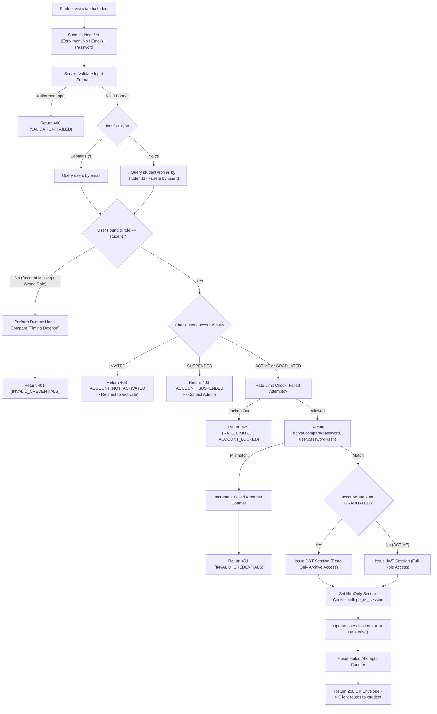

# AUTH-03 — Student Login

- **Feature ID:** `AUTH-03`
- **Feature Title:** Student Login
- **Domain:** Authentication & Identity
- **Milestone:** Core MVP
- **Status:** Approved Specification (Ready for Implementation)
- **Owning Module:** Module 1: Authentication, Institutional Identity & RBAC
- **Primary SOT References:** `COLLEGE_OS_SOT.md` §6.1, §6.2, §6.6, §6.7, §6.8, §7, §16.0, §16.1, §16.2, §17, §18, §21.1, §22.1, §22.2, §22.8; `FEATURE_INVENTORY.md` (AUTH-03, §1, §6, §7.1, §7.2); Project Plan §4, §6, §16, §17

---

## 1. Executive Summary & Purpose

### 1.1 Purpose
Student Login is the primary daily authentication gateway for enrolled and graduated students in College OS. It allows an active student to authenticate securely using either their institutional Enrollment Number / PRN (e.g. `CS-2022-049`) or their official college email address (e.g. `aarav.sharma@csmu.edu.in`), paired with their private password created during activation (`AUTH-02`).

Upon successful credential verification and lifecycle validation, the backend issues a secure, server-controlled HttpOnly JWT session cookie (`college_os_session`) conforming to SOT §17 and redirects the student to the Student Dashboard (`STU-01`). Client-supplied roles, IDs, or session flags are strictly disregarded; all authorization derives from database authority.

### 1.2 In-Scope (Approved Core MVP Scope)
- **Dual-Identifier Authentication:** Authenticating students via either Enrollment Number (`studentProfiles.studentId`) or official institutional email (`users.email`).
- **Cryptographic Credential Verification:** Constant-time password verification using `bcrypt.compare` against the stored `users.passwordHash`.
- **Server-Enforced Lifecycle Gating (SOT §6.8):**
  - `ACTIVE`: Full login access to role-permitted student features.
  - `GRADUATED`: Permitted login for read-only archive access to past transcripts, grade cards, and portfolio; write operations remain strictly blocked.
  - `SUSPENDED`: Login rejected immediately with `403 FORBIDDEN` (`ACCOUNT_SUSPENDED`).
  - `INVITED`: Login rejected with `403 FORBIDDEN` (`ACCOUNT_NOT_ACTIVATED`), directing user to activation (`AUTH-02`).
- **Server-Issued Secure Session Hand-Off (SOT §17, `AUTH-07`):** Setting the `college_os_session` HttpOnly cookie containing signed claims (`userId`, `role: "student"`, `institutionId`).
- **Anti-Enumeration Defense & Rate Limiting:** Returning uniform, generic error responses on failed login attempts and enforcing request throttling to block brute-force and credential-stuffing attacks.
- **Login Audit & Timestamping:** Updating `users.lastLoginAt` and logging successful and security-flagged login events.

### 1.3 Out-of-Scope (Explicit Non-Goals)
- **No Open Public Registration (SOT §21.1, §22.2):** Self-registration is strictly rejected. An account must be pre-provisioned (`AUTH-01`) and activated (`AUTH-02`) before login is possible.
- **No Faculty / Staff Login:** Faculty, HOD, Principal, VP, and Admin log in through the unified Staff Login portal (`AUTH-05`) at `/auth/faculty` or `/auth/staff/login`.
- **No Client-Set Session Cookies:** Browser JavaScript is strictly barred from setting or reading session cookies. The legacy `college_os_session=true` cookie placeholder is rejected.
- **No Direct Password Resets on Login Screen:** Password recovery is delegated to the dedicated password reset flow (`AUTH-06`).

---

## 2. Actors, Permissions & Ownership

### 2.1 Actors & Roles
| Actor | Role / State | Permitted Action | Access Restrictions & Behavior |
| :--- | :--- | :--- | :--- |
| **Active Student** | `student` (`ACTIVE`) | Full Student Login | Authenticates, receives session cookie, and enters student workspace. |
| **Graduated Student** | `student` (`GRADUATED`) | Archive Student Login | Authenticates, receives session cookie with read-only enforcement downstream. |
| **Unactivated Student** | `student` (`INVITED`) | Blocked | Rejected with `403 FORBIDDEN` (`ACCOUNT_NOT_ACTIVATED`); directed to `/auth/student/activate`. |
| **Suspended Student** | `student` (`SUSPENDED`) | Blocked | Rejected with `403 FORBIDDEN` (`ACCOUNT_SUSPENDED`); account locked by administration. |
| **Staff Roles** | `faculty`, `hod`, `principal`, `vp`, `admin` | Blocked on Student Route | Directed to Staff Login (`/auth/faculty` or `/auth/staff/login`). |
| **Unprovisioned User** | Public / Unknown | Blocked | Rejected with generic `401 UNAUTHORIZED` (`INVALID_CREDENTIALS`). |

### 2.2 Identity Resolution & Ownership Rules
- **No Client Trust (SOT §22.8):** The login endpoint does not accept a `role`, `permissions`, or `studentId` from client payloads. The backend queries `users` and linked `studentProfiles` exclusively by the submitted identifier.
- **Role Verification:** The backend strictly verifies that the matched account holds `role === "student"`. If a staff member attempts logging in via the student route, the system rejects the attempt or routes them to the staff portal.
- **Profile Integrity:** The backend ensures that a linked `studentProfiles` record exists with matching `userId`. If corrupted or missing, login aborts with `500 INTERNAL_SERVER_ERROR` and an administrative alert.

---

## 3. Related UI Routes & Current Behavior

### 3.1 Primary Frontend Routes
| Route | Access Guard | Current Repo Implementation | Key Component File |
| :--- | :--- | :--- | :--- |
| `/auth/student` | Public (Redirects to `/student` if authenticated) | Implemented (Demo mock) | `frontend/components/auth/StudentLoginPage.jsx`<br>`frontend/app/auth/student/page.jsx` |
| `/` (Root) | Public | Redirects to `/auth/student` | `frontend/app/page.js` |
| `/auth/forgot-password?role=student` | Public | Implemented | `frontend/components/auth/ForgotPasswordPage.jsx` |
| `/auth/student/activate` | Public | Implemented | `frontend/components/auth/StudentActivationPage.jsx` |

### 3.2 Current UI Implementation Gaps & Deviations
1. **Contradictory "Create an Account" UI Action:**
   - In `frontend/components/auth/StudentLoginPage.jsx` (lines 73–76), the top navigation bar displays:
     `label: "New to College OS?", actionLabel: "Create an Account", href: "/auth/student/activate"`.
   - *Deviation:* SOT §21.1 and §22.2 strictly forbid open self-registration. Offering "Create an Account" misleads students into assuming open signup exists.
   - *Required UI Fix:* Redefine the action label to **"Activate Account"** or **"First Time? Activate Account"**, linking to `/auth/student/activate`.
2. **Demo Password Bypass in `AuthProvider.jsx`:**
   - The current mock in `frontend/components/providers/AuthProvider.jsx` (`login()`) accepts any arbitrary password for demo accounts, sets a plain readable cookie `college_os_session=true`, and stores mock user state in `localStorage`.
   - *Required Fix:* Wire the form to the authoritative backend endpoint `POST /api/v1/auth/student/login` and receive a server-issued HttpOnly cookie.
3. **Demo Quick-Fill Helper:**
   - `StudentLoginPage.jsx` contains a development helper `fillDemoStudent()` populating `22CS087` / `CollegeOS@2026`. This must be restricted to non-production environments.

---

## 4. User Workflows & Flowcharts

### 4.1 Student Login Workflow
1. **Submission:** Student navigates to `/auth/student` and enters an identifier (`enrollmentNo` or official email) plus password.
2. **Sanitization & Format Check:** The server trims whitespace, normalizes email to lowercase, converts enrollment number to uppercase, and rejects empty fields.
3. **Account Lookup:**
   - If identifier contains `@`, query `users.findOne({ email: identifier.toLowerCase() })`.
   - Otherwise, query `studentProfiles.findOne({ studentId: identifier.toUpperCase() })` and load linked `users` record via `userId`.
4. **Anti-Enumeration Timing Protection:** If no matching record is found or role is not `student`, perform a dummy bcrypt comparison against a dummy hash to prevent timing-based user enumeration, then return generic `401 UNAUTHORIZED`.
5. **Lifecycle Verification (SOT §6.8):**
   - If `accountStatus === "INVITED"`: Return `403 FORBIDDEN` (`ACCOUNT_NOT_ACTIVATED`), indicating account must be activated first.
   - If `accountStatus === "SUSPENDED"`: Return `403 FORBIDDEN` (`ACCOUNT_SUSPENDED`), indicating administrative hold.
   - If `accountStatus === "GRADUATED"`: Proceed with login; session downstream enforces read-only archive access.
   - If `accountStatus === "ACTIVE"`: Proceed with login.
6. **Password Verification:** Execute `bcrypt.compare(password, user.passwordHash)`. If mismatch, increment failed attempts counter, log security event, and return generic `401 UNAUTHORIZED`.
7. **Session Issuance & Hand-Off:**
   - Reset failed login attempt counter.
   - Update `users.lastLoginAt = new Date()`.
   - Sign JWT carrying `{ sub: user._id, role: "student", institutionId: user.institutionId }`.
   - Set `college_os_session` HttpOnly cookie.
   - Return `200 OK` with user and student profile data envelope.
8. **Navigation:** Client redirects student to `/student` (Student Dashboard).

### 4.2 Comprehensive Student Login Flowchart



---

## 5. Business Rules, Validations & State Transitions

### 5.1 Business Rules & Security Invariants
1. **Authoritative Backend Credentials:** Authentication validity is determined strictly by the server matching `password` against `passwordHash`.
2. **Account State Gating (SOT §6.8):**
   - An account with `accountStatus === "INVITED"` cannot authenticate under any circumstances; the response directs the user to `AUTH-02`.
   - An account with `accountStatus === "SUSPENDED"` cannot authenticate; all previously issued sessions are invalidated by `lifecycleGuard` on protected endpoints.
   - An account with `accountStatus === "GRADUATED"` can authenticate to access read-only records; downstream mutations return `403 FORBIDDEN` (`ACCOUNT_GRADUATED_READ_ONLY`).
3. **Anti-Enumeration Rule:** The server returns identical generic error messages (`INVALID_CREDENTIALS`) regardless of whether the Enrollment Number does not exist or the password was incorrect.
4. **Timing Attack Protection:** When an account is not found, the server executes a fixed-cost dummy bcrypt operation to match response timing with valid accounts.
5. **Session Isolation:** The issued session is bound to the institutional tenancy (`institutionId`) and user identity (`userId`).

### 5.2 Server-Side Validations
| Field / Parameter | Validation Rules & Constraints | Error Code | HTTP Status |
| :--- | :--- | :--- | :--- |
| `identifier` | Required, string, trimmed, min 4 chars, max 100 chars | `INVALID_IDENTIFIER` | 400 |
| `password` | Required, string, non-empty, max 128 chars | `PASSWORD_REQUIRED` | 400 |
| `rememberMe` | Optional, boolean (defaults to false) | `INVALID_PAYLOAD` | 400 |

### 5.3 Attempt Limits & Lockout Policy (Proposed Defaults)
To protect students against automated brute-force attacks:
- **Max Consecutive Failed Attempts:** 5 failed attempts per account or IP within 15 minutes.
- **Lockout Duration:** 15 minutes temporary hold on exceeding limit.
- **Response upon Lockout:** Returns `429 TOO_MANY_REQUESTS` with error code `RATE_LIMITED` and a `Retry-After: 900` header.
- *(Note: Exact lockout duration and attempt limits are proposed defaults requiring institutional IT confirmation).*

---

## 6. Proposed Data Models & Session Specification

### 6.1 Database Fields Utilized
Student Login operates on existing MongoDB Atlas collections defined in SOT §16.1 and §16.2:

```typescript
// users collection lookup
interface IUserAuthLookup {
  _id: Types.ObjectId;
  institutionId: Types.ObjectId;
  email: string;
  passwordHash: string;          // bcrypt hash
  role: 'student';
  accountStatus: 'INVITED' | 'ACTIVE' | 'SUSPENDED' | 'GRADUATED';
  isActivated: boolean;
  lastLoginAt?: Date;
}

// studentProfiles collection lookup
interface IStudentProfileLookup {
  _id: Types.ObjectId;
  userId: Types.ObjectId;
  studentId: string;             // Enrollment Number / PRN
  fullName: string;
  department: string;
  semester: number;
  section: string;
  academicStatus: 'REGULAR' | 'PROBATION' | 'GRADUATED';
}
```

### 6.2 Session Cookie Specification (SOT §17, `AUTH-07`)
Upon successful login, the server sets a cookie with the following locked attributes:
- **Cookie Name:** `college_os_session`
- **HttpOnly:** `true` (strictly inaccessible to document JavaScript, preventing XSS token theft)
- **Secure:** `true` in production (transmitted only over TLS/HTTPS)
- **SameSite:** `"Lax"` or `"Strict"` (CSRF defense)
- **Path:** `"/"`
- **Max-Age / Expiry:**
  - Standard session: 24 hours (`86400` seconds).
  - "Remember Me" checked: 7 days (`604800` seconds) — *proposed default*.
- **Token Claims Payload:**
  ```json
  {
    "sub": "65f2a1b9c0a1b2c3d4e5f6a1",
    "role": "student",
    "institutionId": "65f29a00b1c2d3e4f5a6b7c8",
    "iat": 1711500000,
    "exp": 1711586400
  }
  ```

---

## 7. Proposed API Contracts (Documentation Proposals)

> [!NOTE]
> The Feature Inventory notes for `AUTH-03`: *"Routes: /auth/student (the site root / redirects here)"*. The following contract is a **proposed architectural REST contract** for backend implementation. It does not represent an existing endpoint.

### 7.1 `POST /api/v1/auth/student/login` (Proposed)
Authenticates an eligible student and establishes a server-issued session cookie.

- **Authentication:** Public (Unauthenticated)
- **Request Headers:**
  ```http
  Content-Type: application/json
  ```
- **Request Body:**
  ```json
  {
    "identifier": "CS-2022-049",
    "password": "SecurePassword@2026",
    "rememberMe": true
  }
  ```
- **Success Response (`200 OK`):**
  ```http
  HTTP/1.1 200 OK
  Set-Cookie: college_os_session=eyJhbGciOiJIUzI1NiIsIn...; Path=/; HttpOnly; Secure; SameSite=Lax; Max-Age=604800
  Content-Type: application/json

  {
    "success": true,
    "data": {
      "user": {
        "id": "65f2a1b9c0a1b2c3d4e5f6a1",
        "email": "aarav.sharma@csmu.edu.in",
        "role": "student",
        "accountStatus": "ACTIVE"
      },
      "profile": {
        "id": "65f2a1b9c0a1b2c3d4e5f6a2",
        "studentId": "CS-2022-049",
        "rollNumber": "CSE-302",
        "fullName": "Aarav Sharma",
        "department": "CSE",
        "semester": 7,
        "section": "A",
        "academicStatus": "REGULAR"
      },
      "redirectTo": "/student"
    }
  }
  ```
- **Error Responses:**
  - `400 BAD_REQUEST`: `{ "success": false, "error": { "code": "VALIDATION_FAILED", "message": "Identifier and password are required." } }`
  - `401 UNAUTHORIZED`: `{ "success": false, "error": { "code": "INVALID_CREDENTIALS", "message": "Invalid Enrollment Number/Email or password." } }`
  - `403 FORBIDDEN`: `{ "success": false, "error": { "code": "ACCOUNT_NOT_ACTIVATED", "message": "Your account has not been activated yet. Please activate your account first.", "redirectTo": "/auth/student/activate" } }`
  - `403 FORBIDDEN`: `{ "success": false, "error": { "code": "ACCOUNT_SUSPENDED", "message": "Your account is placed on administrative hold. Please contact the registrar." } }`
  - `429 TOO_MANY_REQUESTS`: `{ "success": false, "error": { "code": "RATE_LIMITED", "message": "Too many failed login attempts. Please try again in 15 minutes." } }`

---

## 8. Cross-Cutting Concerns

- **Auditing (SOT §6.8, §16, Inventory §6):**
  - Successful logins update `users.lastLoginAt = new Date()`.
  - Security-flagged events (e.g. 5 consecutive failed login attempts, login attempts against suspended accounts, or brute-force lockouts) are logged to `auditLogs`:
    ```typescript
    {
      actorUserId: user?._id || null,
      actorRole: "student",
      action: "AUTH_LOGIN_FAILED_THRESHOLD",
      targetResourceId: user?._id || null,
      details: {
        identifierSubmitted: "CS-2022-049",
        ipAddress: req.ip,
        userAgent: req.headers["user-agent"],
        failureReason: "MAX_FAILED_ATTEMPTS"
      },
      timestamp: new Date()
    }
    ```
- **Logging Safety:** Under no circumstances may passwords, password hashes, or raw session tokens be written to application logs or console streams.
- **Root Path Redirection:** The application root `/` checks for the presence of an authenticated session cookie:
  - If valid student session: Redirect to `/student`.
  - If valid staff session: Redirect to `/faculty`.
  - If unauthenticated: Redirect to `/auth/student`.

---

## 9. Architectural Do's and Don'ts

| Do | Don't |
| :--- | :--- |
| **Do** verify passwords using `bcrypt.compare` against `users.passwordHash`. | **Don't** accept plaintext passwords or skip verification for "demo" accounts. |
| **Do** issue server-controlled HttpOnly cookies (`college_os_session`). | **Don't** set client-readable cookies (`college_os_session=true`) via JavaScript. |
| **Do** return generic error messages on failure to prevent user enumeration. | **Don't** reveal whether an Enrollment Number exists when a password is wrong. |
| **Do** permit graduated students to log in for read-only archive access. | **Don't** grant write/mutation permissions to graduated accounts. |
| **Do** reject unactivated accounts with a clear redirect to `/auth/student/activate`. | **Don't** permit unactivated (`INVITED`) accounts to sign in. |

---

## 10. Acceptance Criteria & Test Scenarios

### 10.1 Acceptance Criteria
- [ ] **AC-1:** Students can log in using either their Enrollment Number (`studentId`) or official institutional email.
- [ ] **AC-2:** Passwords are cryptographically verified using `bcrypt`; incorrect passwords fail with `401 UNAUTHORIZED`.
- [ ] **AC-3:** Successful login sets a server-issued `college_os_session` HttpOnly cookie and updates `lastLoginAt`.
- [ ] **AC-4:** Unactivated accounts (`accountStatus === "INVITED"`) cannot log in and receive `403 FORBIDDEN` (`ACCOUNT_NOT_ACTIVATED`).
- [ ] **AC-5:** Suspended accounts (`accountStatus === "SUSPENDED"`) cannot log in and receive `403 FORBIDDEN` (`ACCOUNT_SUSPENDED`).
- [ ] **AC-6:** Graduated accounts (`accountStatus === "GRADUATED"`) can log in to view read-only archive records, but downstream mutations are blocked.
- [ ] **AC-7:** Staff accounts cannot log in via the student route; they are directed to the staff login portal.
- [ ] **AC-8:** Consecutive failed attempts trigger rate limiting and temporary IP/account lockout.

### 10.2 Positive Test Scenarios
1. **Login by Enrollment Number:** Active student enters `CS-2022-049` and correct password &rarr; receives 200 OK and `college_os_session` cookie; redirected to `/student`.
2. **Login by Official Email:** Active student enters `aarav.sharma@csmu.edu.in` and correct password &rarr; receives 200 OK and session cookie.
3. **Graduated Student Archive Login:** Student with status `GRADUATED` enters credentials &rarr; receives 200 OK and session cookie; dashboard reflects read-only archive mode.

### 10.3 Negative & Security Test Scenarios
1. **Incorrect Password:** Active student submits valid enrollment number but incorrect password &rarr; receives `401 UNAUTHORIZED` (`INVALID_CREDENTIALS`).
2. **Unprovisioned Identity:** User submits non-existent enrollment number `ZZ-9999-999` &rarr; receives identical `401 UNAUTHORIZED` (`INVALID_CREDENTIALS`) after dummy hash delay.
3. **Unactivated Account Attempt:** Student with `accountStatus === "INVITED"` submits correct password &rarr; receives `403 FORBIDDEN` (`ACCOUNT_NOT_ACTIVATED`) with link to `/auth/student/activate`.
4. **Suspended Account Attempt:** Student with `accountStatus === "SUSPENDED"` submits credentials &rarr; receives `403 FORBIDDEN` (`ACCOUNT_SUSPENDED`).
5. **Staff Role Login Attempt:** Faculty member enters employee ID on student login form &rarr; receives `401 UNAUTHORIZED` or redirect to `/auth/faculty`.
6. **Client-Side Cookie Spoofing:** User manually creates browser cookie `college_os_session=true` and attempts to open `/student` &rarr; protected route rejects request with `401 UNAUTHORIZED`.
7. **Brute-Force Rate Limiting:** Attacker submits 5 incorrect passwords within 2 minutes &rarr; 6th attempt returns `429 TOO_MANY_REQUESTS` (`RATE_LIMITED`).
8. **Broken Profile Linkage:** User record exists with `role: "student"` but no corresponding `studentProfiles` record &rarr; server logs error and returns `500 INTERNAL_SERVER_ERROR`.

---

## 11. Dependencies & Cross-Feature Interactions

### 11.1 Upstream Dependencies
- **`AUTH-01 — Institutional User Provisioning`:** Creates pre-provisioned user records and initial `accountStatus`.
- **`AUTH-02 — Student Account Activation`:** Hashes user password and transitions status to `ACTIVE`.
- **`SHARED-01 — User Identity & Profile Foundation`:** Defines user and profile schemas and ownership boundaries.
- **`SHARED-02 — Roles & Permissions (RBAC)`:** Enforces authoritative roles on downstream protected endpoints.

### 11.2 Downstream Dependents
- **`AUTH-07 — Session, Logout & Route Protection`:** Manages JWT validation, cookie lifetime, and logout.
- **`STU-01 — Student Dashboard`:** Landing page following successful login.
- **All Student Features (`STU-02` through `STU-17`):** Protected by the session established here.

---

## 12. Decision Log & Gaps

### 12.1 Resolved Design Decisions
- **Dual Identifier Login (SOT §6.6, §22.1):** Resolved. Students may authenticate with Enrollment Number or official email.
- **Authoritative Backend Authentication (SOT §7, §22.8):** Resolved. Roles and identities are resolved from MongoDB, never client payloads.
- **HttpOnly JWT Session Cookie (SOT §17):** Resolved. Sessions use server-issued cookies; JavaScript cannot access tokens.
- **Lifecycle Gating (SOT §6.8):** Resolved. `INVITED` and `SUSPENDED` are blocked; `GRADUATED` receives read-only archive access.

### 12.2 Genuinely Open Decisions
1. **Brute-Force Lockout Parameters:** Proposed default of 5 failed attempts with a 15-minute temporary lockout requires institutional confirmation.
2. **Session Expiry Duration:** Proposed default of 24 hours for standard sessions and 7 days for "Remember Me" sessions requires administrative confirmation (`AUTH-07`).

### 12.3 Existing UI Gaps to Address
- **Remove "Create an Account" Link:** In `frontend/components/auth/StudentLoginPage.jsx` (lines 73–76), update the top navigation action label from "Create an Account" to **"Activate Account"**, linking to `/auth/student/activate`.
- **Eliminate Client-Set Session Cookie:** Remove `setAuthCookie("true", authUser.role)` from `AuthProvider.jsx` and replace with server-side cookie issuance.

---

## 13. Traceability Matrix

| SOT Section | Project Plan Section | Feature Inventory ID | Verification Method |
| :--- | :--- | :--- | :--- |
| SOT §6.6 (Login Architecture) | Plan §6.3 (Login Flow) | `AUTH-03` | Integration Test: Dual Identifier Login (PRN vs Email) |
| SOT §6.7 (Password Ownership) | Plan §6.3 (Security) | `AUTH-03` | Security Test: Bcrypt Password Hash Verification |
| SOT §6.8 (Account Lifecycle Machine) | Plan §6.2 (Lifecycle) | `AUTH-03` | State Machine Test: Gating on Active vs Suspended vs Graduated |
| SOT §17 (Session & Cookie Architecture) | Plan §17.1 (Auth Model) | `AUTH-03` / `AUTH-07` | Security Test: HttpOnly JWT Cookie Issuance & Header Security |
| SOT §22.8 (Authoritative Role Backend) | Plan §18.1 (RBAC) | `AUTH-03` / `SHARED-02` | Security Test: Rejection of Client-Supplied Role Claims |
