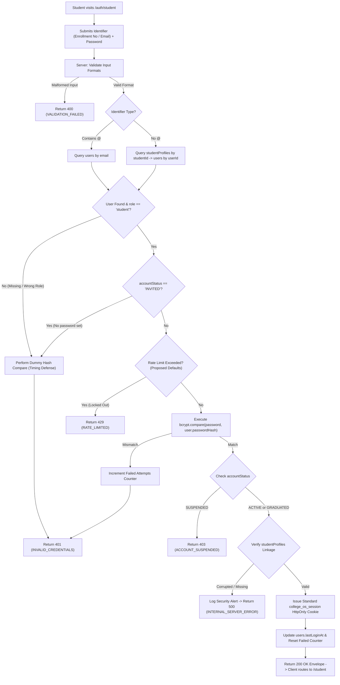

# AUTH-03 — Student Login

- **Feature ID:** `AUTH-03`
- **Feature Title:** Student Login
- **Domain:** Authentication & Identity
- **Milestone:** Core MVP
- **Status:** Approved Specification (Ready for Implementation)
- **Owning Module:** Module 1: Authentication, Institutional Identity & RBAC
- **Primary SOT References:** `COLLEGE_OS_SOT.md` §6.1, §6.2, §6.6, §6.7, §6.8, §7, §16.0, §16.1, §16.2, §17, §18, §21.1, §22.1, §22.2, §22.8; `FEATURE_INVENTORY.md` (AUTH-03, §1, §6, §7.1, §7.2); Project Plan §4, §6, §16, §17

---

## 1. Executive Summary & Purpose

### 1.1 Purpose
Student Login is the primary daily authentication gateway for enrolled and graduated students in College OS. It allows an active student to authenticate securely using either their institutional Enrollment Number / PRN (e.g. `CS-2022-049`) or their official college email address (e.g. `aarav.sharma@csmu.edu.in`), paired with their private password created during activation (`AUTH-02`).

Upon successful credential verification and lifecycle validation, the backend issues a secure, server-controlled HttpOnly JWT session cookie (`college_os_session`) conforming to SOT §17 and redirects the student to the Student Dashboard route at `/student` (`STU-01`). Client-supplied roles, IDs, or session flags are strictly disregarded; all authorization derives from database authority.

### 1.2 In-Scope (Approved Core MVP Scope)
- **Dual-Identifier Authentication:** Authenticating students via either Enrollment Number (`studentProfiles.studentId`) or official institutional email (`users.email`).
- **Cryptographic Credential Verification:** Constant-time password verification using `bcrypt.compare` against the stored `users.passwordHash`.
- **Server-Enforced Lifecycle Gating (SOT §6.8):**
  - `ACTIVE`: Full login access to role-permitted student features.
  - `GRADUATED`: Permitted login for read-only archive access to past transcripts, grade cards, and portfolio; write operations remain strictly blocked server-side by database-resolved status checks.
  - `SUSPENDED`: Verified credentials against suspended accounts return `403 FORBIDDEN` (`ACCOUNT_SUSPENDED`), with no active session established.
  - `INVITED`: Unactivated accounts cannot authenticate; invalid credentials or unactivated state return generic `401 UNAUTHORIZED` (`INVALID_CREDENTIALS`) to prevent account existence disclosure.
- **Server-Issued Secure Session Hand-Off (SOT §17, `AUTH-07`):** Setting the single standard `college_os_session` HttpOnly cookie containing signed claims (`userId`, `role: "student"`, `institutionId`).
- **Anti-Enumeration Defense & Rate Limiting:** Returning uniform, generic error responses on failed login attempts to prevent revealing account existence or lifecycle states, combined with request throttling to block brute-force and credential-stuffing attacks.
- **Login Audit & Timestamping:** Updating `users.lastLoginAt` and logging successful and security-flagged login events.

### 1.3 Out-of-Scope (Explicit Non-Goals)
- **No Open Public Registration (SOT §21.1, §22.2):** Self-registration is strictly rejected. An account must be pre-provisioned (`AUTH-01`) and activated (`AUTH-02`) before login is possible.
- **No Faculty / Staff Login:** Faculty, HOD, Principal, VP, and Admin log in through the unified Staff Login portal (`AUTH-05`) at `/auth/faculty` or `/auth/staff/login`.
- **No Client-Set Session Cookies:** Browser JavaScript is strictly barred from setting or reading session cookies. The legacy `college_os_session=true` cookie placeholder is rejected.
- **No Direct Password Resets on Login Screen:** Password recovery is delegated to the dedicated password reset flow (`AUTH-06`).

---

## 2. Actors, Permissions & Ownership

### 2.1 Actors & Roles
| Actor | Role / State | Permitted Action | Access Restrictions & Behavior |
| :--- | :--- | :--- | :--- |
| **Active Student** | `student` (`ACTIVE`) | Full Student Login | Authenticates, receives standard session cookie, and enters student workspace (`/student`). |
| **Graduated Student** | `student` (`GRADUATED`) | Archive Student Login | Authenticates with same standard session cookie; database status strictly enforces read-only access downstream on all write operations. |
| **Unactivated Student** | `student` (`INVITED`) | Blocked | Unactivated accounts lack password; login attempts fail with generic `401 UNAUTHORIZED` (`INVALID_CREDENTIALS`) to prevent status enumeration. First-time users follow UI link to `/auth/student/activate`. |
| **Suspended Student** | `student` (`SUSPENDED`) | Blocked | Incorrect credentials return generic `401 UNAUTHORIZED`. Valid credentials return `403 FORBIDDEN` (`ACCOUNT_SUSPENDED`); no session is issued. |
| **Staff Roles** | `faculty`, `hod`, `principal`, `vp`, `admin` | Blocked on Student Route | Rejected with generic `401 UNAUTHORIZED` (`INVALID_CREDENTIALS`) or directed to Staff Login (`/auth/faculty` or `/auth/staff/login`). |
| **Unprovisioned User** | Public / Unknown | Blocked | Rejected with generic `401 UNAUTHORIZED` (`INVALID_CREDENTIALS`) after dummy-hash timing delay. |

### 2.2 Identity Resolution & Ownership Rules
- **No Client Trust (SOT §22.8):** The login endpoint does not accept a `role`, `permissions`, or `studentId` from client payloads. The backend queries `users` and linked `studentProfiles` exclusively by the submitted identifier.
- **Role Verification:** The backend strictly verifies that the matched account holds `role === "student"`. If a staff member attempts logging in via the student route, the system rejects the attempt with generic credentials error or routes them to the staff portal.
- **Profile Integrity:** The backend ensures that an authoritative linked `studentProfiles` record exists with matching `userId`. If corrupted or missing, the public response returns a generic `500 INTERNAL_SERVER_ERROR` (`INTERNAL_SERVER_ERROR`) without leaking internal schema corruption, while logging an urgent security alert internally.

---

## 3. Related UI Routes & Current Behavior

### 3.1 Primary Frontend Routes
| Route | Access Guard | Current Repo Implementation | Key Component File |
| :--- | :--- | :--- | :--- |
| `/auth/student` | Public (Redirects to `/student` if authenticated) | Implemented (Demo mock) | `frontend/components/auth/StudentLoginPage.jsx`<br>`frontend/app/auth/student/page.jsx` |
| `/` (Root) | Public | Redirects to `/auth/student` | `frontend/app/page.js` |
| `/auth/forgot-password?role=student` | Public | Implemented | `frontend/components/auth/ForgotPasswordPage.jsx` |
| `/auth/student/activate` | Public | Implemented | `frontend/components/auth/StudentActivationPage.jsx` |

### 3.2 Current UI Implementation Gaps & Deviations
1. **Contradictory "Create an Account" UI Action:**
   - In `frontend/components/auth/StudentLoginPage.jsx` (lines 73–76), the top navigation bar displays:
     `label: "New to College OS?", actionLabel: "Create an Account", href: "/auth/student/activate"`.
   - *Deviation:* SOT §21.1 and §22.2 strictly forbid open self-registration. Offering "Create an Account" misleads students into assuming open signup exists.
   - *Required UI Fix:* Redefine the action label to **"Activate Account"** or **"First Time? Activate Account"**, linking to `/auth/student/activate`.
2. **Demo Password Bypass in `AuthProvider.jsx`:**
   - The current mock in `frontend/components/providers/AuthProvider.jsx` (`login()`) accepts any arbitrary password for demo accounts, sets a plain readable cookie `college_os_session=true`, and stores mock user state in `localStorage`.
   - *Required Fix:* Wire the form to the authoritative backend endpoint `POST /api/v1/auth/student/login` and receive a server-issued HttpOnly cookie.
3. **Demo Quick-Fill Helper:**
   - `StudentLoginPage.jsx` contains a development helper `fillDemoStudent()` populating `22CS087` / `CollegeOS@2026`. This must be restricted to non-production environments.

---

## 4. User Workflows & Flowcharts

### 4.1 Student Login Workflow
1. **Submission:** Student navigates to `/auth/student` and enters an identifier (`enrollmentNo` or official email) plus password.
2. **Sanitization & Format Check:** The server trims whitespace, normalizes email to lowercase, converts enrollment number to uppercase, and rejects empty fields. Malformed inputs immediately return `400 BAD_REQUEST` (`VALIDATION_FAILED`).
3. **Account Lookup:**
   - If identifier contains `@`, query `users.findOne({ email: identifier.toLowerCase() })`.
   - Otherwise, query `studentProfiles.findOne({ studentId: identifier.toUpperCase() })` and load linked `users` record via `userId`.
4. **Anti-Enumeration Timing Protection:**
   - If no matching record is found, or if `user.role !== "student"`, perform a dummy bcrypt comparison against a fixed server dummy hash to prevent timing-based user enumeration, then return generic `401 UNAUTHORIZED` (`INVALID_CREDENTIALS`).
   - If `user.accountStatus === "INVITED"` (no password hash configured yet), execute the dummy bcrypt hash comparison to maintain uniform timing and return generic `401 UNAUTHORIZED` (`INVALID_CREDENTIALS`). The public endpoint does not disclose that an unactivated account exists; first-time students are guided by the persistent UI link to `/auth/student/activate`. Internal audit logs record `AUTH_LOGIN_FAILED_UNACTIVATED`.
5. **Rate Limiting Check (Proposed Defaults):**
   - Verify failure count for the client IP and targeted account identifier.
   - If threshold exceeded (proposed default: 5 failed attempts in 15 minutes), return `429 TOO_MANY_REQUESTS` (`RATE_LIMITED`) with a `Retry-After` header.
6. **Cryptographic Password Verification:**
   - Execute `bcrypt.compare(password, user.passwordHash)`.
   - If mismatch: increment failed attempts counter, record `AUTH_LOGIN_FAILED_CREDENTIALS` in internal security logs, and return generic `401 UNAUTHORIZED` (`INVALID_CREDENTIALS`).
7. **Post-Authentication Lifecycle Evaluation (SOT §6.8):**
   - Once credentials are validly verified:
   - If `user.accountStatus === "SUSPENDED"`: Deny login with `403 FORBIDDEN` (`ACCOUNT_SUSPENDED`). No session cookie is issued. Internal audit records `AUTH_LOGIN_BLOCKED_SUSPENDED`.
   - If `user.accountStatus === "ACTIVE"` or `"GRADUATED"`: Proceed to session issuance.
8. **Profile Linkage & Session Issuance (SOT §17, `AUTH-07`):**
   - Verify that the linked `studentProfiles` record exists. If missing or corrupted, return generic `500 INTERNAL_SERVER_ERROR` (`INTERNAL_SERVER_ERROR`) without leaking schema corruption, and record a high-severity security audit log.
   - Reset failed login attempt counter and update `users.lastLoginAt = new Date()`.
   - Issue the single standard `college_os_session` HttpOnly cookie containing standard claims `{ sub: user._id, role: "student", institutionId: user.institutionId }`. (No separate archive token is created; graduated accounts receive the identical standard session, and database-resolved status enforces read-only access downstream).
   - Return `200 OK` envelope containing user and profile metadata.
9. **Navigation:** Client redirects the student to the approved Student Dashboard route at `/student` (`STU-01`).

### 4.2 Comprehensive Student Login Flowchart



---

## 5. Business Rules, Validations & State Transitions

### 5.1 Business Rules & Security Invariants
1. **Authoritative Backend Credentials:** Authentication validity is determined strictly by the server matching `password` against `passwordHash` stored in the database.
2. **Anti-Enumeration Invariant:** The server returns identical generic error messages (`401 UNAUTHORIZED` with code `INVALID_CREDENTIALS`) for non-existent identifiers, incorrect passwords, and unactivated accounts. The public endpoint never reveals whether an account exists or its activation state.
3. **Post-Authentication Suspension Defense:** Account suspension (`accountStatus === "SUSPENDED"`) is disclosed only after valid password verification, preventing unauthenticated scanning of suspension records while ensuring suspended students cannot receive a session.
4. **Graduated Student Access (Established Requirements vs. Proposed Details):**
   - **Established Requirements (SOT §6.8, §17):**
     - Graduated students retain read-only archive access to academic records (transcripts, grade cards, portfolios).
     - All write/mutation operations are strictly rejected server-side by backend authorization guards.
     - Single standard session cookie `college_os_session` is issued; there is no separate archive token or special cookie.
     - The database-resolved lifecycle status (`accountStatus === "GRADUATED"` verified in `users`) is the sole authority for permissions; client-supplied flags or token claims are never authoritative.
   - **Proposed Implementation Details:**
     - Write mutations return `403 FORBIDDEN` with error code `ACCOUNT_GRADUATED_READ_ONLY`.
     - The user data envelope includes `"accountStatus": "GRADUATED"` so the UI can present an informational archive banner.
5. **Timing Attack Protection:** When an account is not found or has no password set, the server executes a fixed-cost dummy bcrypt operation to match response timing with valid accounts.
6. **Session Isolation:** The issued session is bound to the institutional tenancy (`institutionId`) and user identity (`userId`).

### 5.2 Server-Side Validations
| Field / Parameter | Validation Rules & Constraints | Error Code | HTTP Status |
| :--- | :--- | :--- | :--- |
| `identifier` | Required, string, trimmed, min 4 chars, max 100 chars | `INVALID_IDENTIFIER` | 400 |
| `password` | Required, string, non-empty, max 128 chars | `PASSWORD_REQUIRED` | 400 |
| `rememberMe` | Optional, boolean (defaults to false) | `INVALID_PAYLOAD` | 400 |

### 5.3 Attempt Limits & Lockout Policy (Proposed Defaults)
To protect students against automated brute-force attacks:
- **Max Consecutive Failed Attempts:** 5 failed attempts per account or IP within 15 minutes.
- **Lockout Duration:** 15 minutes temporary hold on exceeding limit.
- **Response upon Lockout:** Returns `429 TOO_MANY_REQUESTS` with error code `RATE_LIMITED` and a `Retry-After: 900` header.
- *(Note: Exact lockout duration and attempt limits are proposed defaults requiring institutional IT confirmation).*

---

## 6. Proposed Data Models & Session Specification

### 6.1 Database Fields Utilized
Student Login operates on existing MongoDB Atlas collections defined in SOT §16.1 and §16.2:

```typescript
// users collection lookup
interface IUserAuthLookup {
  _id: Types.ObjectId;
  institutionId: Types.ObjectId;
  email: string;
  passwordHash: string;          // bcrypt hash
  role: 'student';
  accountStatus: 'INVITED' | 'ACTIVE' | 'SUSPENDED' | 'GRADUATED';
  isActivated: boolean;
  lastLoginAt?: Date;
}

// studentProfiles collection lookup
interface IStudentProfileLookup {
  _id: Types.ObjectId;
  userId: Types.ObjectId;
  studentId: string;             // Enrollment Number / PRN
  fullName: string;
  department: string;
  semester: number;
  section: string;
  academicStatus: 'REGULAR' | 'PROBATION' | 'GRADUATED';
}
```

### 6.2 Session Cookie Specification (SOT §17, `AUTH-07`)
Upon successful login, the server sets a cookie with the following locked attributes:
- **Cookie Name:** `college_os_session`
- **HttpOnly:** `true` (strictly inaccessible to document JavaScript, preventing XSS token theft)
- **Secure:** `true` in production (transmitted only over TLS/HTTPS)
- **SameSite:** `"Lax"` or `"Strict"` (CSRF defense)
- **Path:** `"/"`
- **Max-Age / Expiry:**
  - Standard session: 24 hours (`86400` seconds).
  - "Remember Me" checked: 7 days (`604800` seconds) — *proposed default*.
- **Token Claims Payload:**
  ```json
  {
    "sub": "65f2a1b9c0a1b2c3d4e5f6a1",
    "role": "student",
    "institutionId": "65f29a00b1c2d3e4f5a6b7c8",
    "iat": 1711500000,
    "exp": 1711586400
  }
  ```

---

## 7. Proposed API Contracts (Documentation Proposals)

> [!NOTE]
> The Feature Inventory notes for `AUTH-03`: *"Routes: /auth/student (the site root / redirects here)"*. The following contract is a **proposed architectural REST contract** for backend implementation. It does not represent an existing endpoint.

### 7.1 `POST /api/v1/auth/student/login` (Proposed)
Authenticates an eligible student and establishes a server-issued session cookie.

- **Authentication:** Public (Unauthenticated)
- **Request Headers:**
  ```http
  Content-Type: application/json
  ```
- **Request Body:**
  ```json
  {
    "identifier": "CS-2022-049",
    "password": "SecurePassword@2026",
    "rememberMe": true
  }
  ```
- **Success Response (`200 OK`):**
  ```http
  HTTP/1.1 200 OK
  Set-Cookie: college_os_session=eyJhbGciOiJIUzI1NiIsIn...; Path=/; HttpOnly; Secure; SameSite=Lax; Max-Age=604800
  Content-Type: application/json

  {
    "success": true,
    "data": {
      "user": {
        "id": "65f2a1b9c0a1b2c3d4e5f6a1",
        "email": "aarav.sharma@csmu.edu.in",
        "role": "student",
        "accountStatus": "ACTIVE"
      },
      "profile": {
        "id": "65f2a1b9c0a1b2c3d4e5f6a2",
        "studentId": "CS-2022-049",
        "rollNumber": "CSE-302",
        "fullName": "Aarav Sharma",
        "department": "CSE",
        "semester": 7,
        "section": "A",
        "academicStatus": "REGULAR"
      },
      "redirectTo": "/student"
    }
  }
  ```
- **Error Responses:**
  - `400 BAD_REQUEST`: `{ "success": false, "error": { "code": "VALIDATION_FAILED", "message": "Identifier and password are required." } }`
  - `401 UNAUTHORIZED`: `{ "success": false, "error": { "code": "INVALID_CREDENTIALS", "message": "Invalid Enrollment Number/Email or password." } }`
    *(Uniform error returned for non-existent accounts, password mismatches, and unactivated accounts with no password set, preventing account enumeration).*
  - `403 FORBIDDEN`: `{ "success": false, "error": { "code": "ACCOUNT_SUSPENDED", "message": "Your account is placed on administrative hold. Please contact the registrar." } }`
    *(Returned only after successful credential verification against an account in SUSPENDED state).*
  - `429 TOO_MANY_REQUESTS`: `{ "success": false, "error": { "code": "RATE_LIMITED", "message": "Too many failed login attempts. Please try again later." } }`
    *(Enforced according to proposed rate-limiting defaults).*
  - `500 INTERNAL_SERVER_ERROR`: `{ "success": false, "error": { "code": "INTERNAL_SERVER_ERROR", "message": "An unexpected error occurred during authentication. Please contact system support." } }`
    *(Masks internal errors such as corrupted profile linkage while logging high-priority alerts).*

---

## 8. Cross-Cutting Concerns

- **Auditing (SOT §6.8, §16, Inventory §6):**
  - Successful logins update `users.lastLoginAt = new Date()`.
  - Security-flagged events (e.g. consecutive failed login attempts exceeding thresholds, login attempts against suspended accounts, or brute-force lockouts) are logged to `auditLogs`:
    ```typescript
    {
      actorUserId: user?._id || null,
      actorRole: "student",
      action: "AUTH_LOGIN_FAILED_THRESHOLD",
      targetResourceId: user?._id || null,
      details: {
        identifierSubmitted: "CS-2022-049",
        ipAddress: req.ip,
        userAgent: req.headers["user-agent"],
        failureReason: "MAX_FAILED_ATTEMPTS"
      },
      timestamp: new Date()
    }
    ```
- **Logging Safety:** Under no circumstances may passwords, password hashes, or raw session tokens be written to application logs or console streams.
- **Root Path Redirection:** The application root `/` checks for the presence of an authenticated session cookie:
  - If valid student session: Redirect to `/student`.
  - If valid staff session: Redirect to `/auth/faculty` or staff landing route.
  - If unauthenticated: Redirect to `/auth/student`.

---

## 9. Architectural Do's and Don'ts

| Do | Don't |
| :--- | :--- |
| **Do** verify passwords using `bcrypt.compare` against `users.passwordHash`. | **Don't** accept plaintext passwords or skip verification for "demo" accounts. |
| **Do** issue the single standard server-controlled HttpOnly cookie (`college_os_session`). | **Don't** set client-readable cookies (`college_os_session=true`) via JavaScript or create unnecessary separate archive tokens. |
| **Do** return generic error messages on failure to prevent user enumeration. | **Don't** reveal whether an Enrollment Number exists, or if an account is unactivated, when credentials fail. |
| **Do** permit graduated students to log in and access read-only archive records. | **Don't** grant write/mutation permissions to graduated accounts, and don't rely on client flags for permissions. |
| **Do** provide persistent UI navigation to `/auth/student/activate` for first-time onboarding. | **Don't** permit unactivated (`INVITED`) accounts to sign in. |

---

## 10. Acceptance Criteria & Test Scenarios

### 10.1 Acceptance Criteria
- [ ] **AC-1:** Students can log in using either their Enrollment Number (`studentId`) or official institutional email.
- [ ] **AC-2:** Passwords are cryptographically verified using `bcrypt`; incorrect credentials fail with generic `401 UNAUTHORIZED` (`INVALID_CREDENTIALS`).
- [ ] **AC-3:** Successful login sets a server-issued `college_os_session` HttpOnly cookie, updates `lastLoginAt`, and routes to `/student`.
- [ ] **AC-4:** Unactivated accounts (`accountStatus === "INVITED"`) cannot log in and receive generic `401 UNAUTHORIZED` to prevent status disclosure; UI guides first-time users to activate.
- [ ] **AC-5:** Suspended accounts (`accountStatus === "SUSPENDED"`) cannot log in; upon valid credential entry, they receive `403 FORBIDDEN` (`ACCOUNT_SUSPENDED`).
- [ ] **AC-6:** Graduated accounts (`accountStatus === "GRADUATED"`) can log in with the standard session cookie to view read-only archive records, but downstream mutations are strictly blocked server-side.
- [ ] **AC-7:** Staff accounts cannot log in via the student route; they receive generic credentials error or are directed to the staff login portal.
- [ ] **AC-8:** Consecutive failed attempts trigger rate limiting and temporary IP/account lockout based on proposed defaults.

### 10.2 Positive Test Scenarios
1. **Login by Enrollment Number:** Active student enters `CS-2022-049` and correct password &rarr; receives 200 OK and `college_os_session` cookie; redirected to `/student`.
2. **Login by Official Email:** Active student enters `aarav.sharma@csmu.edu.in` and correct password &rarr; receives 200 OK and session cookie.
3. **Graduated Student Archive Login:** Student with status `GRADUATED` enters credentials &rarr; receives 200 OK and standard session cookie; dashboard reflects read-only archive mode and mutations return `403 FORBIDDEN`.

### 10.3 Negative & Security Test Scenarios
1. **Incorrect Password:** Active student submits valid enrollment number but incorrect password &rarr; receives `401 UNAUTHORIZED` (`INVALID_CREDENTIALS`).
2. **Unprovisioned Identity:** User submits non-existent enrollment number `ZZ-9999-999` &rarr; receives identical `401 UNAUTHORIZED` (`INVALID_CREDENTIALS`) after dummy hash delay.
3. **Unactivated Account Attempt:** User submits credentials for an unactivated account (`INVITED`) &rarr; receives generic `401 UNAUTHORIZED` (`INVALID_CREDENTIALS`), preventing account existence disclosure.
4. **Suspended Account Attempt with Bad Password:** Suspended student enters incorrect password &rarr; receives `401 UNAUTHORIZED` (`INVALID_CREDENTIALS`).
5. **Suspended Account Attempt with Valid Password:** Suspended student enters valid password &rarr; receives `403 FORBIDDEN` (`ACCOUNT_SUSPENDED`).
6. **Staff Role Login Attempt:** Faculty member enters employee ID on student login form &rarr; receives `401 UNAUTHORIZED` (`INVALID_CREDENTIALS`).
7. **Client-Side Cookie Spoofing:** User manually creates browser cookie `college_os_session=true` and attempts to open `/student` &rarr; protected route rejects request with `401 UNAUTHORIZED`.
8. **Brute-Force Rate Limiting:** Attacker submits 5 incorrect passwords within 2 minutes &rarr; 6th attempt returns `429 TOO_MANY_REQUESTS` (`RATE_LIMITED`).
9. **Broken Profile Linkage:** User record exists with `role: "student"` but no corresponding `studentProfiles` record &rarr; server logs error and returns `500 INTERNAL_SERVER_ERROR`.

---

## 11. Dependencies & Cross-Feature Interactions

### 11.1 Upstream Dependencies
- **`AUTH-01 — Institutional User Provisioning`:** Creates pre-provisioned user records and initial `accountStatus`.
- **`AUTH-02 — Student Account Activation`:** Hashes user password and transitions status to `ACTIVE`.
- **`SHARED-01 — User Identity & Profile Foundation`:** Defines user and profile schemas and ownership boundaries.
- **`SHARED-02 — Roles & Permissions (RBAC)`:** Enforces authoritative roles on downstream protected endpoints.

### 11.2 Downstream Dependents
- **`AUTH-07 — Session, Logout & Route Protection`:** Manages JWT validation, cookie lifetime, and logout.
- **`STU-01 — Student Dashboard`:** Landing page following successful login.
- **All Student Features (`STU-02` through `STU-17`):** Protected by the session established here.

---

## 12. Decision Log & Gaps

### 12.1 Resolved Design Decisions
- **Dual Identifier Login (SOT §6.6, §22.1):** Resolved. Students may authenticate with Enrollment Number or official email.
- **Authoritative Backend Authentication (SOT §7, §22.8):** Resolved. Roles and identities are resolved from MongoDB, never client payloads.
- **HttpOnly JWT Session Cookie (SOT §17):** Resolved. Sessions use the single standard server-issued `college_os_session` cookie; browser JavaScript cannot access tokens, and no separate archive token is created.
- **Graduated Archive Access Architecture (SOT §6.8):** Resolved. Graduated accounts receive standard session cookies, but backend middleware enforces read-only access based on the database `accountStatus === "GRADUATED"`, rejecting all write operations server-side.
- **Anti-Enumeration Protocol:** Resolved. The public login endpoint returns generic `401 UNAUTHORIZED` (`INVALID_CREDENTIALS`) for missing accounts, incorrect passwords, and unactivated accounts. Suspension status is disclosed only after valid credential verification.

### 12.2 Genuinely Open Decisions & Proposed Defaults
1. **Brute-Force Lockout Parameters (Proposed Defaults):** The threshold of 5 failed attempts with a 15-minute temporary lockout is a proposed default requiring institutional IT confirmation.
2. **Session Expiry Duration (Proposed Defaults):** The duration of 24 hours for standard sessions and 7 days for "Remember Me" sessions is a proposed implementation default subject to administrative confirmation in `AUTH-07`.
3. **Internal Timing Dummy Salt/Hash:** The exact configuration of the dummy hash for non-existent users is an implementation detail to be configured in server environment variables.

### 12.3 Existing UI Gaps to Address
- **Remove "Create an Account" Link:** In `frontend/components/auth/StudentLoginPage.jsx` (lines 73–76), update the top navigation action label from "Create an Account" to **"Activate Account"**, linking to `/auth/student/activate`.
- **Eliminate Client-Set Session Cookie:** Remove `setAuthCookie("true", authUser.role)` from `AuthProvider.jsx` and replace with server-side cookie issuance.

---

## 13. Traceability Matrix

| SOT Section | Project Plan Section | Feature Inventory ID | Verification Method |
| :--- | :--- | :--- | :--- |
| SOT §6.6 (Login Architecture) | Plan §6.3 (Login Flow) | `AUTH-03` | Integration Test: Dual Identifier Login (PRN vs Email) |
| SOT §6.7 (Password Ownership) | Plan §6.3 (Security) | `AUTH-03` | Security Test: Bcrypt Password Hash Verification |
| SOT §6.8 (Account Lifecycle Machine) | Plan §6.2 (Lifecycle) | `AUTH-03` | State Machine Test: Gating on Active vs Suspended vs Graduated |
| SOT §17 (Session & Cookie Architecture) | Plan §17.1 (Auth Model) | `AUTH-03` / `AUTH-07` | Security Test: HttpOnly JWT Cookie Issuance & Header Security |
| SOT §22.8 (Authoritative Role Backend) | Plan §18.1 (RBAC) | `AUTH-03` / `SHARED-02` | Security Test: Rejection of Client-Supplied Role Claims |
