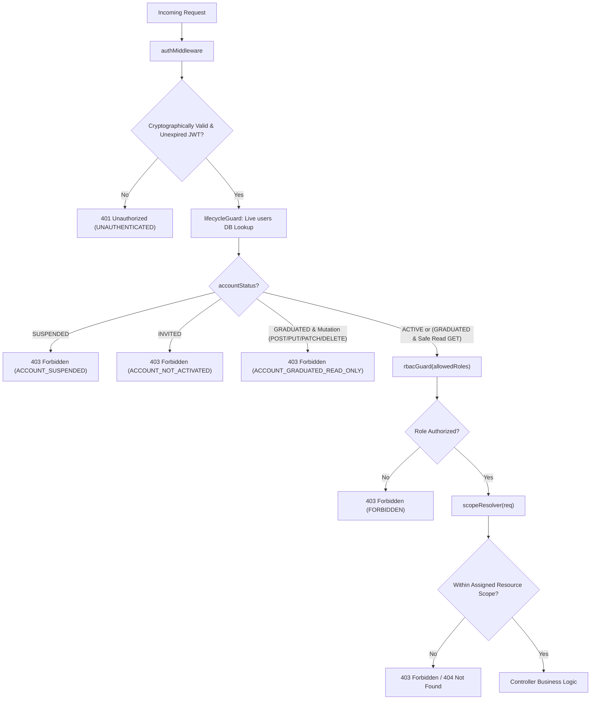

# College OS — Shared Backend Conventions

**Status:** approved engineering standard
**Applies to:** all backend endpoints, middleware, models, and service layers
**Authority:** `COLLEGE_OS_SOT.md` v1.3 (§6, §11.5, §12, §15, §16, §17), `FEATURE_INVENTORY.md` (SHARED-01, SHARED-02, SHARED-08)

---

## 1. Architectural Principles & Technology Stack

The College OS backend provides a secure, role-bounded, and predictable application programming interface (API) for student, faculty, and administrative portals.

### 1.1 Core Stack
- **Runtime & Framework:** Node.js (LTS) with Express.js REST API.
- **Database & ODM:** MongoDB Atlas with Mongoose ODM.
- **Authentication:** Server-issued JSON Web Tokens (JWT) stored in secure, `HttpOnly` cookies.
- **Password Hashing:** `bcrypt` with salt rounds &ge; 12.
- **Data Integrity:** Strict Mongoose schemas with validation, unique indexes, and transaction boundaries where multi-document consistency is mandatory.

### 1.2 Core Architectural Invariants
1. **The Backend Is the Sole Authority:** Frontend role claims, client-side session cookies (such as `college_os_session=true`), or client-supplied user identifiers are never trusted. All permissions and ownership derive from database-verified sessions.
2. **Strict Separation of Concerns:** Database entities, API contracts, and business logic follow single-responsibility domains. Shared capabilities (identity, files, notices, events) are implemented once in `shared/` workflows.
3. **Defense in Depth:** Authentication middleware verifies the token; authorization middleware verifies the institutional role; scoping middleware enforces class/department boundaries.

---

## 2. API Response & Error Handling Standards

All endpoints must return responses wrapped in a uniform JSON envelope.

### 2.1 Standard Success Envelope
For all `2xx` responses:
```json
{
  "success": true,
  "data": { ... },
  "meta": {
    "page": 1,
    "limit": 20,
    "total": 42,
    "totalPages": 3
  }
}
```
- `data`: The primary resource object or array of resource objects.
- `meta`: Optional pagination and query metadata (mandatory for collection list queries).

### 2.2 Standard Error Envelope
For all `4xx` and `5xx` responses:
```json
{
  "success": false,
  "error": {
    "code": "CANONICAL_ERROR_CODE",
    "message": "Human-readable explanation suitable for display or logging.",
    "details": [
      {
        "field": "officialEmail",
        "message": "Institutional email must end with @csmu.edu.in"
      }
    ]
  }
}
```

### 2.3 Canonical HTTP Status Codes & Error Codes
| HTTP Status | Canonical Code | Meaning / When to Use |
| :--- | :--- | :--- |
| `200 OK` | — | Successful query or synchronous update. |
| `201 Created` | — | Successful resource creation. |
| `204 No Content` | — | Successful operation with empty body (e.g., resource deletion). |
| `400 Bad Request` | `VALIDATION_FAILED` | Malformed JSON, missing mandatory fields, invalid data formats. |
| `401 Unauthorized` | `UNAUTHENTICATED` | Missing, expired, or cryptographically invalid session token. |
| `403 Forbidden` | `FORBIDDEN` | Valid session, but role or scope lacks permission for this action. |
| `403 Forbidden` | `ACCOUNT_SUSPENDED` | Account is placed on administrative hold; logins blocked and sessions revoked. |
| `403 Forbidden` | `ACCOUNT_GRADUATED_READ_ONLY` | Graduated account attempting a write/mutation; read-only archive access only. |
| `403 Forbidden` | `ACCOUNT_NOT_ACTIVATED` | Account is in `INVITED` state; OTP activation required before accessing endpoints. |
| `404 Not Found` | `RESOURCE_NOT_FOUND`| Resource does not exist, or hidden to prevent enumeration. |
| `409 Conflict` | `DUPLICATE_RESOURCE`| Unique index collision (e.g. email or enrollment ID already exists). |
| `422 Unprocessable`| `BUSINESS_RULE_VIOLATION`| Syntactically valid payload violates business invariants. |
| `429 Too Many Reqs`| `RATE_LIMITED` | Exceeded burst or rate limits (e.g., OTP resend, login attempts). |
| `500 Server Error` | `INTERNAL_SERVER_ERROR` | Unexpected unhandled server exception. |

---

## 3. Server-Side Input Validation & Sanitization

Client input must be validated server-side before passing to business logic or database layers.

### 3.1 Strict Payload Whitelisting
- Express route handlers must strip or reject any payload properties not defined in the endpoint's schema.
- **Never perform blind object spread into Mongoose queries or updates** (e.g., `Profile.findByIdAndUpdate(id, req.body)` is strictly forbidden).

### 3.2 Data Type and Format Enforcement
- **Email:** Case-insensitive validation against official institutional domains.
- **Identifiers:** Strict regex validation for Enrollment Numbers / PRNs, Employee IDs, and MongoDB `ObjectId` strings.
- **Strings:** Explicit length limits (min/max) and trimming to prevent whitespace inflation.
- **Enums:** Server-side enum verification for roles, statuses, and categories.

### 3.3 Immutability of Institution-Controlled Fields
- User-facing update endpoints (e.g., student or faculty profile edits) must strictly reject any payload attempting to modify institutional fields (`studentId`, `facultyId`, `fullName`, `officialEmail`, `department`, `semester`, `section`, `assignedClassIds`, `assignedSubjectIds`).
- If a client payload contains an immutable field, the API must return `400 BAD_REQUEST` with error code `IMMUTABLE_FIELD_MODIFICATION`.

---

## 4. Authentication, Session & Scope Resolution

### 4.1 Session Cookie Specification (SOT §17)
- **Cookie Name:** `college_os_session`
- **Attributes:**
  - `HttpOnly: true` (inaccessible to JavaScript)
  - `Secure: true` (transmitted only over HTTPS in production)
  - `SameSite: "Strict"` or `"Lax"` (CSRF protection)
  - `Path: "/"`
- **Token Type:** Signed JWT with server-held secret key (`JWT_SECRET`).
- **Token Payload:**
  ```json
  {
    "sub": "65f2a1b9c...",        // users._id
    "role": "student",            // Authoritative role
    "institutionId": "65f29...",  // collegeProfile._id
    "iat": 1711500000,
    "exp": 1711586400
  }
  ```

### 4.2 Authentication vs. Authorization & Account Lifecycle Enforcement

College OS strictly enforces the architectural boundary between **Authentication** and **Authorization**:

- **Authentication (Session Validity):** Answers *"Who is making this request, and is their session cryptographically valid?"*
  - Verifies that the incoming request presents a server-issued JWT via the `college_os_session` HttpOnly cookie.
  - Validates cryptographic signature and expiration.
  - Extracts the authoritative `userId` (`sub`) and institutional tenancy `institutionId`.
- **Authorization (Lifecycle & Scope Enforcement):** Answers *"Is this account currently allowed to perform this action on this resource?"*
  - Re-retrieves the live `users` record from the database on every protected request. Frontend claims or unverified token claims are never trusted.
  - Enforces the **Account Lifecycle State Machine** (SOT §6.8):
    - **`ACTIVE`:** Granted full role-permitted read and write capabilities within assigned scope.
    - **`GRADUATED`:** Granted read-only archive access to permitted historical records (e.g. transcript, grade sheets, portfolio showcase). **All write and mutation operations (POST, PUT, PATCH, DELETE) are strictly blocked server-side with `403 FORBIDDEN` (`ACCOUNT_GRADUATED_READ_ONLY`)**, regardless of client UI state or direct manual API requests.
    - **`SUSPENDED`:** Account placed on administrative hold. Logins are blocked, and all active sessions are revoked immediately. Any request returns `403 FORBIDDEN` (`ACCOUNT_SUSPENDED`).
    - **`INVITED`:** Pre-provisioned account awaiting OTP verification and password setup (`AUTH-02`, `AUTH-04`). Cannot access protected operational endpoints; returns `403 FORBIDDEN` (`ACCOUNT_NOT_ACTIVATED`).

### 4.3 Protected Request Pipeline
Every request to a protected endpoint must pass through a standard middleware chain:



1. **`authMiddleware`**: Extracts JWT from the cookie, verifies cryptographic signature, checks expiration, and attaches authenticated token claims (`req.auth`).
2. **`lifecycleGuard`**: Queries `users.findById(req.auth.sub)`. Enforces account lifecycle states: rejects `SUSPENDED`, rejects `INVITED`, blocks writes for `GRADUATED`, and attaches the live `user` record (`req.user`).
3. **`rbacGuard(...allowedRoles)`**: Validates that `user.role` matches the approved roles for the target endpoint.
4. **`scopeResolver`**: Resolves dynamic resource scope:
   - **Student:** Bounded to `user._id` and student's active `enrollment` class and subjects.
   - **Faculty:** Bounded to `teachingAssignments` (`classId`, `subjectId`) for the active `academicTermId` (SOT §16.6).
   - **HOD:** Bounded to records matching `departmentCode`.
   - **Principal / VP:** Campus-wide academic read access.
   - **Admin:** System configuration, user provisioning, and audit logs.

---

## 5. Safe Logging & Audit Trail Conventions

### 5.1 Audit Trail Mandate (SOT §6.8, §16, Inventory §6)
The following events require immediate, immutable audit logging:
1. User provisioning, activation, role changes, and account suspensions.
2. Mark entry, grade updates, and grade locking.
3. Attendance roll-call edits and manual retroactive corrections.
4. Official notice publication, edit, and deletion.
5. Lost & Found claim verifications and property handover confirmations.

### 5.2 Audit Log Structure
```typescript
interface IAuditLogEntry {
  actorUserId: ObjectId;         // Who performed the action
  actorRole: string;             // Role at time of action
  action: string;                // e.g., "ATTENDANCE_EDIT", "GRADE_LOCK", "NOTICE_PUBLISH"
  targetCollection: string;      // e.g., "attendance", "marks", "notices"
  targetResourceId: ObjectId;    // Document ID modified
  previousState?: object;        // State prior to edit (for destructive or correction actions)
  newState?: object;             // State after edit
  ipAddress?: string;            // Anonymized or captured IP
  userAgent?: string;
  timestamp: Date;
}
```

### 5.3 Sensitive Data Exclusion in Logs
**NEVER log:**
- Plaintext passwords or bcrypt password hashes.
- One-Time Password (OTP) tokens or verification codes.
- JWT secrets, private keys, or raw cookie session strings.
- Sensitive personal data (PII) including unverified phone numbers or personal financial details.

---

## 6. File Handling & Private Storage Boundaries (SHARED-08 / SOT §11.5)

To prevent unauthorized access, malware propagation, and storage leakage:

1. **Private Storage Backend:** All uploaded files (assignment submissions, notes, study materials, notice attachments, lost & found photos) reside in private object storage (e.g. S3 / GridFS / MinIO). Internal bucket names and storage keys are never exposed directly to client applications.
2. **Strict MIME & Magic-Number Validation:** Files are verified server-side by analyzing initial magic bytes, not just client-supplied MIME types or filename extensions.
3. **Approved File Formats:**
   - **Study Materials / Notes:** PDF, DOCX, PPTX (SOT §11.5).
   - **Submissions:** PDF, DOCX, ZIP (where explicitly enabled for code).
   - **Images (Avatar, Banners, Lost & Found):** JPEG, PNG, WebP.
4. **Authorized Short-Lived Downloads:** File access is granted exclusively through short-lived (e.g. 15-minute) pre-signed download URLs or authorized server streaming endpoints that re-verify the requesting user's active session and scope before serving.
5. **Checksum Verification:** Uploaded files compute and store a SHA-256 checksum to guarantee file integrity and prevent duplicate storage.

---

## 7. Database Safety, Indexing & Query Patterns

### 7.1 Multi-Tenant Institutional Isolation
- Where entities belong to the campus ecosystem, documents maintain `institutionId` (referencing `collegeProfile._id`).
- All queries must include the resolved `institutionId` to guarantee complete multi-tenant safety.

### 7.2 Indexing Conventions
- Every foreign reference field (`userId`, `classId`, `subjectId`, `academicTermId`) must be indexed.
- Compound unique indexes are required to enforce business uniqueness:
  - `studentProfiles`: `{ userId: 1 }` (unique), `{ studentId: 1 }` (unique)
  - `facultyProfiles`: `{ userId: 1 }` (unique), `{ facultyId: 1 }` (unique)
  - `projectLikes`: `{ projectId: 1, studentId: 1 }` (unique)
  - `enrollments`: `{ studentId: 1, classId: 1, academicTermId: 1 }` (unique)
  - `teachingAssignments`: `{ facultyId: 1, subjectId: 1, classId: 1, academicTermId: 1 }` (unique)

### 7.3 Pagination and Resource Limits
- Unbounded collection reads (e.g. `Collection.find()`) are strictly prohibited in user-facing endpoints.
- All list endpoints enforce:
  - Default limit: `20` items
  - Maximum allowable limit: `100` items
  - Mandatory cursor-based or indexed offset pagination.
