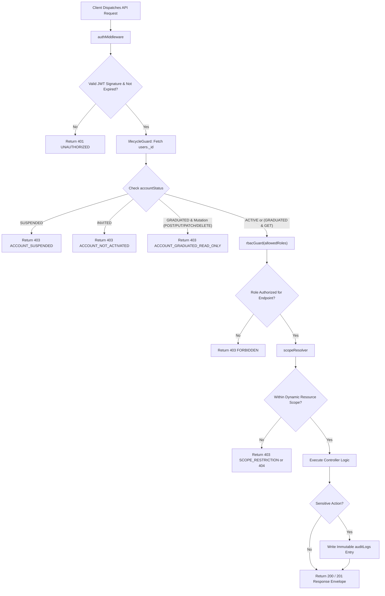

# SHARED-02 — Roles & Permissions (RBAC)

- **Feature ID:** `SHARED-02`
- **Feature Title:** Roles & Permissions (RBAC)
- **Domain:** Shared
- **Milestone:** Core MVP
- **Status:** Approved Specification (Ready for Implementation)
- **Owning Module:** Module 1: Authentication, Institutional Identity & RBAC (Enforced across all 12 Core MVP Modules)
- **Primary SOT References:** `COLLEGE_OS_SOT.md` §5, §6.8, §7, §12, §15.3, §16.0, §16.6, §17, §18; `FEATURE_INVENTORY.md` (SHARED-02, §1, §6, §7.1, §7.2); Project Plan §4, §16, §18

---

## 1. Executive Summary & Purpose

### 1.1 Purpose
Roles & Permissions (RBAC) establishes the authoritative, server-enforced access control engine for College OS. It ensures that every request to a protected endpoint or data resource is strictly authorized based on the user's database-verified institutional role, active account lifecycle state, and dynamic academic assignment scope. It eliminates lateral privilege escalation across departments and sections, protects student privacy, and enforces institutional hierarchy without relying on client-side state.

### 1.2 In-Scope (Approved Core MVP Scope)
- **Authoritative Server-Side Role Enforcement:** Verification of the six approved institutional roles (`student`, `faculty`, `hod`, `principal`, `vp`, `admin`) strictly from the backend database session, rejecting all client-supplied role claims.
- **Dynamic Resource Scoping (SOT §16.6):**
  - **Student Scope:** Personal records (attendance, marks, submissions, portfolio) plus public campus directory content and enrolled class study materials.
  - **Faculty Scope:** Dynamically bounded to assigned classes, sections, and subjects derived from authoritative `teachingAssignments` for the active `academicTermId`.
  - **HOD Scope:** Department-wide read and audit scope bounded by matching `departmentCode`.
  - **Principal / VP Scope:** Campus-wide academic read and institutional governance scope.
  - **Admin Scope:** System configuration, institutional user provisioning (`AUTH-01`), account lifecycle controls, and audit log access.
- **Account Lifecycle Authorization Gates (SOT §6.8):**
  - `ACTIVE`: Full role-permitted read and write capabilities within assigned scope.
  - `GRADUATED`: Read-only archive access to transcript, grade sheets, and portfolio; all writes/mutations (POST, PUT, PATCH, DELETE) are strictly blocked server-side with `403 FORBIDDEN` (`ACCOUNT_GRADUATED_READ_ONLY`).
  - `SUSPENDED`: Logins blocked and existing sessions revoked immediately; returns `403 FORBIDDEN` (`ACCOUNT_SUSPENDED`).
  - `INVITED`: Pre-provisioned; returns `403 FORBIDDEN` (`ACCOUNT_NOT_ACTIVATED`).
- **Standardized Authorization Error Handling:** Consistent HTTP `401`, `403`, and `404` error responses adhering to `shared/backend-conventions.md`.
- **Security-Sensitive Action Auditing:** Automatic creation of immutable audit logs for role modifications, grade locking, roll-call corrections, and notice publications.

### 1.3 Out-of-Scope (Explicit Non-Goals)
- **No Dedicated Dashboards for Leadership Roles (SOT §16.0, Inventory SHARED-02):** HOD, Principal, Vice Principal, and System Administrator dashboards are out of Core MVP scope. Their permissions exist to govern access to shared endpoints (notices, events, directory, audit, AI), not to support custom portals.
- **No Client-Side Authorization Trust:** Frontend menu hiding or router guards are user-experience conveniences only; they are never treated as security boundaries.
- **No Self-Assigned Roles (SOT §22.1–§22.2):** Roles are assigned exclusively by institutional authority during provisioning.
- **No Unrestricted Public Access:** All academic and operational records require authenticated, role-verified sessions.

---

## 2. Actors, Permissions & Ownership

### 2.1 The Six Institutional Roles
| Role Identifier | Assignment Source | Primary Responsibility | Dynamic Access Scope |
| :--- | :--- | :--- | :--- |
| `student` | Institutional Admissions Import | Enrolled student learning and showcase | Personal records only + public campus directories + enrolled class materials |
| `faculty` | Academic Administration Course Allocation | Teaching, roll-call, grading, and study materials | Bounded dynamically to `teachingAssignments` in the current `academicTermId` |
| `hod` | Departmental Leadership Appointment | Departmental academic governance and review | Department-wide scope bounded by `departmentCode` |
| `principal` / `vp` | University Executive Governance | Executive institutional leadership & compliance | Campus-wide scope across all departments and programs |
| `admin` | IT Administration Authority | Technical system operations and account lifecycle | System configuration, provisioning, lifecycle states, and audit trails |

### 2.2 Scoping & Ownership Hierarchy

```
                               CAMPUS SCOPE
                      (Principal / Vice Principal)
                                   │
                      ┌────────────┴────────────┐
                      ▼                         ▼
             DEPARTMENT SCOPE (CSE)    DEPARTMENT SCOPE (ECE)
                     (HOD)                     (HOD)
                      │                         │
              ┌───────┴───────┐                 │
              ▼               ▼                 ▼
        CLASS CSE-7A    CLASS CSE-7B       CLASS ECE-5A
        ┌───────────┐   ┌───────────┐      ┌───────────┐
        │  FACULTY  │   │  FACULTY  │      │  FACULTY  │
        │ASSIGNMENT │   │ASSIGNMENT │      │ASSIGNMENT │
        └─────┬─────┘   └─────┬─────┘      └─────┬─────┘
              │               │                  │
        ┌─────┴─────┐   ┌─────┴─────┐      ┌─────┴─────┐
        ▼           ▼   ▼           ▼      ▼           ▼
     STUDENT     STUDENT STUDENT     STUDENT STUDENT     STUDENT
     PERSONAL    PERSONAL PERSONAL   PERSONAL PERSONAL   PERSONAL
      SCOPE       SCOPE   SCOPE       SCOPE   SCOPE       SCOPE
```

- **Student Personal Boundary:** A student can read and mutate only records carrying their own `studentId` or `userId`. Attempting to read another student's marks, attendance, or private profile returns `403 FORBIDDEN` (or `404 NOT_FOUND` to prevent identity probing).
- **Faculty Teaching Assignment Boundary (SOT §16.6):** Faculty permissions to enter marks, take attendance, publish assignments, or post class notes derive strictly from `teachingAssignments` matching `{ facultyId, classId, subjectId, academicTermId }`. A faculty member teaching `CSE-7A` has zero access to grade or mark attendance for `CSE-7B` or any class in another department.
- **Department Boundary (HOD):** Access is bounded by `departmentCode`. An HOD in Computer Science cannot inspect private departmental records of Mechanical Engineering.
- **Campus Boundary (Principal / VP):** Access covers academic aggregates, audit logs, and institutional circulars campus-wide.

---

## 3. Related UI Routes & Current Behavior

### 3.1 Primary Frontend Routes & Guarding
| Route | Expected Access Guard | Current Repo Implementation | Current Route Guard in Repo |
| :--- | :--- | :--- | :--- |
| `/student/**` | `student` (Active or Graduated) | Implemented (32 pages) | `frontend/middleware.js` checks `college_os_session=true` cookie placeholder |
| `/faculty/**` | `faculty` (Active) | Implemented (14 pages) | `frontend/middleware.js` checks `college_os_session=true` cookie placeholder |
| `/auth/student` | Public (Unauthenticated) | Implemented | Redirects to `/student` if cookie present |
| `/auth/faculty` | Public (Unauthenticated) | Implemented | Redirects to `/faculty` if cookie present |
| `/admin/**` | `admin` (Active) | Not implemented (Out of Scope) | No route in repository |

### 3.2 Current Implementation Gaps & Security Deficits
1. **Client-Set Cookie Vulnerability (SOT §17):** The running frontend sets a client-accessible cookie `college_os_session=true` in `frontend/context/AuthProvider.jsx`. Any user can set this cookie in browser developer tools to bypass the client-side router guard.
2. **Missing Server-Side RBAC Middleware:** Because the backend is currently a minimal Express stub (`backend/server.js`), no server-side role validation exists yet.
3. **No Graduated Account Distinction in UI:** The frontend treats all sessions identically; it does not disable mutation buttons (e.g. submit assignment, edit profile) for graduated students. Server-side rejection must be the definitive guard.
4. **Mocked Faculty Assignments:** In `frontend/components/faculty/**`, assigned classes are loaded from static mock files rather than derived from `teachingAssignments`.

---

## 4. Master Permission Matrix (SOT §18)

The following matrix defines the authoritative permission boundaries across all six roles.

**Legend:**
- **Full:** Full create, read, update, delete permissions within assigned scope.
- **Read-Write (Assigned):** Permitted only for classes/subjects explicitly assigned in `teachingAssignments`.
- **Read (Assigned):** Read access restricted to assigned classes/subjects.
- **Read (Own):** Read access restricted strictly to own personal records.
- **Read (Dept):** Read access across all classes and subjects in the department.
- **Read (Campus):** Read access across all institutional departments.
- **Denied:** Request rejected server-side with `403 FORBIDDEN` or `404 NOT_FOUND`.

| Resource / Action | Student | Faculty | HOD | Principal / VP | Admin |
| :--- | :--- | :--- | :--- | :--- | :--- |
| **Authentication & Lifecycle** |
| Activate account (`AUTH-02`, `AUTH-04`) | Own account (OTP) | Own account (OTP) | Denied (Direct) | Denied (Direct) | Denied (Self-activation) |
| Log in / Logout (`AUTH-03`, `AUTH-05`) | Own account | Own account | Own account | Own account | Own account |
| Change password (`AUTH-06`) | Own account | Own account | Own account | Own account | System reset assistance |
| Provision users / Set lifecycle (`AUTH-01`) | Denied | Denied | Denied | Denied | **Full (Audited)** |
| **User & Staff Profiles** |
| Read own profile (`SHARED-01`) | Full | Full | Full | Full | Full |
| Edit customizable showcase fields | Own (Student fields) | Own (Cabin/Bio) | Own (Cabin/Bio) | Own (Cabin/Bio) | Own (Cabin/Bio) |
| Read peer public profiles | Read (Campus) | Read (Campus) | Read (Campus) | Read (Campus) | Read (Campus) |
| Read assigned student profiles | Denied | Read (Assigned) | Read (Dept) | Read (Campus) | Read (Campus) |
| Correct official institutional fields | Denied | Denied | Denied | Denied | **Full (Audited)** |
| **Timetable & Academic Calendar** |
| View student class schedule (`STU-04`) | Read (Own class) | Read (Assigned) | Read (Dept) | Read (Campus) | Read (Campus) |
| View faculty teaching schedule (`FAC-07`) | Denied | Read (Own schedule)| Read (Dept) | Read (Campus) | Read (Campus) |
| Request timetable change (`FAC-07`) | Denied | Create request | Review / Endorse | Denied | Approve & Publish |
| Create / edit official timetables | Denied | Denied | Denied | Denied | **Full (Audited)** |
| **Attendance & Roll-Call** |
| View attendance standing (`STU-05`) | Read (Own records) | Read (Assigned) | Read (Dept) | Read (Campus) | Read (Campus) |
| Mark daily roll-call (`FAC-04`) | Denied | **Write (Assigned)** | Read / Audit *(Gap)*| Read / Audit | Denied (Academic) |
| Retroactive attendance edit (`FAC-04`) | Denied | Update (Assigned) | Audit (Dept) *(Gap)* | Audit (Campus) | Override (Audited) |
| **Assignments & Submissions** |
| Browse assignments (`STU-06`, `FAC-05`) | Read (Enrolled) | Read (Assigned) | Read (Dept) | Read (Campus) | Read (Campus) |
| Submit assignment file (`STU-06`) | **Create (Own/Enrolled)**| Denied | Denied | Denied | Denied |
| Create / edit assignment (`FAC-05`) | Denied | **Write (Assigned)** | Read / Audit *(Gap)*| Read (Campus) | Administrative archive |
| Grade & evaluate submissions (`FAC-05`) | Denied | **Grade (Assigned)** | Read / Audit *(Gap)*| Read (Campus) | Denied |
| **Marks & Performance** |
| View grade card / CGPA (`STU-02`) | Read (Own records) | Read (Assigned) | Read (Dept) | Read (Campus) | Read (Campus) |
| Enter & update internal marks (`FAC-06`) | Denied | **Write (Assigned)** | Read / Audit *(Gap)*| Read (Campus) | Denied |
| Publish & lock exam results (`FAC-06`) | Denied | Lock (Assigned) | Sign-off *(Gap)* | Read (Campus) | Final Lock / Admin Sign-off |
| **Academic Resources (Study Materials)** |
| Download permitted materials (`FAC-08`) | Read (Enrolled) | Read (Assigned) | Read (Dept) | Read (Campus) | Read (Campus) |
| Upload study materials (`FAC-08`) | Denied | **Write (Assigned)** | Write (Dept) *(Gap)*| Denied | Storage Management |
| Delete study materials (`FAC-08`) | Denied | Delete (Own upload)| Delete (Dept) *(Gap)*| Denied | Storage Management |
| **Notices & Circulars** |
| Read official bulletins (`SHARED-03`) | Read (Permitted scope)| Read (Permitted scope)| Read (Campus) | Read (Campus) | Read (Campus) |
| Publish class-level notice (`SHARED-03`) | Denied | Write (Assigned class)| Write (Dept) | Write (Campus) | Write (Campus) |
| Publish department notice (`SHARED-03`) | Denied | Denied | **Write (Dept)** | Write (Campus) | Write (Campus) |
| Publish campus-wide circular (`SHARED-03`) | Denied | Denied | Denied | **Write (Campus)** | **Write (Campus)** |
| **Campus Events** |
| Browse events & register (`SHARED-04`) | Read & Register | Read & Register | Read & Register | Read & Register | Read & Register |
| Publish departmental event (`SHARED-04`) | Denied | Propose / Create | **Publish (Dept)** | Publish (Campus) | Full CRUD |
| Authorize institutional event (`SHARED-04`) | Denied | Denied | Endorse | **Authorize (Campus)**| Full CRUD |
| **Projects Showcase & Explore Directory** |
| Publish student project (`STU-08`) | **Create / Edit (Owner)**| Denied | Denied | Denied | Moderate / Remove |
| Star / like project (`STU-08`) | Create / Delete (Own)| Create / Delete (Own)| Create / Delete (Own)| Create / Delete (Own)| Audit |
| Explore peer directory (`SHARED-05`) | Read (Campus) | Read (Campus) | Read (Campus) | Read (Campus) | Read (Campus) |
| **Campus AI Assistant** |
| Campus AI queries (`AI-01`, `AI-02`, `AI-03`)| Personal scope | Assigned class scope | Department scope | Executive campus scope| Retrieval audit & metrics |
| Ingest RAG documents (`AI-04`) | Denied | Denied | Endorse Dept Handbooks| Authorize Handbooks | Manage Ingestion Index |
| **Audit Logs & System Overrides** |
| View security audit logs (`auditLogs`) | Denied | Denied | Denied | Read (Campus Audits) | **Full Access** |

*(Gap)* indicates an unresolved write boundary detailed in Section 7.

---

## 5. Authorization & Lifecycle Enforcement Rules

### 5.1 Authentication vs. Authorization

```
                       INCOMING CLIENT REQUEST
                                  │
                                  ▼
                    ┌───────────────────────────┐
                    │      AUTHENTICATION       │
                    │   Valid JWT in cookie?    │
                    │   Signature & exp valid?  │
                    └─────────────┬─────────────┘
                                  │ Yes
                                  ▼
                    ┌───────────────────────────┐
                    │    LIFECYCLE STATUS GATE  │
                    │  users.accountStatus check│
                    └─────────────┬─────────────┘
                                  │ Active or Graduated Read
                                  ▼
                    ┌───────────────────────────┐
                    │       ROLE CHECK          │
                    │  user.role in allowed?    │
                    └─────────────┬─────────────┘
                                  │ Yes
                                  ▼
                    ┌───────────────────────────┐
                    │      RESOURCE SCOPE       │
                    │ Matches teaching assignment│
                    │ or student enrollment?    │
                    └─────────────┬─────────────┘
                                  │ Authorized
                                  ▼
                    ┌───────────────────────────┐
                    │      EXECUTE ACTION       │
                    └───────────────────────────┘
```

1. **Authentication:** Establishes identity. If the cookie is missing or invalid, the API returns `401 UNAUTHORIZED` (`UNAUTHENTICATED`).
2. **Authorization:** Governs permissions based on three factors:
   - **Account Lifecycle State (`accountStatus`):**
     - `ACTIVE`: Access granted to role-permitted actions.
     - `GRADUATED`: Granted read-only archive access. **Any write/mutation request (POST, PUT, PATCH, DELETE) is rejected server-side with `403 FORBIDDEN` (`ACCOUNT_GRADUATED_READ_ONLY`)**.
     - `SUSPENDED`: Blocked completely; returns `403 FORBIDDEN` (`ACCOUNT_SUSPENDED`).
     - `INVITED`: Blocked; returns `403 FORBIDDEN` (`ACCOUNT_NOT_ACTIVATED`).
   - **Authoritative Role (`role`):** Verified against the allowed roles for the endpoint.
   - **Resource Scope:** Validates that the targeted resource falls within the user's assigned domain (e.g. `classId` in `teachingAssignments` for faculty; `studentId === req.user.studentId` for students).

### 5.2 Dynamic Faculty Scoping (SOT §16.6)
- A faculty member's permissions are never static. They are computed from `teachingAssignments` for the active term:
  $$\text{FacultyScope} = \left\{ (\text{classId}, \text{subjectId}) \mid \text{teachingAssignments}(\text{facultyId}, \text{academicTermId}_{\text{active}}) \right\}$$
- When faculty submit marks, roll-call, or assignments for class $C$ and subject $S$, the authorization middleware verifies that $(C, S) \in \text{FacultyScope}$.
- If $(C, S) \notin \text{FacultyScope}$, the request is rejected with `403 FORBIDDEN` (`SCOPE_RESTRICTION`).

### 5.3 Department and Campus Isolation
- Departmental queries by an HOD must enforce `departmentCode === user.department`.
- Requests attempting to query another department's internal attendance or marks return `403 FORBIDDEN` (or `404 NOT_FOUND` to prevent directory probing).
- Campus-wide reads by Principal/VP are restricted to aggregated academic data; they cannot view private personal records (passwords, disciplinary notes, personal student phone numbers).

---

## 6. Common Authorization Errors & Audit Logging

### 6.1 Standard Error Responses (`shared/backend-conventions.md`)

| Condition | HTTP Status | Error Code | Response Message |
| :--- | :--- | :--- | :--- |
| Missing or expired session cookie | `401 Unauthorized` | `UNAUTHENTICATED` | `"Session has expired or is invalid. Please log in again."` |
| Suspended account attempting access | `403 Forbidden` | `ACCOUNT_SUSPENDED` | `"Your account is suspended. Contact administration."` |
| Graduated account attempting mutation | `403 Forbidden` | `ACCOUNT_GRADUATED_READ_ONLY`| `"Graduated accounts have read-only archive access."` |
| Unactivated account attempting access | `403 Forbidden` | `ACCOUNT_NOT_ACTIVATED` | `"Account activation via OTP is required before login."` |
| Role not permitted for endpoint | `403 Forbidden` | `FORBIDDEN` | `"You do not have permission to access this resource."` |
| Faculty accessing unassigned class | `403 Forbidden` | `SCOPE_RESTRICTION` | `"You are not assigned to teach this class/subject."` |
| Resource outside scope (or hidden) | `404 Not Found` | `RESOURCE_NOT_FOUND` | `"The requested resource was not found."` |

### 6.2 Audit Logging Requirements (SOT §6.8, §16, Inventory §6)
The authorization system must automatically generate an immutable record in `auditLogs` for the following security-sensitive actions:
1. **User Account Lifecycle:** Account creation, OTP activation, suspension, graduation, and role changes.
2. **Academic Results:** Mark entry, grade updates, and grade locking (`FAC-06`).
3. **Attendance Records:** Manual retroactive corrections and roll-call overrides (`FAC-04`).
4. **Institutional Notices:** Publication, modification, and deletion of college or department notices (`SHARED-03`).
5. **Profile Corrections:** Administrative modifications to official student/faculty records (`SHARED-01`).
6. **Property Handover:** Lost & Found claim verification and item return (`STU-12`).

**Sensitive Data Exclusion Rule:** Audit logs must record `actorUserId`, `actorRole`, `action`, `targetResourceId`, `previousState`, `newState`, and `timestamp`. **Under no circumstances may passwords, password hashes, OTP codes, session tokens, or student phone numbers be recorded in audit logs.**

---

## 7. Genuine Open Decisions & Recommended Defaults

### 7.1 Unresolved HOD & Principal/VP Write Boundaries (Feature Inventory §7.2 Item 6)
The Feature Inventory and SOT establish that HOD, Principal, and VP possess department-wide and campus-wide **read and audit** authority, as well as notice publishing authority. However, **which direct academic writes these leadership roles may execute (as opposed to audit-only) remains an unresolved decision**:
- Can an HOD directly edit or override attendance marked by a faculty member?
- Can an HOD directly enter or alter internal marks, or must they request a faculty correction?
- Can a Principal directly modify grades before publishing?

### 7.2 Proposed Default: Principle of Least Privilege
Until the institution formally defines executive academic write workflows, the following **least-privilege defaults are recommended**:

> [!IMPORTANT]
> **Recommended Architectural Default (Least Privilege):**
> 1. **Audit & Review by Default:** HOD, Principal, and VP roles are granted **read and audit permissions only** for daily attendance, internal marks, and assignment grades.
> 2. **Faculty Primacy for Course Writes:** Only the faculty member assigned via `teachingAssignments` is authorized to enter marks or mark roll-call.
> 3. **Formal Correction Workflow:** If an HOD identifies a marking error, they must request a correction from the assigned faculty member, or escalate to the System Administrator for an audited administrative override (`admin`).
> 4. **Executive Notice Authority:** HODs retain direct publishing rights for department bulletins; Principal/VP retain direct publishing rights for campus circulars.

---

## 8. Workflow Flowchart & API Authorization Examples

### 8.1 Complete Authorization Flowchart



---

## 9. Architectural Do's and Don'ts

| Do | Don't |
| :--- | :--- |
| **Do** enforce every role and scope check on the backend server. | **Don't** trust client-supplied role claims, hidden forms, or cookies. |
| **Do** verify active `teachingAssignments` dynamically for all faculty writes. | **Don't** allow a faculty member to mark attendance for unassigned classes. |
| **Do** block all mutations for `GRADUATED` accounts with `403 FORBIDDEN`. | **Don't** rely on disabling frontend UI buttons to stop graduated writes. |
| **Do** revoke active sessions immediately upon account `SUSPENDED` status. | **Don't** permit suspended users to continue using previously issued JWTs. |
| **Do** record actor and state diffs in `auditLogs` for all overrides. | **Don't** log sensitive credentials, OTP tokens, or private PII. |

---

## 10. Acceptance Criteria & Test Scenarios

### 10.1 Acceptance Criteria
- [ ] **AC-1:** Every protected request re-validates the user's authoritative role and live `accountStatus` against MongoDB Atlas.
- [ ] **AC-2:** `ACTIVE` users execute role-permitted actions within their assigned scope.
- [ ] **AC-3:** `GRADUATED` users can read historical records (transcripts, portfolios) but are strictly blocked from all mutations with `403 FORBIDDEN` (`ACCOUNT_GRADUATED_READ_ONLY`).
- [ ] **AC-4:** `SUSPENDED` users are blocked from all endpoints with `403 FORBIDDEN` (`ACCOUNT_SUSPENDED`).
- [ ] **AC-5:** Faculty members attempting to enter attendance or marks for unassigned classes receive `403 FORBIDDEN` (`SCOPE_RESTRICTION`).
- [ ] **AC-6:** Students attempting to access another student's private marks or attendance receive `403 FORBIDDEN` or `404 NOT_FOUND`.
- [ ] **AC-7:** Security-sensitive administrative overrides and grade locks generate an immutable `auditLogs` record.

### 10.2 Positive Test Scenarios
1. **Student Accessing Own Marks:** Student requests `GET /api/v1/academics/marks` &rarr; returns 200 OK with personal grades.
2. **Faculty Marking Assigned Roll-Call:** Faculty assigned to `CSE-7A` submits attendance for `CSE-7A` &rarr; returns 200 OK.
3. **HOD Reading Department Circulars:** HOD in CSE requests departmental notices &rarr; returns 200 OK with CSE bulletins.
4. **Graduated Student Viewing Transcript:** Graduated student requests `GET /api/v1/academics/grade-card` &rarr; returns 200 OK with read-only grade card.

### 10.3 Negative & Authorization Test Scenarios
1. **Cross-Student Tampering:** Student A requests `GET /api/v1/academics/marks?studentId=StudentB` &rarr; returns `403 FORBIDDEN` or `404 NOT_FOUND`.
2. **Unassigned Faculty Roll-Call:** Faculty assigned to `CSE-7A` submits attendance for `CSE-7B` &rarr; returns `403 FORBIDDEN` (`SCOPE_RESTRICTION`).
3. **Cross-Department HOD Access:** HOD in CSE requests restricted internal records of ECE &rarr; returns `403 FORBIDDEN`.
4. **Graduated Account Mutation:** Graduated student attempts `PATCH /api/v1/users/students/profile` &rarr; returns `403 FORBIDDEN` (`ACCOUNT_GRADUATED_READ_ONLY`).
5. **Suspended Account Access:** User with `accountStatus === "SUSPENDED"` sends request &rarr; returns `403 FORBIDDEN` (`ACCOUNT_SUSPENDED`).
6. **Client Role Impersonation:** Student sends payload `{"role": "admin"}` or header `X-Role: admin` &rarr; ignored; backend reads DB role `student` &rarr; returns `403 FORBIDDEN`.
7. **Unauthorized Institutional Modification:** Faculty member attempts `PATCH /api/v1/admin/users/:id/institutional-profile` &rarr; returns `403 FORBIDDEN`.

---

## 11. Dependencies & Cross-Feature Interactions

### 11.1 Upstream Dependencies
- **`AUTH-01 — Institutional User Provisioning`:** Sets authoritative `role` and initial `accountStatus`.
- **`AUTH-07 — Session, Logout & Route Protection`:** Issues signed JWT cookies and extracts session tokens.
- **`SHARED-01 — User Identity & Profile Foundation`:** Links user accounts to `studentProfiles` or `facultyProfiles`.

### 11.2 Downstream Dependents
- **All Core MVP Modules (Modules 1–12):** Every operational workflow (Attendance, Timetable, Marks, Assignments, Resources, Notices, Events, Campus AI) relies on `SHARED-02` middleware to guard endpoints and scope data.

---

## 12. Decision Log & Gaps

### 12.1 Resolved Decisions
- **Authoritative Backend Role (SOT §7, §22.8):** Resolved. Frontend role claims are never trusted.
- **Dynamic Faculty Assignment Scoping (SOT §16.6):** Resolved. Derived strictly from `teachingAssignments` in the active term.
- **Graduated Account Read-Only Behavior (SOT §6.8):** Resolved. Archive reads permitted; mutations blocked.
- **No Leadership Dashboards (SOT §16.0):** Resolved. HOD, Principal, VP, and Admin permissions enforced on shared resources without separate dashboard modules.

### 12.2 Genuinely Open Decisions
- **HOD & Principal/VP Academic Write Boundaries (Inventory §7.2 Item 6):** Unresolved. Recommended default of least privilege (audit & read by default; writes restricted to class faculty or audited administrative overrides) is specified in Section 7.2.

---

## 13. Traceability Matrix

| SOT Section | Project Plan Section | Feature Inventory ID | Verification Method |
| :--- | :--- | :--- | :--- |
| SOT §5 (Institutional Model) | Plan §4.1 (Actors) | `SHARED-02` | Integration Test: Role Authorization Hierarchy |
| SOT §6.8 (Account Lifecycle) | Plan §6.2 (Lifecycle) | `SHARED-02` | Integration Test: Active vs Graduated vs Suspended |
| SOT §7 (Role & RBAC Model) | Plan §7.1 (RBAC Rules) | `SHARED-02` | Unit Test: Role Matrix Authorization Enforcement |
| SOT §16.6 (Academic Relationships) | Plan §16.5 (Scoping) | `SHARED-02` | Integration Test: Dynamic Faculty Teaching Assignment Scope |
| SOT §18 (Authorization Matrix) | Plan §18.1 (Permissions)| `SHARED-02` | Security Test Suite: Master Permission Matrix Verification |

