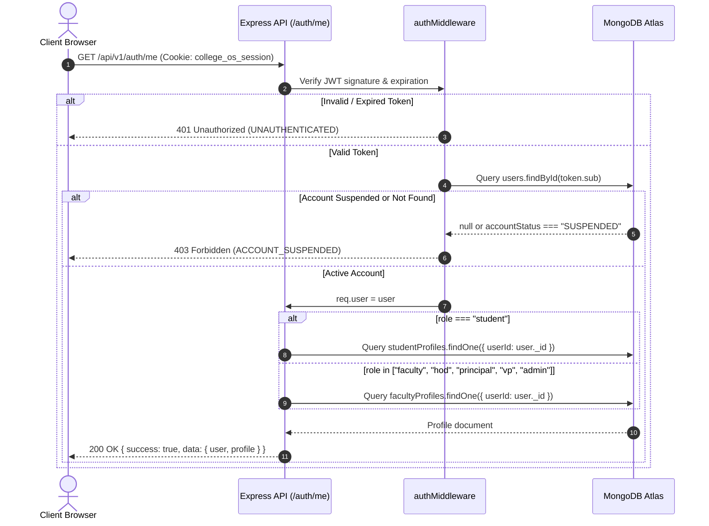
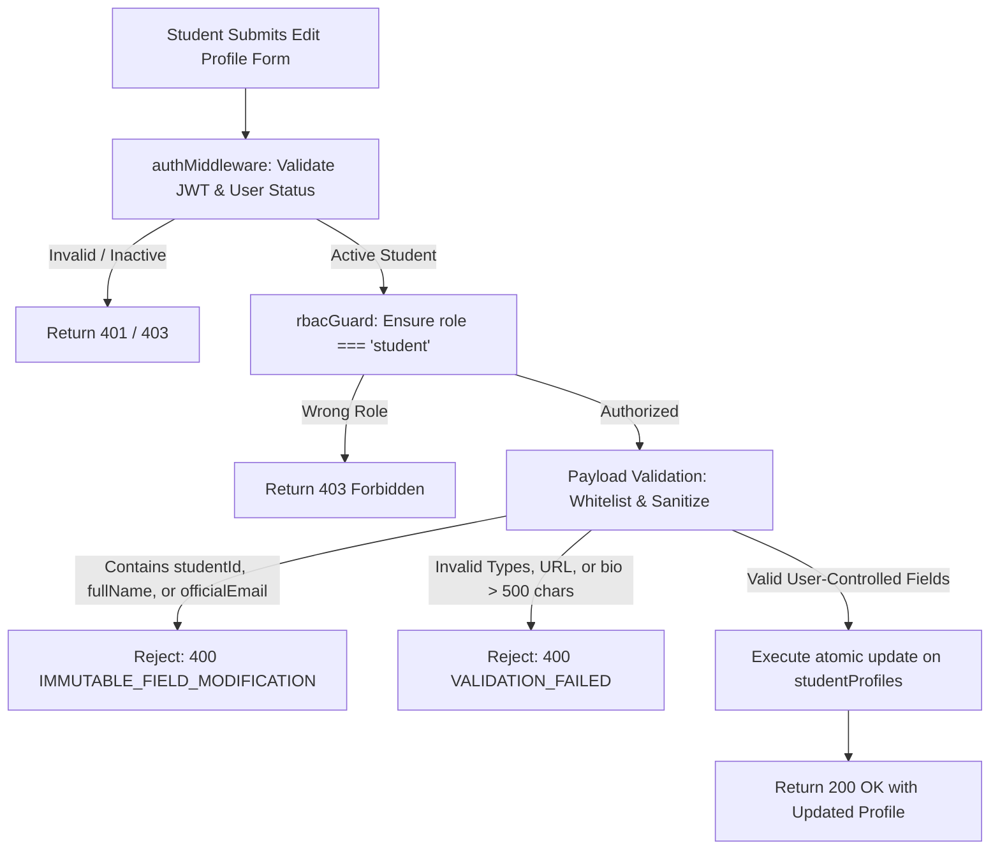
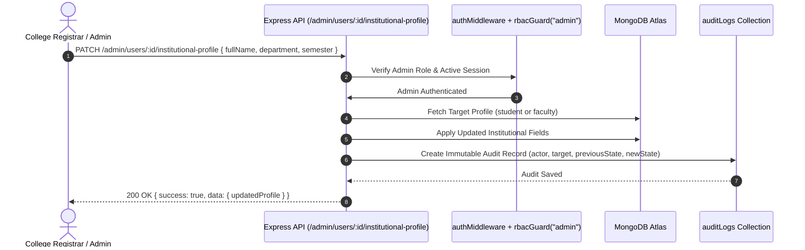
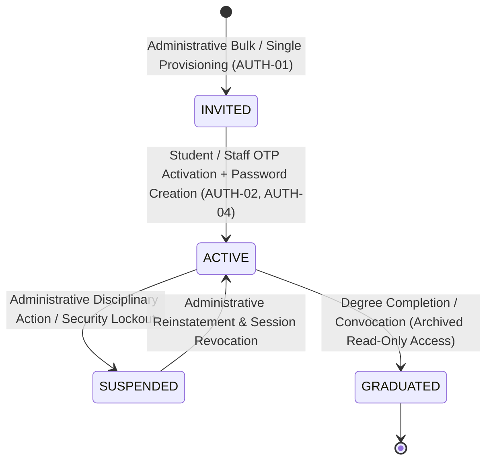

# SHARED-01 — User Identity & Profile Foundation

- **Feature ID:** `SHARED-01`
- **Feature Title:** User Identity & Profile Foundation
- **Domain:** Shared
- **Milestone:** Core MVP
- **Status:** Approved Specification (Ready for Implementation)
- **Owning Module:** Module 1: Authentication, Institutional Identity & RBAC (Foundation for all 12 Core Modules)
- **Primary SOT References:** `COLLEGE_OS_SOT.md` §5, §6, §16.0, §16.1, §16.2, §16.3, §17; `FEATURE_INVENTORY.md` (SHARED-01, §1, §6, §7.1); Project Plan §4, §16

---

## 1. Executive Summary & Purpose

### 1.1 Purpose
The User Identity & Profile Foundation establishes the unified identity architecture for College OS. It binds every human institutional member to exactly one authenticated system account (`users`) and links that account to exactly one domain profile (`studentProfiles` for students, and the single staff profile collection `facultyProfiles` for all non-student roles). It enforces strict architectural separation between **institution-controlled academic credentials** (immutable by the user) and **user-controlled showcase portfolio fields** (customizable by the individual), preventing identity tampering while empowering students to build verified technical portfolios.

### 1.2 In-Scope (Approved Core MVP Scope)
- **1:1 Identity-to-Profile Binding:** Enforcing that one person has exactly one account in `users`, and each account links to exactly one profile matching their authorized institutional role.
- **Unified Staff Profile Model:** Retaining `facultyProfiles` as the single profile collection for all staff roles (`faculty`, `hod`, `principal`, `vp`, `admin`), utilizing the `designation` and role attributes to distinguish duties without creating redundant profile collections.
- **Field-Level Immutability Boundary:** Server-enforced immutability on all institution-controlled academic fields (enrollment number, employee ID, official name, institutional email, department, semester, section, class assignments).
- **User-Controlled Showcase Management:** Allowing authenticated students and staff to customize their approved public fields (bio, technical skills, GitHub/portfolio links, avatar, cabin location).
- **Authoritative Identity Resolution:** A canonical session-resolution endpoint (`GET /api/v1/auth/me`) delivering consolidated identity and profile context to client applications.
- **Administrative Institutional Profile Correction:** Providing an audited, restricted administrative workflow for modifying institutional fields upon formal registrar approval.
- **Duplicate Prevention & Account Lifecycle Handling:** Enforcing compound unique database constraints and lifecycle states (`INVITED`, `ACTIVE`, `SUSPENDED`, `GRADUATED`).

### 1.3 Out-of-Scope (Explicit Non-Goals)
- **No Self-Registration or Role Elevation (SOT §21.1, §22.1–§22.2):** Users cannot create their own accounts or choose their roles; all accounts originate from institutional provisioning (`AUTH-01`).
- **No Parallel Profile Models for Leadership (SOT §16.0):** HOD, Principal, Vice Principal, and System Administrator do not have separate collections (e.g. `hodProfiles` or `adminProfiles`); their permissions are governed by RBAC (`SHARED-02`), and their profile data resides in `facultyProfiles`.
- **No Campus Handle / Username (`@username`):** Neither the SOT nor the Feature Inventory approves a custom campus `@handle` or username subsystem. Institutional identity relies strictly on official institutional identifiers (`studentId`, `facultyId`, `fullName`, and `officialEmail`). The `@username` field present in the legacy frontend edit UI is an unapproved UI artifact and is strictly out of scope.
- **No Social Network Messaging (SOT §21.6):** Direct peer-to-peer messaging, friend requests, or chat rooms are strictly excluded from Phase 1.
- **No Direct Academic Writes via Profile:** Course registrations, grade updates, and attendance are handled exclusively through their respective academic modules, never via profile updates.

---

## 2. Actors, Permissions & Ownership

### 2.1 Actors & Roles
| Role | Access Level | Description / Responsibilities |
| :--- | :--- | :--- |
| `student` | Own Profile (Customizable Only); Public Peer Read | Reads own full profile; updates own student-controlled showcase fields; reads public peer profiles (`/student/profile/[id]`). Cannot edit institutional fields. |
| `faculty` | Own Profile (Customizable Only); Assigned Student Read | Reads own staff profile; updates own staff-controlled fields; reads academic profiles of students enrolled in assigned classes via `/faculty/students`. Cannot edit institutional fields. |
| `hod` | Own Profile; Department-Wide Student/Staff Read | Reads own staff profile; reads profiles of all students and faculty within their department (`departmentCode`). Cannot directly mutate institutional fields without administrative audit. |
| `principal` / `vp` | Own Profile; Campus-Wide Academic Read | Reads own staff profile; reads campus-wide student and faculty profiles for institutional governance and compliance. |
| `admin` | Full Institutional Maintenance (Audited) | Provisions accounts (`AUTH-01`); updates institution-controlled fields on behalf of the registrar through audited administrative endpoints. |

### 2.2 Field-Level Ownership & Immutability Matrix

```text
                      USER IDENTITY ARCHITECTURE

               ┌──────────────────────────────────────┐
               │         users (Account Auth)         │
               │   email, passwordHash, role, status  │
               └──────────────────┬───────────────────┘
                                  │
                 1:1 Link via unique userId index
                                  │
         ┌────────────────────────┴────────────────────────┐
         ▼                                                 ▼
┌─────────────────────────────────┐       ┌─────────────────────────────────┐
│         studentProfiles         │       │         facultyProfiles         │
├─────────────────────────────────┤       ├─────────────────────────────────┤
│ INSTITUTION-CONTROLLED          │       │ INSTITUTION-CONTROLLED          │
│ • studentId (Enrollment/PRN)    │       │ • facultyId (Employee ID)       │
│ • fullName                      │       │ • fullName                      │
│ • officialEmail                 │       │ • officialEmail                 │
│ • phone                         │       │ • phone                         │
│ • department                    │       │ • department                    │
│ • semester                      │       │ • designation                   │
│ • section                       │       │ • assignedClassIds              │
│ • academicStatus                │       │ • assignedSubjectIds            │
├─────────────────────────────────┤       │ • academicStatus                │
│ STUDENT-CONTROLLED              │       ├─────────────────────────────────┤
│ • bio                           │       │ FACULTY-CONTROLLED              │
│ • skills []                     │       │ • cabinLocation                 │
│ • githubUrl                     │       │ • bio                           │
│ • websiteUrl                    │       │ • avatarUrl                     │
│ • interests []                  │       └─────────────────────────────────┘
│ • avatarUrl                     │
└─────────────────────────────────┘
```

#### Student Profile Field Ownership
| Field | Controlling Authority | Student Mutation Allowed? | Verification / Validation Rule |
| :--- | :--- | :--- | :--- |
| `studentId` | Institutional Registrar | **STRICTLY NO** | Unique enrollment number (alphanumeric, e.g. `CS-2022-049`). |
| `rollNumber` | Department / Academic Office | **STRICTLY NO** | Class roll number string (e.g. `CSE-302`). |
| `fullName` | Institutional Registrar | **STRICTLY NO** | Official legal name matching matriculation records. |
| `officialEmail` | College IT Administration | **STRICTLY NO** | Validated against institutional domain (`@csmu.edu.in`). |
| `phone` | Student / Verified by OTP | **STRICTLY NO (Self-service)** | Modified only through verified OTP workflow (`AUTH-02`). |
| `department` | Academic Office | **STRICTLY NO** | Department code matching `departments.code` (e.g. `CSE`). |
| `semester` | Academic Office | **STRICTLY NO** | Integer (1–8); updated upon formal semester promotion. |
| `section` | Academic Office | **STRICTLY NO** | Section identifier (e.g. `A`, `B`). |
| `academicStatus`| Academic Office | **STRICTLY NO** | Enum: `REGULAR`, `PROBATION`, `GRADUATED`. |
| `bio` | Student (Owner) | **YES** | Trimmed string, max 500 characters, Markdown/text sanitized. |
| `skills` | Student (Owner) | **YES** | Array of unique strings, max 30 items, max 30 chars each. |
| `githubUrl` | Student (Owner) | **YES** | Valid URL string matching `^https://github\.com/[A-Za-z0-9_-]+$`. |
| `websiteUrl` | Student (Owner) | **YES** | Valid HTTPS URL string, max 200 characters. |
| `interests` | Student (Owner) | **YES** | Array of unique strings, max 15 items, max 40 chars each. |
| `avatarUrl` | Student (Owner) | **YES** | Internal media key or path managed via `SHARED-08`. |

#### Faculty & Staff Profile Field Ownership
| Field | Controlling Authority | Staff Mutation Allowed? | Verification / Validation Rule |
| :--- | :--- | :--- | :--- |
| `facultyId` | Institutional HR / Admin | **STRICTLY NO** | Unique employee ID (e.g. `EMP-CSE-104`). |
| `fullName` | Institutional HR / Admin | **STRICTLY NO** | Official employee legal name. |
| `officialEmail` | College IT Administration | **STRICTLY NO** | Validated institutional email. |
| `phone` | Institutional HR / Verified | **STRICTLY NO (Self-service)** | Institutional contact phone number. |
| `department` | Academic Administration | **STRICTLY NO** | Department code (e.g. `CSE`). |
| `designation` | Institutional HR / Admin | **STRICTLY NO** | String: Professor, Associate Professor, HOD, Principal, etc. |
| `assignedClassIds`| Academic Term Scheduler | **STRICTLY NO** | Denormalized cache of `teachingAssignments` (SOT §16.6). |
| `assignedSubjectIds`| Academic Term Scheduler | **STRICTLY NO** | Denormalized cache of `teachingAssignments` (SOT §16.6). |
| `academicStatus`| Institutional HR | **STRICTLY NO** | Enum: `ACTIVE`, `ON_LEAVE`, `RELIEVED`. |
| `cabinLocation`| Faculty / Staff (Owner) | **YES** | Campus room/cabin identifier (e.g. `B-Block Room 304`). |
| `bio` | Faculty / Staff (Owner) | **YES** | Academic background, research interests, max 1000 chars. |
| `avatarUrl` | Faculty / Staff (Owner) | **YES** | Internal media path managed via `SHARED-08`. |

---

## 3. Related UI Routes & Current Behavior

### 3.1 Primary Frontend Routes
| Route | Access Guard | Current Repo Implementation | Key Component Files |
| :--- | :--- | :--- | :--- |
| `/student/profile` | Student session | Implemented (Mock data) | `frontend/app/student/profile/page.js`<br>`frontend/components/profile/Profile.jsx` |
| `/student/profile/edit` | Student session | Implemented (localStorage mock) | `frontend/app/student/profile/edit/page.jsx`<br>`frontend/components/profile/edit/EditProfileAssembler.jsx` |
| `/student/profile/[id]` | Authenticated users | Implemented (Mock data) | `frontend/app/student/profile/[id]/page.jsx`<br>`frontend/components/profile/public/PublicProfileAssembler.jsx` |
| `/faculty/settings` | Faculty session | Implemented (Mock UI) | `frontend/app/faculty/settings/page.js`<br>`frontend/components/settings/Settings.jsx` |
| `/faculty/students` | Faculty session | Implemented (Mock directory) | `frontend/app/faculty/students/page.jsx`<br>`frontend/components/faculty/students/FacultyStudentsAssembler.jsx` |

### 3.2 Current UI Implementation Gaps & Deviations
1. **Client-Controlled Display Name in Edit Form:** In `frontend/components/profile/edit/EditProfileIdentity.jsx`, the UI provides an editable text input for "Display Name" (`name`). Per SOT §16.2, `fullName` is an institution-controlled field and must be strictly read-only.
2. **Unapproved Campus Handle (`username`):** In `frontend/components/profile/edit/EditProfileIdentity.jsx`, the UI provides an editable input for `@username`. This field is not approved in the SOT or Feature Inventory. It is an unapproved UI artifact and must be removed from the frontend edit form. Institutional identity relies strictly on `studentId`, `facultyId`, `fullName`, and `officialEmail`.
3. **Client-Side Storage Reliance:** `EditProfileAssembler.jsx` reads and writes profile changes to browser `localStorage` (`editProfileData.js`) and relies on `college_os_session=true` cookie placeholder. This must be replaced with the authenticated REST API.
4. **Mocked Academic Metrics:** `/student/profile` displays static stats (CGPA 8.74, Attendance 84.6%). These must not be stored as mutable strings on `studentProfiles`, but computed or joined dynamically from the authoritative academic collections (`marks`, `attendance`).
5. **No Administrative Correction UI:** There is currently no administrative screen for updating institutional fields when a student legally changes their name or corrects an enrollment mistake.

---

## 4. User Workflows & Flowcharts

### 4.1 Workflow 1: Consolidated Identity Resolution (`GET /api/v1/auth/me`)
When any client portal loads, it queries the identity foundation to establish who the authenticated user is, their authoritative role, account status, and associated profile.



### 4.2 Workflow 2: Student Showcase Profile Update (`PATCH /api/v1/users/students/profile`)



### 4.3 Workflow 3: Audited Administrative Institutional Correction



---

## 5. Business Rules, Validations & State Transitions

### 5.1 Invariant Business Rules
1. **Cardinality Rules (SOT §16.0):**
   - Exactly one `users` record per person, uniquely indexed by `email`.
   - Exactly one profile per `users` record, uniquely indexed by `userId`.
   - A `studentProfiles` record must never link to a `users` record whose `role !== "student"`.
   - A `facultyProfiles` record must never link to a `users` record whose `role === "student"`.
2. **Immutability Invariant:** A user can never change their own `studentId`, `facultyId`, `fullName`, `officialEmail`, `department`, `semester`, `section`, `designation`, or `assignedClassIds` via self-service APIs.
3. **Authentication vs. Authorization & Account Lifecycle Gating (SOT §6.8):**
   - **Authentication:** Verifies that a request carries a cryptographically valid, unexpired server-issued JWT via `college_os_session`.
   - **Authorization:** Verifies the user's live database `accountStatus`, authoritative `role`, and assigned scope on every request:
     - `accountStatus === "ACTIVE"`: Full role-permitted read and write access within assigned scope.
     - `accountStatus === "GRADUATED"`: Retains read-only archive access to transcript, grade cards, and portfolio. **All write/mutation requests (POST, PUT, PATCH, DELETE) are strictly blocked server-side with `403 FORBIDDEN` (`ACCOUNT_GRADUATED_READ_ONLY`)**, regardless of client UI controls.
     - `accountStatus === "SUSPENDED"`: Immediate hold; logins blocked and all sessions revoked. Any request returns `403 FORBIDDEN` (`ACCOUNT_SUSPENDED`).
     - `accountStatus === "INVITED"`: Pre-provisioned; cannot authenticate until OTP activation (`AUTH-02`, `AUTH-04`) is completed. Protected endpoints return `403 FORBIDDEN` (`ACCOUNT_NOT_ACTIVATED`).
4. **Data Isolation:** Private student data (phone number, probation status) is never exposed on public peer profile routes (`/student/profile/[id]`).

### 5.2 Server-Side Validations
| Field | Target Collection | Validation Rules | Error Code | HTTP Status |
| :--- | :--- | :--- | :--- | :--- |
| `email` | `users` | Required, valid institutional email domain, lowercase, unique | `INVALID_EMAIL` / `DUPLICATE_RESOURCE` | 400 / 409 |
| `role` | `users` | Enum: `["student", "faculty", "hod", "principal", "vp", "admin"]` | `INVALID_ROLE` | 400 |
| `accountStatus`| `users` | Enum: `["INVITED", "ACTIVE", "SUSPENDED", "GRADUATED"]` | `INVALID_STATUS` | 400 |
| `bio` | `studentProfiles` | String, max 500 characters, XSS sanitized | `BIO_TOO_LONG` | 400 |
| `skills` | `studentProfiles` | Array of strings, 0–30 items, each item 1–30 chars | `INVALID_SKILLS` | 400 |
| `githubUrl` | `studentProfiles` | Optional, regex: `^https://github\.com/[A-Za-z0-9_-]+$` | `INVALID_GITHUB_URL` | 400 |
| `websiteUrl` | `studentProfiles` | Optional, valid HTTPS URL, max 200 chars | `INVALID_WEBSITE_URL` | 400 |
| `cabinLocation`| `facultyProfiles` | Optional, string, max 100 characters | `INVALID_CABIN_LOCATION` | 400 |

### 5.3 Account Lifecycle State Transitions



---

## 6. Proposed Data Models & Constraints

Database schemas are implemented via Mongoose ODM for MongoDB Atlas (SOT §16.0–§16.3).

### 6.1 Collection: `users`
Represents the core authenticated identity across all roles:

```typescript
import { Schema, Document, Types } from 'mongoose';

export interface IUser extends Document {
  _id: Types.ObjectId;
  institutionId: Types.ObjectId; // References collegeProfile._id
  email: string;                 // Official institutional email (e.g., student@csmu.edu.in)
  passwordHash?: string;         // Bcrypt hash (null during INVITED stage)
  role: 'student' | 'faculty' | 'hod' | 'principal' | 'vp' | 'admin';
  accountStatus: 'INVITED' | 'ACTIVE' | 'SUSPENDED' | 'GRADUATED';
  isActivated: boolean;          // Set true upon OTP completion
  activatedAt?: Date;
  lastLoginAt?: Date;
  createdAt: Date;
  updatedAt: Date;
}

const UserSchema = new Schema<IUser>(
  {
    institutionId: { type: Schema.Types.ObjectId, ref: 'CollegeProfile', required: true, index: true },
    email: { type: String, required: true, unique: true, lowercase: true, trim: true },
    passwordHash: { type: String, select: false }, // Never included in default queries
    role: {
      type: String,
      required: true,
      enum: ['student', 'faculty', 'hod', 'principal', 'vp', 'admin'],
      index: true
    },
    accountStatus: {
      type: String,
      required: true,
      enum: ['INVITED', 'ACTIVE', 'SUSPENDED', 'GRADUATED'],
      default: 'INVITED',
      index: true
    },
    isActivated: { type: Boolean, default: false },
    activatedAt: { type: Date },
    lastLoginAt: { type: Date }
  },
  { timestamps: true }
);

// Indexes
UserSchema.index({ email: 1 }, { unique: true });
UserSchema.index({ institutionId: 1, role: 1 });
```

### 6.2 Collection: `studentProfiles`
Represents student academic records and portfolio showcase:

```typescript
export interface IStudentProfile extends Document {
  _id: Types.ObjectId;
  userId: Types.ObjectId;        // 1:1 Unique link -> users._id
  // Institution-controlled (Immutable by Student)
  studentId: string;             // Enrollment No / PRN (e.g. "CS-2022-049")
  rollNumber?: string;           // Class Roll No (e.g. "CSE-302")
  fullName: string;              // Legal full name
  officialEmail: string;         // Canonical college email
  phone?: string;                // Verified contact
  department: string;            // Department code (e.g. "CSE")
  semester: number;              // Current semester (1-8)
  section: string;               // Section (e.g. "A")
  academicStatus: 'REGULAR' | 'PROBATION' | 'GRADUATED';
  // Student-controlled Showcase Fields
  bio?: string;
  skills: string[];
  githubUrl?: string;
  websiteUrl?: string;
  avatarUrl?: string;
  interests: string[];
  createdAt: Date;
  updatedAt: Date;
}

const StudentProfileSchema = new Schema<IStudentProfile>(
  {
    userId: { type: Schema.Types.ObjectId, ref: 'User', required: true, unique: true, index: true },
    studentId: { type: String, required: true, unique: true, uppercase: true, trim: true, index: true },
    rollNumber: { type: String, trim: true },
    fullName: { type: String, required: true, trim: true },
    officialEmail: { type: String, required: true, lowercase: true, trim: true },
    phone: { type: String, trim: true },
    department: { type: String, required: true, uppercase: true, trim: true, index: true },
    semester: { type: Number, required: true, min: 1, max: 12, index: true },
    section: { type: String, required: true, uppercase: true, trim: true },
    academicStatus: {
      type: String,
      required: true,
      enum: ['REGULAR', 'PROBATION', 'GRADUATED'],
      default: 'REGULAR'
    },
    bio: { type: String, maxlength: 500, default: '' },
    skills: { type: [String], default: [] },
    githubUrl: { type: String, trim: true },
    websiteUrl: { type: String, trim: true },
    avatarUrl: { type: String, trim: true },
    interests: { type: [String], default: [] }
  },
  { timestamps: true }
);

// Unique Constraints
StudentProfileSchema.index({ userId: 1 }, { unique: true });
StudentProfileSchema.index({ studentId: 1 }, { unique: true });
StudentProfileSchema.index({ department: 1, semester: 1, section: 1 });
```

### 6.3 Collection: `facultyProfiles`
The single unified profile collection for all staff roles (`faculty`, `hod`, `principal`, `vp`, `admin`):

```typescript
export interface IFacultyProfile extends Document {
  _id: Types.ObjectId;
  userId: Types.ObjectId;        // 1:1 Unique link -> users._id
  // Institution-controlled (Immutable by Staff)
  facultyId: string;             // Official Employee ID (e.g. "EMP-CSE-104")
  fullName: string;              // Legal full name
  officialEmail: string;         // Canonical college email
  phone?: string;                // Contact number
  department: string;            // Department code (e.g. "CSE")
  designation: string;           // "Assistant Professor", "HOD", "Principal", etc.
  assignedClassIds: string[];    // Denormalized cache of teaching assignments (e.g. ["CSE-7A"])
  assignedSubjectIds: string[];  // Denormalized cache of teaching assignments (e.g. ["CS-701"])
  academicStatus: 'ACTIVE' | 'ON_LEAVE' | 'RELIEVED';
  // Staff-controlled Profile Fields
  cabinLocation?: string;        // Campus office / cabin identifier
  bio?: string;
  avatarUrl?: string;
  createdAt: Date;
  updatedAt: Date;
}

const FacultyProfileSchema = new Schema<IFacultyProfile>(
  {
    userId: { type: Schema.Types.ObjectId, ref: 'User', required: true, unique: true, index: true },
    facultyId: { type: String, required: true, unique: true, uppercase: true, trim: true, index: true },
    fullName: { type: String, required: true, trim: true },
    officialEmail: { type: String, required: true, lowercase: true, trim: true },
    phone: { type: String, trim: true },
    department: { type: String, required: true, uppercase: true, trim: true, index: true },
    designation: { type: String, required: true, trim: true },
    assignedClassIds: { type: [String], default: [] },
    assignedSubjectIds: { type: [String], default: [] },
    academicStatus: {
      type: String,
      required: true,
      enum: ['ACTIVE', 'ON_LEAVE', 'RELIEVED'],
      default: 'ACTIVE'
    },
    cabinLocation: { type: String, maxlength: 100, default: '' },
    bio: { type: String, maxlength: 1000, default: '' },
    avatarUrl: { type: String, trim: true }
  },
  { timestamps: true }
);

// Unique Constraints
FacultyProfileSchema.index({ userId: 1 }, { unique: true });
FacultyProfileSchema.index({ facultyId: 1 }, { unique: true });
FacultyProfileSchema.index({ department: 1, designation: 1 });
```

---

## 7. API Contracts

All contracts adhere strictly to the response standards in `shared/backend-conventions.md`.

### 7.1 `GET /api/v1/auth/me`
Resolves current user identity, authoritative role, and linked profile from the active session.

- **Authentication:** Mandatory (`college_os_session` HttpOnly cookie)
- **Authorization:** All authenticated roles (`student`, `faculty`, `hod`, `principal`, `vp`, `admin`)
- **Success Response (`200 OK`):**
  ```json
  {
    "success": true,
    "data": {
      "user": {
        "id": "65f2a1b9c0a1b2c3d4e5f6a1",
        "email": "aarav.sharma@csmu.edu.in",
        "role": "student",
        "accountStatus": "ACTIVE",
        "isActivated": true
      },
      "profile": {
        "id": "65f2a1b9c0a1b2c3d4e5f6a2",
        "studentId": "CS-2022-049",
        "rollNumber": "CSE-302",
        "fullName": "Aarav Sharma",
        "department": "CSE",
        "semester": 7,
        "section": "A",
        "academicStatus": "REGULAR",
        "bio": "Full-stack developer passionate about distributed systems.",
        "skills": ["React", "Node.js", "MongoDB", "TypeScript"],
        "githubUrl": "https://github.com/aaravsharma",
        "websiteUrl": "https://aarav.dev",
        "avatarUrl": "/assets/profile/avatar.png",
        "interests": ["Machine Learning", "Open Source"]
      }
    }
  }
  ```
- **Error Responses:**
  - `401 UNAUTHORIZED`: `{ "success": false, "error": { "code": "UNAUTHENTICATED", "message": "No valid session found." } }`
  - `403 FORBIDDEN`: `{ "success": false, "error": { "code": "ACCOUNT_SUSPENDED", "message": "Your account has been suspended." } }`

---

### 7.2 `PATCH /api/v1/users/students/profile`
Updates customizable showcase portfolio fields for the signed-in student.

- **Authentication:** Mandatory
- **Authorization:** `student` role only (operates strictly on own profile via `req.user._id`)
- **Request Body (Whitelisted Student Fields Only):**
  ```json
  {
    "bio": "Specializing in Next.js and Cloud Native architectures.",
    "skills": ["React", "Next.js", "Node.js", "Docker"],
    "githubUrl": "https://github.com/aaravsharma",
    "websiteUrl": "https://aarav.dev",
    "interests": ["Distributed Systems", "Cloud Computing"]
  }
  ```
- **Success Response (`200 OK`):**
  ```json
  {
    "success": true,
    "data": {
      "id": "65f2a1b9c0a1b2c3d4e5f6a2",
      "bio": "Specializing in Next.js and Cloud Native architectures.",
      "skills": ["React", "Next.js", "Node.js", "Docker"],
      "githubUrl": "https://github.com/aaravsharma",
      "websiteUrl": "https://aarav.dev",
      "interests": ["Distributed Systems", "Cloud Computing"],
      "updatedAt": "2026-10-28T18:00:00.000Z"
    }
  }
  ```
- **Error Responses:**
  - `400 BAD_REQUEST`: `{ "success": false, "error": { "code": "IMMUTABLE_FIELD_MODIFICATION", "message": "Modifying institutional fields (fullName, studentId, department) is strictly prohibited." } }`
  - `422 UNPROCESSABLE`: `{ "success": false, "error": { "code": "VALIDATION_FAILED", "message": "Bio exceeds 500 characters limit." } }`
  - `403 FORBIDDEN`: `{ "success": false, "error": { "code": "FORBIDDEN", "message": "Only active students can update student profiles." } }`

---

### 7.3 `GET /api/v1/users/students/:id`
Retrieves public student profile for directory inspection or peer portfolio discovery.

- **Authentication:** Mandatory
- **Authorization:** Authenticated campus users (Students, Faculty, Staff)
- **Data Filtering:** Strictly omits private academic standing (`academicStatus`), verified phone numbers, and account credentials.
- **Success Response (`200 OK`):**
  ```json
  {
    "success": true,
    "data": {
      "studentId": "CS-2022-049",
      "fullName": "Aarav Sharma",
      "department": "CSE",
      "semester": 7,
      "section": "A",
      "bio": "Specializing in Next.js and Cloud Native architectures.",
      "skills": ["React", "Next.js", "Node.js", "Docker"],
      "githubUrl": "https://github.com/aaravsharma",
      "websiteUrl": "https://aarav.dev",
      "avatarUrl": "/assets/profile/avatar.png",
      "interests": ["Distributed Systems", "Cloud Computing"]
    }
  }
  ```
- **Error Responses:**
  - `404 NOT_FOUND`: `{ "success": false, "error": { "code": "RESOURCE_NOT_FOUND", "message": "Student profile not found." } }`

---

### 7.4 `PATCH /api/v1/admin/users/:id/institutional-profile`
Administrative correction endpoint to update official records upon registrar confirmation.

- **Authentication:** Mandatory
- **Authorization:** `admin` role only
- **Request Body:**
  ```json
  {
    "fullName": "Aarav K. Sharma",
    "department": "CSE",
    "semester": 8,
    "section": "B",
    "academicStatus": "REGULAR",
    "correctionReason": "Matriculation certificate verification resolution #CSMU-REG-8492"
  }
  ```
- **Success Response (`200 OK`):**
  ```json
  {
    "success": true,
    "data": {
      "message": "Institutional profile corrected successfully.",
      "updatedFields": ["fullName", "semester", "section"],
      "auditLogId": "65f2b8c9d0e1f2a3b4c5d6e7"
    }
  }
  ```
- **Side Effects:** Automatically writes immutable audit record to `auditLogs` with `previousState`, `newState`, `adminUserId`, and `correctionReason`.

---

## 8. Cross-Cutting Concerns

- **Auditing (SOT §6.8, §16, Inventory §6):** Every institutional field modification, account activation, status change (Suspended/Graduated), and administrative update must generate an immutable `auditLogs` entry with actor ID, target ID, diff, and timestamp.
- **File Handling (SHARED-08 / SOT §11.5):** Avatar photos (`avatarUrl`) must be processed through the secure file upload subsystem (`SHARED-08`). Avatars must be validated for image magic bytes (JPEG/PNG/WebP), constrained to &le; 2MB, stored in private storage, and served via cached secure paths.
- **Campus AI Boundary (SOT §15.3):** Campus AI may query student and faculty profiles to provide personalized academic context (e.g. knowing the student's semester or department). **Passwords, password hashes, OTP tokens, and suspended account details are permanently excluded from LLM context.**

---

## 9. Architectural Do's and Don'ts

| Do | Don't |
| :--- | :--- |
| **Do** enforce `userId` uniqueness across both profile collections so no account can claim two profiles. | **Don't** allow a single `users` account to link to multiple profiles or switch profile collections. |
| **Do** strictly reject updates containing immutable institutional fields with HTTP `400`. | **Don't** rely on frontend input `disabled` or `readOnly` attributes as a security boundary. |
| **Do** retain `facultyProfiles` as the single model for Faculty, HOD, Principal, VP, and Admin. | **Don't** invent parallel collections (`hodProfiles`, `adminProfiles`) that fragment identity. |
| **Do** strip private fields (phone numbers, disciplinary probation) when serving public peer profiles. | **Don't** expose administrative or sensitive personal contact info on `/student/profile/[id]`. |
| **Do** record an immutable audit log whenever an administrator corrects official records. | **Don't** perform silent database corrections without tracking who authorized the change. |

---

## 10. Acceptance Criteria & Test Scenarios

### 10.1 Acceptance Criteria
- [ ] **AC-1:** Every authenticated user session resolves their authoritative role, account state, and exact 1:1 linked profile via `GET /api/v1/auth/me`.
- [ ] **AC-2:** Students can update their own `bio`, `skills`, `githubUrl`, `websiteUrl`, and `interests` via `PATCH /api/v1/users/students/profile`.
- [ ] **AC-3:** Any client attempt by a student or faculty member to mutate `fullName`, `studentId`, `facultyId`, `department`, `semester`, or `assignedClassIds` is rejected with `400 BAD_REQUEST` and error code `IMMUTABLE_FIELD_MODIFICATION`.
- [ ] **AC-4:** The staff profile model `facultyProfiles` successfully houses faculty, HOD, Principal/VP, and Admin records without requiring secondary profile collections.
- [ ] **AC-5:** Public peer profile queries (`GET /api/v1/users/students/:id`) return portfolio showcase fields while omitting private academic status and contact details.
- [ ] **AC-6:** Accounts with status `SUSPENDED` are rejected from all profile read and update operations with `403 FORBIDDEN`.

### 10.2 Positive Test Scenarios
1. **Consolidated Self-Lookup:** Authenticated student requests `GET /api/v1/auth/me` &rarr; receives 200 OK with matching `users` and `studentProfiles` data.
2. **Showcase Portfolio Update:** Active student submits valid new skills and bio &rarr; receives 200 OK; changes persist and reflect in public profile lookup.
3. **Staff Profile Customization:** Faculty member updates `cabinLocation` and `bio` &rarr; receives 200 OK; institutional teaching assignments remain untouched.
4. **Administrative Correction:** Admin submits verified legal name change with correction reason &rarr; receives 200 OK; profile updates and `auditLogs` entry is created.

### 10.3 Negative & Authorization Test Scenarios
1. **Unauthenticated Request:** Calling `GET /api/v1/auth/me` without a session cookie &rarr; returns `401 UNAUTHORIZED`.
2. **Immutability Violation (Tampering):** Student attempts `PATCH /api/v1/users/students/profile` with `{"fullName": "Hacked Name"}` &rarr; returns `400 BAD_REQUEST` (`IMMUTABLE_FIELD_MODIFICATION`).
3. **Cross-Role Tampering:** Faculty member attempts calling student profile update endpoint &rarr; returns `403 FORBIDDEN`.
4. **Suspended Account Access:** User whose `accountStatus === "SUSPENDED"` attempts profile read &rarr; returns `403 FORBIDDEN` (`ACCOUNT_SUSPENDED`).
5. **Duplicate Enrollment Collision:** Admin tries to provision a second profile with an existing `studentId` &rarr; returns `409 CONFLICT` (`DUPLICATE_RESOURCE`).

---

## 11. Dependencies & Cross-Feature Interactions

### 11.1 Upstream Dependencies
- **`AUTH-01 — Institutional User Provisioning`:** Creates pre-provisioned `users` and linked `studentProfiles`/`facultyProfiles` records.
- **`AUTH-02 / AUTH-04 — Student / Staff Activation (OTP)`:** Transitions account status from `INVITED` to `ACTIVE`.
- **`AUTH-07 — Session, Logout & Route Protection`:** Issues signed JWT cookies and validates sessions.
- **`SHARED-02 — Roles & Permissions (RBAC)`:** Authorizes endpoints based on database-verified roles.

### 11.2 Downstream Dependents
- **`STU-01 / FAC-01 — Dashboards`:** Display user identity, department affiliation, and semester context.
- **`STU-07 — Student Profile & Portfolio`:** The direct UI surface for this feature.
- **`SHARED-05 — Explore Directory & Peer Discovery`:** Queries public student profiles by department, semester, and skills.
- **`FAC-03 — Assigned Students Directory`:** Restricts faculty profile queries to students in assigned classes.
- **`AI-01 / AI-02 — Campus AI`:** Ingests user identity context (department, semester, classes) for grounded queries.

---

## 12. Decision Log & Gaps

### 12.1 Resolved Design Decisions
- **One Account, One Profile (SOT §16.0):** Resolved. Each user has exactly one `users` record and one profile.
- **Unified Staff Profile Model (SOT §16.0, §16.3):** Resolved. All staff roles (`faculty`, `hod`, `principal`, `vp`, `admin`) use `facultyProfiles`. No separate models are created.
- **Separation of Institutional vs User Fields (SOT §16.2):** Resolved. Institutional fields are immutable to the user and corrected exclusively via administrative audit.
- **Graduation Read-Only Archival (SOT §6.8):** Resolved. Graduated students retain read-only access to their portfolio.

### 12.2 Genuinely Open Decisions
- **Avatar Media Storage Provider (`SHARED-08`):** The specific cloud storage provider (AWS S3 vs MinIO vs local grid) remains unselected until storage infrastructure is configured.
- **Profile Visibility Toggle:** Whether a student may opt out of directory discovery (`SHARED-05`) while keeping their profile active for faculty is an open product question.

### 12.3 Existing UI Gaps to Address
- **Display Name Input in Edit Profile:** Update `frontend/components/profile/edit/EditProfileIdentity.jsx` to render `fullName` as a read-only field (matching `EditProfileAcademicSnapshot.jsx`), rather than an editable text input.
- **Remove Unapproved Handle Input:** Remove the `@username` field from `frontend/components/profile/edit/EditProfileIdentity.jsx` as it is not part of approved scope.
- **Transition from localStorage to REST API:** Wire `EditProfileAssembler.jsx` to `GET /api/v1/auth/me` and `PATCH /api/v1/users/students/profile`.

---

## 13. Traceability Matrix

| SOT Section | Project Plan Section | Feature Inventory ID | Verification Method |
| :--- | :--- | :--- | :--- |
| SOT §5 (User & Institutional Model) | Plan §4.1 (Actors) | `SHARED-01` | Integration Test: Model Cardinality & Roles |
| SOT §16.0 (Identity Model) | Plan §16.1 (Architecture) | `SHARED-01` | Database Test: Unique `userId` and `email` Indexes |
| SOT §16.1 (`users` Schema) | Plan §16.2 (Schemas) | `SHARED-01` | Schema Validation & Field Type Tests |
| SOT §16.2 (`studentProfiles`) | Plan §16.3 (Student Data) | `SHARED-01` | Security Test: Immutability of Institutional Fields |
| SOT §16.3 (`facultyProfiles`) | Plan §16.4 (Faculty Data) | `SHARED-01` | Security Test: Unified Staff Profile & Immutability |
| SOT §17 (Session & Cookie Architecture) | Plan §17.1 (Auth Flow) | `AUTH-07` / `SHARED-01` | End-to-End Test: `GET /api/v1/auth/me` Session Resolution |
